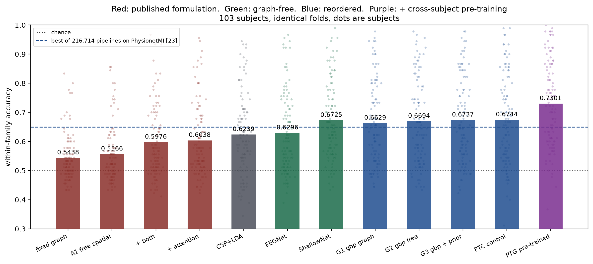
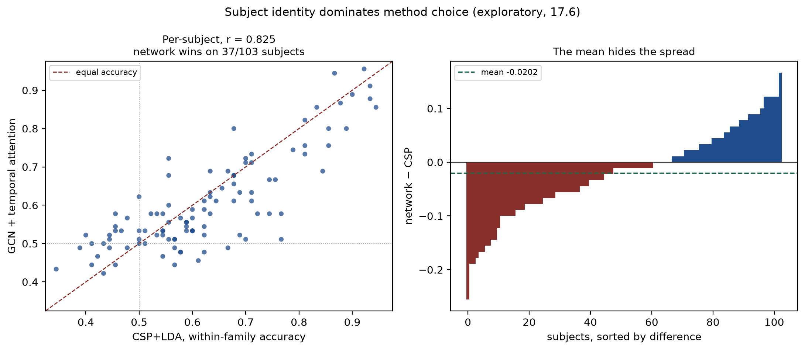
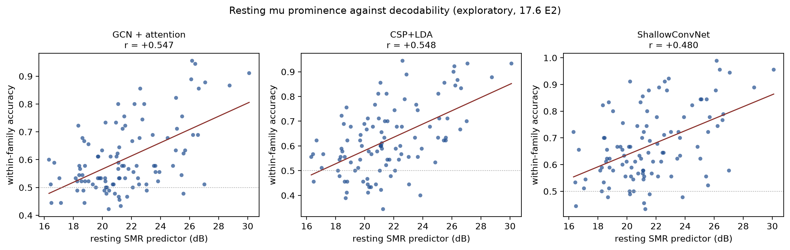

# A Reported 93 % on Four-Class Motor Imagery Is a Protocol, Not a Capability: Reassessing GCNs-Net

Saligram Sriram Shravan

*Affiliation to be completed.*

---

## Abstract

Graph convolutional networks have been proposed for electroencephalogram (EEG) motor
imagery decoding on the premise that an electrode correlation graph supplies a useful
spatial prior. GCNs-Net (Hou et al., 2024) reports 93.06 % within-subject and 88.57 %
"group-level" accuracy on four-class motor imagery from the PhysioNet EEG Motor
Movement/Imagery database. We reimplement the architecture in PyTorch, matching the
reference to 359,428 parameters, and reproduce its published protocol at 0.8975
(95 % CI [0.8794, 0.9147]) across 103 subjects and three seeds. Evaluating the identical
model under a trial-level split reduces performance to chance: within-family accuracy
0.5090 [0.4984, 0.5199] against a chance level of 0.500, a paired drop of 0.6096
[0.5767, 0.6411]. We identify three leakage paths in the published protocol and show that
the residual above-chance four-class accuracy is attributable to a structural confound in
the dataset — class pairs occur in disjoint recording runs — rather than to motor imagery.
A Common Spatial Patterns baseline with shrinkage LDA, run on identical subjects and folds,
outperforms every graph-based configuration we construct. Of three repairs, pre-registered
with fixed directions and Holm-corrected, only temporal attention succeeds (+0.0600,
p = 0.0005); explicit band power and a learnable adjacency do not. A post-hoc control
establishes that attention operates by weighting each trial differently rather than by
averaging. Under leave-one-subject-out evaluation the repaired model reaches 0.6040
[0.5823, 0.6268] with 88 of 103 subjects above chance — marginally *higher* than
subject-dependent performance, which we attribute to a hundredfold increase in training
data per fold.

Two further controls locate the limitation. Replacing the Chebyshev operators with
unconstrained dense operators, holding every other factor fixed, recovers only 16 % of the
gap to the classical baseline (+0.0128, p = 0.0046), so the graph-locality constraint is
real but minor. Two graph-free convolutional networks trained on the identical folds and
the same ~45 trials per problem reach and exceed the classical baseline — EEGNet 0.6296
(indistinguishable from CSP, p = 0.49) and ShallowConvNet 0.6725 (+0.0485 over CSP,
p = 0.0006), the latter placing 94 of 103 subjects above chance and exceeding the best
single configuration reported from a 216,714-pipeline search on this dataset. Deep learning
is therefore not limited by sample size here.

The limitation is nonetheless not the graph. Reordering the network so that power is taken
*after* the spatial stage, with a learned temporal filter, a single spatial layer and no
node pooling, lifts the identical Chebyshev graph convolution to 0.6629 and past the
classical baseline by 0.0389 on 70 % of subjects, with nothing about the graph altered.
Four different priors on that same operator — a hard graph constraint, a graph
initialisation, the graph as a Dirichlet penalty, and a subspace derived from common spatial
patterns — span 0.0108 and are mutually indistinguishable, as are a graph-free convolutional
network and a Riemannian tangent-space classifier with no network at all. Varying the sample
window over a fourfold range moves nothing either. **We therefore report ~0.67 as a
within-subject ceiling on this dataset rather than a property of any model**: six methods
sharing almost no components converge on it, and a resting sensorimotor-rhythm measure taken
from a task-free baseline predicts per-subject decodability equally for a graph network
(r = +0.547) and a classical one (r = +0.548), accounting for roughly 30 % of the
between-subject variance.

One intervention breaks the ceiling, and it is not architectural. Cross-subject pre-training
under a group-wise design that never places a subject in their own source set adds 0.0557
over an otherwise identical control on 90 % of subjects, reaching 0.7301; run unchanged on a
graph-free network it adds 0.0483 and reaches 0.7369, and the difference between the two
gains is −0.0073 [−0.0204, +0.0056]. The technique is therefore architecture-agnostic by
measurement rather than assumption. We conclude that the reported figure measures an
evaluation protocol rather than a decoding capability; that the graph-convolutional
formulation was never the binding constraint, though no spatial prior we tried earns
anything either; and that the only lever that moved this dataset was more data.

**Keywords:** EEG, motor imagery, brain–computer interface, graph convolutional networks,
data leakage, reproducibility, common spatial patterns

---

## 1. Introduction

Motor imagery decoding — inferring which movement a person is imagining from scalp EEG — is
a core problem in non-invasive brain–computer interfaces. Reported accuracies on public
datasets have risen steadily with the adoption of deep learning, and graph neural networks
in particular have been proposed on the argument that EEG electrodes form a graph whose
structure encodes functional connectivity, and that a spectral convolution over that graph
is a better inductive bias than a grid convolution or a fully connected layer.

GCNs-Net [1] is a prominent instance. It builds an adjacency matrix from the absolute
Pearson correlation between electrode time series, derives a normalised graph Laplacian,
applies six Chebyshev spectral convolutions interleaved with Graclus coarsening, and
reports 93.06 % four-class accuracy at the subject level on the PhysioNet EEG Motor
Movement/Imagery database (EEGMMIDB) [3, 7].

That figure is high. Four-class motor imagery on EEGMMIDB is generally regarded as
difficult, and classical pipelines typically report figures in the 60–70 % range for
binary sub-problems. A result of 93 % therefore invites scrutiny of the evaluation
protocol before the architecture.

This paper reports that scrutiny. Our central claim is not that the implementation is
faulty — we reproduce the published number when we run the published protocol — but that
the protocol does not measure what it is taken to measure.

### 1.1 Contributions

1. **A faithful reimplementation** of GCNs-Net in PyTorch, matched to the reference at
   359,428 parameters, which reproduces the published protocol at 0.8975 across 103
   subjects and three seeds (§5.1).

2. **Identification and quantification of three leakage paths** in the published protocol:
   single-timepoint samples with a shuffled split, BatchNorm fixed in training mode at
   test, and a correlation graph computed over all data including test (§4.4, §5.2). Under
   a correct protocol the identical model performs at chance.

3. **A structural confound in EEGMMIDB** that makes four-class accuracy on this dataset
   uninterpretable in isolation, together with a decomposition that isolates the
   confound-free component (§3.3, §4.5). We show that the entire above-chance four-class
   accuracy of the published formulation is attributable to this confound.

4. **A classical baseline under identical conditions.** CSP+LDA outperforms every
   *graph-based* configuration we build, including the repaired model (§5.4, §5.6).

5. **A pre-registered evaluation of three architectural repairs**, of which one succeeds,
   with a post-hoc control identifying the mechanism (§5.6, §5.7).

6. **The first correct subject-independent evaluation** of this architecture, which is
   *not* worse than subject-dependent evaluation (§5.8).

7. **Two controls that localise the limitation** (§5.9). Freeing the spatial operator from
   the graph, with every other factor held fixed, recovers only 16 % of the gap to the
   classical baseline. Two graph-free convolutional networks on identical folds and the
   same trial counts reach and exceed it, with ShallowConvNet at 0.6725 exceeding the best
   configuration reported from a large published pipeline search on this dataset. Together
   these refute a sample-size explanation and show that the constraint conventionally
   invoked to explain graph-network underperformance accounts for a minority of the gap.

8. **A subject-level ceiling, quantified** (§5.10). Per-subject accuracies of two unrelated
   methods correlate at *r* ≈ 0.83, and a resting sensorimotor-rhythm measure from a
   task-free baseline predicts both equally (+0.547, +0.548), explaining about 30 % of the
   between-subject variance. Reporting means alone obscures this: our repaired model wins on
   80 % of subjects against the fixed graph but on only a third against the classical
   baseline, from comparable p-values.

9. **A reordering that makes a graph model competitive** (§5.11). Taking power after the
   spatial stage, with a learned temporal filter, one spatial layer and no node pooling,
   lifts the same Chebyshev convolution from 0.6038 to 0.6629 and past CSP+LDA — with the
   graph untouched. Three variants isolating the graph's role are mutually
   indistinguishable, so the formulation was never the binding constraint and the graph
   contributes nothing either. This also corrects §5.9: the constraint it measured only
   cost anything while the surrounding architecture was misordered.

10. **Cross-subject pre-training, with the control that makes it interpretable** (§5.12),
    **and the transfer control that makes it general** (§5.14). Pre-training adds 0.0557
    over an otherwise identical arm with pre-training skipped, on 90 % of subjects, reaching
    0.7301, with the gain concentrated in the weakest quartile. Run unchanged on a
    graph-free network it adds 0.0483; the difference between the two gains is −0.0073
    [−0.0204, +0.0056] on 47 of 103 subjects. Architecture-agnosticism is therefore measured
    rather than assumed, and the two pre-trained arms are tied rather than ranked.

11. **A within-subject ceiling, established by convergence rather than by one result**
    (§5.13, §5.15, §5.16). Four spatial priors on the same operator, a graph-free
    convolutional network and a Riemannian tangent-space classifier span 0.0108; a fourfold
    change in window length moves nothing. A properly tuned classical baseline reaches
    0.6694, beating the CSP+LDA of §5.4 by 0.0454 and raising the bar our own architectures
    failed to clear.

All code, the full experiment log covering 22,315 folds, and a record of the twenty-nine
errors made and corrected during this work are released with the paper.

---

## 2. Related work

### 2.1 GCNs-Net and its lineage

GCNs-Net [1] derives directly from Defferrard et al.'s ChebNet [6]: the graph
construction, Laplacian normalisation, Chebyshev polynomial filters and Graclus coarsening
[9] are inherited essentially unchanged, with the contribution being their application to
an EEG electrode graph built from signal correlation. The same group's subsequent work [2]
pairs a graph convolution with a bidirectional LSTM and attention, reporting 98.81 % on the
same dataset.

We examined the authors' released implementation directly. Three properties of that
implementation bear on the reported numbers and are documented in §4.4.

### 2.2 Graph networks for EEG

More recent work has moved toward *adaptive* graphs. MHD-GCN [4] combines spatiotemporal
attention with hierarchical global and local topologies constructed by community
clustering, and SAMGCN [5] learns inter-channel relationships through channel position
encoding and a self-attention graph embedding, updating the adjacency during training.
Both are evaluated on BCI Competition datasets; MHD-GCN also uses PhysioNet. **We describe
[4] and [5] from their abstracts and metadata only**: neither full text was accessible to us,
so we do not characterise their evaluation protocols, and in particular we make no claim
about whether their reported accuracies were obtained under a trial-level split. Given that
this paper's central finding is a protocol artefact, that is a limitation we prefer to state
than to gloss.

The convergent direction across this literature is that the graph should be learned rather
than fixed. Our results speak to that directly, and more broadly than an earlier draft
claimed. Making the adjacency learnable produces no measurable benefit here (§5.6); nor does
freeing the spatial operator from the graph entirely, imposing the graph as a soft penalty,
or replacing the graph prior with one derived from common spatial patterns (§5.11, §5.15).
Four priors on the same operator span 0.0108. If that generalises, the productive question is
not which graph to learn but whether a spatial prior of any kind is where the remaining
performance lives — though we establish this on one dataset under one protocol, and [4] and
[5] report gains on datasets we did not test.

### 2.3 Classical motor imagery decoding

Common Spatial Patterns [10] and its regularised and filter-bank variants [11, 12] remain
the standard against which motor imagery decoders are measured. CSP finds spatial filters
maximising the ratio of between-class variances, which for motor imagery corresponds
directly to the event-related desynchronisation (ERD) of mu and beta rhythms over
sensorimotor cortex [13]. It is a linear method with few parameters and no capacity to
model temporal structure beyond band-limited variance.

We include CSP+LDA as a baseline not because it is competitive with modern deep learning in
general, but because a proposed architecture that cannot beat it under matched conditions
has not demonstrated the value of its additional machinery.

### 2.4 Leakage in machine-learning-based science

Kapoor and Narayanan [8] survey reproducibility failures across seventeen scientific
fields and find data leakage to be the dominant cause, cataloguing eight distinct types.
Several map onto what we find here: *no test set*, where the same data informs training and
evaluation; *temporal leakage*, where information from the evaluation period reaches
training; and *feature selection on the full dataset*, where a preprocessing step is fit
before splitting.

Our contribution to that literature is a quantified case study: we measure the size of the
inflation (0.6096 paired), isolate the mechanism (memorisation, visible as 99.85 % training
accuracy against chance validation), and show that after removing the leakage the residual
signal is a further artefact rather than the intended construct.

---

## 3. Dataset

### 3.1 PhysioNet EEG Motor Movement/Imagery

EEGMMIDB [3, 7] contains 109 subjects recorded with 64 electrodes at 160 Hz using the
BCI2000 system. Each subject performs 14 runs: two one-minute baselines and twelve
two-minute task runs comprising four conditions in three repetitions. We use the motor
*imagery* runs only — runs 4, 8, 12 (left versus right fist) and 6, 10, 14 (both fists
versus both feet). Annotations mark T0 (rest), T1 and T2, whose meaning depends on the run:
in runs 4/8/12, T1 is left fist and T2 right fist; in runs 6/10/14, T1 is both fists and T2
both feet.

**The class label is therefore a function of (run number, annotation code), never of the
code alone.** A loader that maps T1 to a single class merges left fist with both fists
silently. We assert on this mapping.

Trials are epoched from the annotation onset over 4.0 s, giving 640 samples, yielding 90
motor-imagery trials per subject (approximately 22–23 per class).

### 3.2 Data quality audit

Every EDF header and every imagery-run annotation channel was parsed rather than relying on
published exclusion lists. Of 109 subjects, six deviate:

| Subject | Sampling rate | Anomaly | Affects imagery runs |
|---|---|---|---|
| S088, S092 | 128 Hz | 38 events/run | yes, all six |
| S100 | 128 Hz | 24 events/run | yes, all six |
| S104 | 160 Hz | R08 truncated to 106 s | one run |
| S089 | 160 Hz | R03 is 181 s | no (execution run) |
| S106 | 160 Hz | R05 is 37 s | no (execution run) |

We note that the exclusion list circulated in this literature commonly names **S090**,
which we verify to be clean — all 14 runs at 160 Hz with 30 annotations in every imagery
run, a profile identical to its neighbour S091. The subject that carries a defect is
**S089**. Both spellings leave N = 103, but the substitution matters for reproducibility.

We retain the six-subject exclusion for comparability with prior work while noting that,
for an imagery-only protocol, only S088, S092 and S100 are strictly unusable.

### 3.3 A structural confound

Classes 0 and 1 (left, right fist) occur **only** in runs 4/8/12. Classes 2 and 3 (both
fists, both feet) occur **only** in runs 6/10/14. Consequently any signal that identifies
the recording run — electrode drift, impedance change over a session, changes in alertness
— separates the class pairs without decoding motor imagery at all.

This is a property of the dataset, not of any model, and it cannot be removed by analysis.
It means a four-class accuracy on EEGMMIDB is uninterpretable in isolation: a model can
score well above the 25 % chance level while decoding nothing about the imagined movement.
§4.5 describes the decomposition we use to separate the two contributions.

We are not aware of prior work on this dataset that reports this decomposition.

---

## 4. Methods

### 4.1 Preprocessing

Signals are read with MNE-Python, which separates the 65th "EDF Annotations" signal from
the 64 EEG channels. Channel names are normalised from the dataset's dotted Sharbrough
labels (`Fc5.`, `C3..`) to standard 10-05 names. Sampling rate, channel count and
annotation count are asserted per run; a run that deviates aborts the build rather than
being coerced.

Common Average Reference is applied, matching the reference implementation. Where a band-
pass is used it is 8–30 Hz, covering the mu and beta rhythms in which motor imagery ERD
manifests [13]; the reference applies no filter, a deviation we treat as an experimental
factor (§5.5).

Epochs are cut manually by annotation onset rather than with `mne.Epochs`, because run
lengths vary across subjects (123, 124 or 125 s) so any fixed offset into a run is
incorrect. Epochs are cached in microvolts **without normalisation**: mean and standard
deviation are estimated on the training split at training time, since the cache is built
before any split exists.

### 4.2 Architecture

The model reproduces the reference configuration: six Chebyshev graph convolutions with
filter counts (16, 32, 64, 128, 256, 512), polynomial order K = 2, and six stride-2 graph
max-pooling layers, followed by a linear classifier.

For a graph with adjacency **A**, the symmetric normalised Laplacian is

    L = I − D^(−1/2) A D^(−1/2)

rescaled to the Chebyshev domain as **L̃** = 2L/λ_max − I with λ_max fixed at 2, and the
Chebyshev basis computed by the recurrence

    T_0 = I,   T_1 = L̃,   T_k = 2 L̃ T_(k−1) − T_(k−2).

A layer maps features **X** ∈ ℝ^(M×F_in) to

    Y = [T_0 X ‖ T_1 X ‖ … ‖ T_(K−1) X] W,   W ∈ ℝ^(F_in·K × F_out).

Each convolution is followed by a per-vertex-per-filter bias of shape [1, M, F], batch
normalisation, and a softplus activation. The model has **359,428 parameters** at F_in = 1,
of which 264,192 (73 %) are in the final convolution operating on a two-node graph.

Two deviations from the reference are deliberate. Batch normalisation respects evaluation
mode; the reference hardcodes training mode, which we retain only for the replication arm.
And we correct an off-by-one in the reference's Graclus row-length scan that causes the
matching to consider a node outside the current row.

### 4.3 Graph construction and coarsening

The adjacency is **A = |P| − I**, where **P** is the Pearson correlation matrix between
electrode time series, matching the reference. **We compute P on the training split only.**
The reference computes it over all signals including test data, which is a leakage path
(§4.4).

Coarsening uses Graclus heavy-edge matching under the normalised-cut criterion
w(i,j)·(1/d_i + 1/d_j) [9], producing graphs of 64, 32, 16, 8, 4 and 2 nodes. Nodes are
permuted so that nodes 2i and 2i+1 are the children of node i in the coarser graph, after
which pooling is a stride-2 maximum over the node axis. Unmatched nodes receive zero-filled
fake siblings so that max-pooling selects the real node.

We note in passing that this coarsening recovers scalp topography without being given
electrode positions: level-0 clusters are anatomically adjacent pairs (AF7+F7, CP2+CP4,
FC5+C5, Oz+Iz), with a mean cluster edge length of 0.045 against 0.109 for a random
pairing.

### 4.4 Evaluation protocols

**The published protocol.** From the released implementation: each sample is a *single
timepoint* across 64 channels (`Fin = 1`); all samples are pooled and shuffled with
`randperm`, then cut 90/10. With 640 timepoints per trial, essentially every trial
contributes rows to both training and test. In addition, batch normalisation is fixed in
training mode so that test batches normalise using their own statistics, and the
correlation graph is computed over the pooled dataset before splitting.

We identify these as three distinct leakage paths. A fourth candidate — the mean-centring
step in the released preprocessing — is *not* leakage: inspection shows it operates on a
(channels × time) matrix and is therefore Common Average Reference.

**The correct protocol.** Stratified five-fold cross-validation at trial level; adjacency
and normalisation statistics fit on training trials only; batch normalisation respecting
evaluation mode; a further trial-level split of the training data for checkpoint selection.

**Leave-one-subject-out.** One fold per subject, training on the remaining 102, with five
*disjoint* validation subjects per fold so that model selection never observes the held-out
subject.

Trial-level predictions are formed by averaging logits across a trial's samples.

### 4.5 The within-family decomposition

Given the confound in §3.3, we decompose a four-class confusion matrix **C** into two
quantities. Writing f(c) for the run family of class c (f = 0 for classes 0, 1; f = 1 for
classes 2, 3):

- **Run-family accuracy** = Σ_{t,p : f(t)=f(p)} C_{t,p} / Σ C. Chance 0.5. This mixes
  run-level artefact with a genuine neurophysiological difference, since bilateral and
  unilateral imagery differ topographically.
- **Within-family accuracy** = tr(C) / Σ_{t,p : f(t)=f(p)} C_{t,p}. Chance 0.5. Both
  classes in each comparison originate in the *same* runs, so the run-family artefact
  cannot contribute.

**Within-family accuracy is our primary outcome.** For direct comparison with CSP, which is
inherently binary, we also train and evaluate the network on the two binary problems
separately; that variant is used for all confirmatory tests.

### 4.6 Contributed components

**Learnable adjacency.** A = relu(A_PCC + Δ), symmetrised and zero-diagonal by
construction, with Δ initialised to zero so that the model is numerically identical to the
fixed-graph baseline at initialisation. The coarsening hierarchy is held fixed, since
Graclus is discrete and recomputing the pooling tree during training would change which
electrodes are siblings mid-run. Cost is 5,460 parameters (1.5 %).

**Temporal attention.** For a windowed sample **X** ∈ ℝ^(M×T), scores are computed from the
full channel pattern at each instant, s_t = W_2 tanh(W_1 x_t), and normalised over time by
softmax to give α ∈ ℝ^(T×H). The output is Σ_t α_{t,h} x_t ∈ ℝ^(M×H). Profiles are shared
across nodes by default. Unlike the adjacency this is not initialisation-equivalent to the
baseline: the first convolution sees F_in = H rather than T.

**Reordered spatial-then-power block (§5.11).** A learned temporal filter of F kernels is
applied per node, the graph convolution then acts on the F-dimensional node features at each
retained time step, and power is taken last as `mean_t(h²) → log`. The graph operator itself
is the same Chebyshev filter as the baseline; three variants differ only in whether the
spatial weights are constrained to the Chebyshev basis, free, or free with a Dirichlet
penalty ‖·‖_L over the electrode graph, using the combinatorial Laplacian D − A so that a
constant potential across electrodes is penalised at zero.

**Grouped cross-subject pre-training (§5.12).** Subjects are partitioned into ten groups by
index, and one source model is fitted per group on the cohort minus that entire group, so no
subject's source model has seen that subject. Each target's own folds then fine-tune the
corresponding source model at a tenth of the pre-training learning rate. The fine-tuning
stage holds out no validation set and selects the final epoch, so no target test trial can
influence model selection.

### 4.7 Statistical procedure

All comparisons are paired on subject, because between-subject variance in EEG greatly
exceeds the effects under test. Intervals are 95 % bootstrap over subjects with 10,000
resamples; p-values are bootstrap under a re-centred null.

**Pre-registration.** Before running the confirmatory experiments we fixed five hypotheses
with directions, the primary outcome, the analysis plan, the stopping rules and the list of
exploratory analyses, and committed them to version control. Two clarifications — the
tag namespace and the resolution of an ambiguity in one hypothesis — were also recorded
before the corresponding runs began.

**Development and confirmation sets.** Every exploratory result was obtained on the same 20
subjects, which were inspected repeatedly while choosing what to try. Those subjects were
designated a development set, and **all confirmatory tests were run on the full 103**, of
which 83 had never influenced any design decision. Holm–Bonferroni correction is applied
across the five confirmatory tests at family-wise α = 0.05.

---

## 5. Experiments

Unless stated, results are over 103 subjects; "within-family" denotes the primary outcome of
§4.5 with a chance level of 0.500.

### 5.1 Reproduction of the published protocol

Three seeds, 103 subjects: timepoint accuracy **0.8975**, CI [0.8794, 0.9147], with a
between-seed spread of 0.0008. The paper reports 0.8835 at group level and 0.9306 at
subject level.

This reproduction is a precondition for everything that follows: it establishes that
subsequent results are properties of the protocol rather than of our implementation.

### 5.2 Correct evaluation

The identical model under the correct protocol, with identical training and test set sizes:

| Protocol | 4-class | Within-family | 95 % CI |
|---|---|---|---|
| Published | — | 0.8975 | [0.8794, 0.9147] |
| Correct | 0.3097 | **0.5090** | [0.4984, 0.5199] |

The within-family interval contains chance. The paired difference between protocols is
**0.6096** [0.5767, 0.6411].

The mechanism is visible in the training curve. Training accuracy reaches 99.85 % while
validation remains at chance: the model memorises trial-specific voltage patterns, which
under the published protocol are shared between training and test. A learning-rate sweep
from 10⁻⁶ to 10⁻² leaves held-out accuracy at chance throughout, so this is not an
optimisation artefact.

### 5.3 The residual is a confound, not decoding

| Measure | Value | Chance |
|---|---|---|
| 4-class accuracy | 0.3097 | 0.250 |
| Run-family accuracy | 0.6106 | 0.500 |
| **Within-family accuracy** | **0.5090** | 0.500 |

The model identifies the run family 11 points above chance and discriminates within a
family at chance. **Under correct evaluation, the published architecture and sample
definition decode no motor imagery.**

*Figure 1. Pooled trial confusion, 103 subjects; red lines divide the run families. Left:
the published formulation — mass concentrates within the diagonal blocks while cells inside
each block are near-equal (0.37/0.32, 0.34/0.33). Right: with band-pass and windowing,
`both_feet` reaches 0.35 against 0.20, indicating genuine within-family discrimination.*

### 5.4 Classical baseline

CSP (four components, Ledoit–Wolf regularised) with shrinkage LDA, on identical subjects,
folds, cache and metric, with CSP fit on training trials only:

| Binary problem | GCNs-Net | CSP+LDA | Paired difference |
|---|---|---|---|
| Left vs right fist | 0.5148 | 0.5942 | −0.0794 [−0.1068, −0.0535] |
| Both fists vs feet | 0.5728 | 0.6537 | −0.0809 [−0.1031, −0.0591] |
| Mean | 0.5438 | **0.6239** | −0.0802 [−0.0985, −0.0621] |

All figures are over the full 103-subject cohort, paired on subject. Both methods find
fists-versus-feet easier than left-versus-right, consistent with the separation of hand and
foot representations on the motor homunculus. CSP was not tuned, which makes this
comparison conservative — **§5.13 later quantifies by how much**: a Riemannian tangent-space
classifier on the same folds reaches 0.6694, beating this baseline by 0.0454. Every negative
result in this paper about our own architectures should be read against that higher figure,
not against 0.6239.

### 5.5 Representation ablation (exploratory, 20 subjects)

A 2×2 over band-pass and sample definition, plus a band-power variant:

| Band-pass | Sample | 4-class | Family | Within-family |
|---|---|---|---|---|
| none | 1 timepoint | 0.3000 | 0.6239 | 0.4859 |
| 8–30 Hz | 1 timepoint | 0.3472 | 0.6778 | 0.5110 |
| none | 64 timepoints | 0.3311 | 0.6544 | 0.5051 |
| 8–30 Hz | 64 timepoints | 0.3300 | 0.6100 | **0.5418** |
| log band power | 1 s | 0.4222 | 0.7378 | 0.5716 |

Only the fourth row's within-family interval excludes chance. The band-power row
illustrates why the decomposition is necessary: its four-class accuracy rises by 9 points
over the fourth row, but roughly four fifths of that is improved run-family identification.
On the confound-free binary problems, band power is indistinguishable from raw voltage.

### 5.6 Confirmatory results

| Configuration | Within-family | 95 % CI | Above chance |
|---|---|---|---|
| Fixed graph, no attention | 0.5438 | [0.5288, 0.5598] | 64/103 |
| + learnable adjacency | 0.5469 | [0.5317, 0.5632] | 70/103 |
| **+ temporal attention** | **0.6038** | [0.5805, 0.6278] | 83/103 |
| + both | 0.5976 | [0.5745, 0.6220] | 79/103 |
| CSP+LDA | 0.6239 | [0.5977, 0.6521] | 81/103 |

| | Hypothesis | Difference | p (Holm) | Verdict |
|---|---|---|---|---|
| H1 | Learnable adjacency > fixed graph | +0.0031 | 0.392 | not supported |
| H2 | Temporal attention > none | +0.0600 | 0.0005 | **supported** |
| H3 | Both > better single component | −0.0061 | 0.899 | not supported |
| H4 | Contribution ≠ CSP+LDA (two-sided) | −0.0263 | 0.0012 | **supported, negative** |
| H5 | LOSO within-family > chance | +0.1040 | 0.0005 | **supported** |

H4 was pre-specified two-sided; the significant difference is in CSP's favour.

**The learnable adjacency does not help, and this is not a failure to train.** Checkpoint
inspection shows 80–90 % of first-layer edges changed by more than 1 % of the mean base
weight, with ‖Δ‖ reaching 2.0. The graph was learned; it did not matter.

### 5.7 What attention learned (exploratory)

The population-mean attention profile deviates from uniform by only 2.1 %, which suggested
the H2 gain might be temporal averaging plus a sixteen-fold narrower first convolution
rather than attention. We tested this with a fixed segment-mean pool — same output shape,
identical downstream network, no learned temporal parameters:

| Configuration | Within-family | vs baseline |
|---|---|---|
| Fixed graph, no pooling | 0.5472 | — |
| Fixed mean pool | 0.5367 | −0.0106, p = 0.885 |
| Temporal attention | **0.5939** | +0.0467, p = 0.0001 |

Averaging confers no benefit; attention exceeds the fixed-weight control by 0.0572
(p = 0.0009). The hypothesis is refuted, and the near-uniform mean profile is an artefact of
aggregation:

| Statistic | Value |
|---|---|
| Population-mean deviation from uniform | 2.1 % |
| Per-sample deviation, median | 104.5 % |
| Max/min weight within a sample, median | 4.9× |
| Argmax timepoint across samples | spans all 64 |

Individual trials are strongly peaked but at *different* moments, so averaging flattens the
profile. This is the behaviour a signal with variable onset latency requires.

*Figure 2. Left: individual attention profiles (thin) against their mean (bold). Right:
decoding accuracy by window position within the trial, peaking at 0.60 s after cue onset —
the shape ERD predicts [13], measured without trial timing being supplied to the model.*

### 5.8 Subject-independent evaluation

| Protocol | Within-family | 95 % CI | Above chance |
|---|---|---|---|
| Subject-dependent | 0.6038 | [0.5805, 0.6278] | 83/103 |
| **Leave-one-subject-out** | **0.6040** | [0.5823, 0.6268] | 88/103 |

LOSO is marginally *higher*, contrary to the usual expectation and to our own
pre-experiment prediction. A LOSO fold trains on approximately 4,600 trials from 102
subjects against approximately 36 trials from one, and this hundredfold increase in data
outweighs the loss of subject-specific calibration. The implication is that the
subject-dependent protocol on this dataset is data-starved rather than that between-subject
transfer is easy.

Neither published headline for this architecture is subject-independent — the 88.57 %
"group-level" figure pools subjects and then splits across the pool — so we believe this to
be the first correct subject-independent evaluation of GCNs-Net.

---

### 5.9 Locating the limitation: two controls (exploratory)

Sections 5.5 and 5.6 establish that neither explicit band power nor a learnable adjacency
closes the gap to CSP, and it is tempting to read those two null results as identifying the
graph-convolutional inductive bias as the cause. That inference is not sound on its own,
and two competing explanations remain. The first is the one just named: an order-2
Chebyshev convolution mixes only within one-hop neighbourhoods with weights shared across
nodes, and cannot express the unconstrained spatial projection CSP fits. The second is
sample size: a large benchmark study reports that deep pipelines typically require more
than 150 trials per class, and reach satisfactory performance on an easy binary problem
with as few as 50, whereas Riemannian and raw-signal pipelines succeed below 50 [16]. Our
binary problems supply approximately 45 trials, and a subject-dependent fold trains on
approximately 36.

The two explanations make different predictions and we tested both, on identical folds,
seeds, cache, standardiser, windowing and metric. Both arms are **exploratory**: neither is
on the pre-registered list, and the first tests a claim formed after the confirmatory runs.
Holm correction is applied across the six comparisons regardless.

**Control A — free the spatial operator.** We replaced each Chebyshev basis `T_k(L̃)` with a
free dense operator of the same shape, initialised at that basis so the model is
bit-identical to the fixed-graph baseline at step 0. This lifts graph locality, symmetry
and non-negativity simultaneously, while changing nothing else, at a cost of 10,920
parameters (3 %).

**Control B — remove the graph entirely.** We ran EEGNet-8,2 [14] and ShallowConvNet [15]
through the same fold-preparation path with graph construction disabled, so channels reach
the network in montage order without coarsening or permutation. Both spatially combine all
64 channels without any graph.

| Arm | Within-family | vs fixed graph | % of gap to CSP recovered |
|---|---|---|---|
| Fixed PCC graph | 0.5438 | — | — |
| Learnable adjacency (§5.6) | 0.5469 | +0.0031, p = 0.39 | 3.9 % |
| **A — free spatial operator** | 0.5566 | **+0.0128** [+0.0042, +0.0221], p = 0.0046 | **16.0 %** |
| + temporal attention (§5.6) | 0.6038 | +0.0600 | 74.8 % |
| CSP+LDA | 0.6239 | +0.0802 | 100 % |
| **B — EEGNet** | 0.6296 | +0.0858 [+0.0697, +0.1024] | **107.0 %** |
| **B — ShallowConvNet** | **0.6725** | +0.1287 [+0.1118, +0.1454] | **160.6 %** |

Against the classical baseline, paired on subject and two-sided:

| Comparison | Difference | p (Holm) | Subjects won |
|---|---|---|---|
| Free spatial operator vs CSP | −0.0673 [−0.0843, −0.0506] | 0.0006 | 24/103 |
| **EEGNet vs CSP** | +0.0056 [−0.0107, +0.0220] | **0.49, not distinguishable** | 56/103 |
| **ShallowConvNet vs CSP** | **+0.0485** [+0.0318, +0.0650] | 0.0006 | 67/103 |

Per problem, ShallowConvNet reaches 0.6608 on left-versus-right fist and 0.6841 on both
fists versus both feet, and places 94 of 103 subjects above chance against CSP's 81. For
external calibration, a benchmark evaluating 216,714 pipeline configurations on this
dataset under a matched left-versus-right protocol reports 0.650 for its best single
configuration and 0.605 and 0.604 for the tangent-space and CSP families respectively [17];
our untuned CSP reaches 0.5942 and ShallowConvNet exceeds the reported best.

*Figure 3. All seven arms over 103 subjects on identical folds; each dot is a subject. Every
arm left of CSP+LDA is a graph model and every arm right of it is not. The dashed line is
the best single configuration reported from a 216,714-pipeline search on this dataset [17].
The graph arms plateau below the classical baseline; both graph-free networks pass it.*

**Sample size does not explain the gap.** Two graph-free networks trained on precisely the
trials, folds and cache available to the graph arms reach and exceed the classical
baseline. Whatever limits the graph formulation, it is not the quantity of data.

**The graph-locality constraint is real but minor.** Freeing the spatial operator produces
a reliable improvement — four times the learnable adjacency's effect, confirming the extra
freedom buys something a learned graph cannot — yet recovers only a sixth of the gap.
Approximately 84 % lies elsewhere in the formulation. The most salient remaining
difference is temporal: both graph-free networks convolve over time before combining
channels, whereas the architecture under study performs a spatial operation first and
admits temporal structure only through the attention module of §5.6 — which is, by a wide
margin, the largest single gain any graph configuration achieved.

---

### 5.10 Per-subject variation dominates the method effect (exploratory)

Every comparison above is a mean over 103 subjects, which presumes that the choice of
method is the dominant source of variation. Re-analysing the same folds per subject shows
that it is not.

| Comparison | Subjects won | Pearson *r* | Mean | Median |
|---|---|---|---|---|
| GCN + attention vs CSP+LDA | 37/103 (36 %) | +0.825 | −0.0202 | −0.011 |
| GCN + both vs CSP+LDA (H4) | 34/103 (33 %) | +0.831 | −0.0263 | −0.033 |
| GCN + attention vs fixed graph (H2) | 82/103 (80 %) | +0.823 | +0.0600 | +0.056 |

*Figure 4. Left: per-subject accuracy of the repaired model against CSP+LDA, which track the
identity line closely. Right: the same differences sorted, showing the mean sitting inside a
distribution running from −0.256 to +0.167.*

Three observations follow. First, **the between-subject standard deviation is 0.1247
against a method gap of roughly 0.02–0.03**, so subject identity carries on the order of
twenty to forty times the variance that the choice of method does. Second, **per-subject
accuracies of two structurally unrelated methods correlate at *r* ≈ 0.83**: they largely
succeed and fail on the same people, which is the signature of a subject-level ceiling
rather than of an algorithmic difference. Eleven of 103 subjects are at or below chance
under *both* methods, consistent with the 15–30 % of participants generally reported not to
produce classifiable sensorimotor rhythms.

Third, and most consequential for how these results should be read, **the two headline
findings differ sharply in evidential quality once the means are decomposed.** H2 wins on
80 % of subjects — a consistent effect. H4's significant mean difference sits over an
interleaved distribution in which our model wins on a third of subjects. Both statements are
correct; reporting either mean without its spread would misrepresent it.

This is consistent with published benchmarks on this dataset, which report that the single
best pipeline is optimal for only 35 % of participants and that matching pipelines to
individuals is worth roughly seven accuracy points [17] — an effect several times larger
than any difference between methods reported here.

**A third of that variance is fixed before any modelling choice.** If subject identity
dominates, it should be predictable from the subject rather than from the task. We computed
Blankertz et al.'s SMR predictor [18] — the prominence of the resting mu rhythm above a
fitted 1/f background — from run R01, the 61-second eyes-open baseline. That run contains no
motor imagery and is used nowhere else in this work, so it cannot leak into a decoding
result.

| Arm | *r* with the resting predictor | Variance explained |
|---|---|---|
| GCN + temporal attention | **+0.547** | **30 %** |
| CSP+LDA | **+0.548** | **30 %** |
| ShallowConvNet | +0.480 | 23 % |

*Figure 5. The resting SMR predictor against within-family accuracy for three methods.
Predictor range 16.32–30.10 dB over 103 subjects.*

The first two coefficients are +0.547 and +0.548. A graph network and a linear method
published in 2000, sharing no component, are predicted equally well by a property of the
participant measured before either was run — which is close to a direct demonstration of a
subject-level ceiling. The eleven subjects at or below chance under both methods average
1.70 dB less mu prominence than the rest. Blankertz et al. report their predictor explaining
approximately 37 % of variance in SMR-BCI feedback accuracy; our 30 % on a different task
and cohort is consistent with that.

This bounds what any architecture could recover on this dataset. It does not excuse the
graph formulation — the remaining variance is where ShallowConvNet exceeds it by 0.1287 —
but it means a substantial part of the apparent difficulty is a property of the participants
rather than of the models.

---

### 5.11 Reordering the architecture (exploratory)

Section 6 of an earlier draft of this paper offered a hypothesis and declined to test it:
that the difference between the graph models and the networks outperforming them is
*temporal*, since both graph-free networks convolve over time before combining channels
while the architecture studied here operates spatially first. We then tested it.

**What the ordering argument actually says.** CSP combines channels linearly and *then*
takes the variance. The combination works by cancellation between channels, which requires
phase-coherent voltage: square first and the sign is gone, so no subsequent linear
combination can perform that cancellation. This is why §5.5's null result — band power
supplied as node features, computed per channel before the network — says nothing about the
present question. That is power-then-spatial; CSP, FBCSP and ShallowConvNet are all
spatial-then-power.

**Four changes, none of them to the graph.** We built a network that (i) takes power
*after* the spatial stage as `square → mean over time → log`, where GCNs-Net applies a
softplus to voltage; (ii) places a learned temporal filter first, so the time axis survives
until power is taken, whereas attention pooled it away before the first convolution;
(iii) uses one spatial layer rather than six; and (iv) drops the Graclus node pooling. The
graph is untouched.

**Three variants isolate the graph's role**, and are the only thing that differs between
them: **G1** keeps the Chebyshev constraint, **G2** frees the spatial operators entirely,
and **G3** frees them but adds a Dirichlet-energy penalty over the electrode graph — the
graph as a *prior* rather than a constraint, which is the form A1's result suggests might
survive. Predictions were registered before any aggregate was computed.

| Arm | L vs R | B vs F | Within-family | Above chance |
|---|---|---|---|---|
| Fixed PCC graph | 0.5148 | 0.5728 | 0.5438 | 65/103 |
| GCN + temporal attention (§5.6) | 0.5877 | 0.6198 | 0.6038 | 83/103 |
| CSP+LDA | 0.5942 | 0.6537 | 0.6239 | 81/103 |
| ShallowConvNet | 0.6608 | 0.6841 | 0.6725 | 94/103 |
| **G1 — graph constraint** | 0.6408 | 0.6850 | **0.6629** | 88/103 |
| **G2 — free operator** | 0.6494 | 0.6893 | **0.6694** | 93/103 |
| **G3 — graph as prior** | 0.6520 | 0.6954 | **0.6737** | 91/103 |

Paired, two-sided, Holm-corrected:

| Comparison | Difference | p | Subjects won |
|---|---|---|---|
| **G1 vs GCN + attention** | **+0.0591** [+0.0458, +0.0722] | 0.0014 | 82/103 (80 %) |
| **G1 vs CSP+LDA** | **+0.0389** [+0.0224, +0.0552] | 0.0014 | 72/103 (70 %) |
| G2 vs G1 (constraint lifted) | +0.0065 [−0.0018, +0.0148] | 0.52 | 53/103 |
| G3 vs G2 (the prior added) | +0.0043 [−0.0020, +0.0107] | 0.54 | 51/103 |
| G3 vs ShallowConvNet | +0.0012 [−0.0099, +0.0121] | 0.99 | 46/103 |

**A graph-based model now beats the classical baseline.** G1 is the *hard* Chebyshev
constraint — the same formulation the original work proposes — and it exceeds CSP+LDA by
0.0389 on 70 % of subjects. Every graph configuration in §5.6 lost to CSP. The reordering
alone lifts the graph model by 0.0591 on four subjects in five, and nothing about the graph
changed.

**The graph itself contributes nothing.** Hard constraint, free operator and soft prior
span 0.0108 in total and are mutually indistinguishable; the prior wins on exactly half the
subjects. Whatever the electrode graph encodes, this architecture does not need it.

**This revises §5.9's conclusion rather than confirming it.** In the *unreordered*
architecture, freeing the spatial operator was a significant improvement (A1: +0.0128,
p = 0.0046). In the reordered one, the identical relaxation gains 0.0065 and is not
distinguishable from zero. The graph constraint only cost anything while the rest of the
architecture was misordered — so A1's 16 % was measuring the slack available in a badly
ordered network, not a property of graph convolution.

### 5.12 Cross-subject pre-training (exploratory)

Section 5.8 reported two numbers that had never been combined: leave-one-subject-out at
0.6040, with roughly a hundred times the training data and no subject-specific calibration,
and subject-dependent at 0.6038, with calibration and approximately 36 training trials per
fold. They are the same number reached from opposite directions, and neither uses the
other's information.

We pre-train on other subjects and then fine-tune on the target's own training folds.
Subjects are partitioned into ten groups; each group's source model excludes that entire
group, so **no subject is ever pre-trained on their own data** — not their trials, not the
graph, not the normalisation statistics. Fine-tuning uses the same folds as every other arm
at the same seed.

**A control is mandatory here and is reported alongside.** Pre-training and source-fit
normalisation change together, so only the difference between the pre-trained arm and an
otherwise identical arm with pre-training skipped isolates the effect of pre-training. We
ran both.

| Arm | L vs R | B vs F | Within-family | Above chance |
|---|---|---|---|---|
| **PTC** — control, pre-training skipped | 0.6533 | 0.6956 | **0.6744** | 89/103 |
| **PTG** — cross-subject pre-training | **0.7206** | **0.7396** | **0.7301** | **98/103** |

| Comparison | Difference | p | Subjects won |
|---|---|---|---|
| **PTG vs PTC** (isolates pre-training) | **+0.0557** [+0.0464, +0.0650] | 0.0014 | **93/103 (90 %)** |
| PTG vs ShallowConvNet | +0.0576 [+0.0454, +0.0693] | 0.0014 | 85/103 (83 %) |
| PTG vs G3 | +0.0564 [+0.0461, +0.0666] | 0.0014 | 87/103 (84 %) |

The control landing at 0.6744 — indistinguishable from G3's 0.6737 — is what makes the
contrast interpretable: the representation change is neutral, so the 0.0557 is pre-training.

**The gain is concentrated where the deficit was.** Splitting subjects by their control
accuracy, the weakest quartile gains 0.0720 and the strongest 0.0346, and between-subject
standard deviation falls from 0.1548 to 0.1490. This is the variance reduction reported for
pre-training elsewhere [19], and it matters because §5.10 located the shortfall below the
median rather than at the top. Ninety-eight of 103 subjects are now above chance, against
89 without pre-training.

**On the size of the number.** 0.7301 is the highest figure this work produces, and an
unexpectedly high number is the point at which leakage should be suspected rather than
celebrated. We ran eight structural checks before recording it: group assignment matches
the deterministic rule; every source set is exactly the cohort minus that group; no target
appears in its own source set; all 1,030 fine-tuning folds report final-epoch selection, so
nothing was ever chosen using the target's test trials; and the gain is distributed across
groups (SD 0.0189) rather than concentrated in a few. The shape of the effect argues the
same way: a leak of test information would be expected to help uniformly, or to help
already-strong subjects, not to help the weakest quartile twice as much as the strongest.

**One comparison that must not be drawn.** PTG's 0.7206 on left-versus-right exceeds the
0.650 that [17] reports as the best of 216,714 configurations on this dataset. **That is not
a like-for-like comparison.** Those pipelines are evaluated within-session and see only the
target subject's own data, whereas PTG additionally consumes roughly 92 other subjects'
recordings. It is not a better pipeline under their protocol; it is a different protocol
with two orders of magnitude more data. Every other arm in this paper is directly
comparable to that figure. This one is not.

---

### 5.13 A stronger classical baseline (exploratory)

§5.4's CSP+LDA was deliberately untuned, which we described as making the comparison
conservative without saying by how much. A published benchmark of 216,714 configurations on
this dataset [17] is more specific: covariance tangent-space projection and CSP are the two
leading families, with tangent space ahead. We had never run one.

Covariances are shrunk toward a scaled identity, projected to the tangent space at the
Fréchet mean of the **training** covariances under the affine-invariant metric, vectorised
with the usual √2 off-diagonal scaling, and classified by a strongly penalised linear model.
Reference point, scaler and classifier are all fitted on training trials alone.

| Arm | L vs R | B vs F | Within-family | Above chance |
|---|---|---|---|---|
| CSP+LDA (§5.4) | 0.5942 | 0.6537 | 0.6239 | 81/103 |
| **Tangent space** | 0.6550 | 0.6837 | **0.6694** | 89/103 |

Tangent space beats CSP+LDA by **+0.0454** [+0.0310, +0.0594] on 74 of 103 subjects, and is
indistinguishable from ShallowConvNet (−0.0031 [−0.0164, +0.0101], 47/103). The classical
baseline in this paper was understated, and the ordering of families we obtain independently
matches the one [17] reports for this dataset.

This makes every negative result about our own architecture *stronger*, not weaker: the bar
the graph models failed to clear is higher than §5.4 claimed.

### 5.14 Does the pre-training gain transfer? (exploratory)

§5.12 reported 0.7301 and stated that pre-training is architecture-agnostic — but that was
an assertion, not a measurement. The obvious control is to run the identical procedure on an
architecture sharing no component with ours, and compare the *gains* rather than the totals.

| Arm | L vs R | B vs F | Within-family | Above chance |
|---|---|---|---|---|
| PTC — graph model, pre-training skipped | 0.6533 | 0.6956 | 0.6744 | 89/103 |
| **PTG — graph model, pre-trained** | 0.7206 | 0.7396 | **0.7301** | 98/103 |
| PTC — ShallowConvNet, pre-training skipped | 0.6714 | 0.7057 | 0.6886 | 92/103 |
| **PTG — ShallowConvNet, pre-trained** | 0.7387 | 0.7351 | **0.7369** | **101/103** |

| Comparison | Difference | 95 % CI | Subjects won |
|---|---|---|---|
| Gain, graph model | +0.0557 | [+0.0464, +0.0650] | 93/103 |
| Gain, ShallowConvNet | +0.0483 | [+0.0379, +0.0590] | 82/103 |
| **Difference of the two gains** | **−0.0073** | [−0.0204, +0.0056] | 47/103 |

**Pre-training transfers at the same magnitude to an architecture that shares nothing with
ours.** The difference of differences is a coin flip. Two design points make this
interpretable: the control arms start level (0.6744 against 0.6886, inside the 0.020
detectable difference), so a gain difference could not be dismissed as a ceiling effect; and
each gain is measured against its own architecture's control, so the small offset between
those controls cancels.

**The two pre-trained arms are tied, not ranked.** PTG-ShallowConvNet's 0.7369 exceeds the
graph model's 0.7301 by 0.0068 [−0.0022, +0.0155] on 59/103 — below the 0.010 floor fixed
before the run, with a CI containing zero. Neither is "the best model"; ShallowConvNet wins
left-versus-right and loses fists-versus-feet.

We had predicted the two architectures' per-subject gains would correlate strongly, since
§5.12 showed the gain tracks subject-level data hunger. Measured, ρ = +0.160 — weakly
positive, so this test resolved less than we projected and a gain difference below ~0.019
would not have been detectable.

### 5.15 The spatial prior does not matter, whatever it is (exploratory)

§5.11 found the graph inert: hard constraint, free operator and Dirichlet prior span 0.0108.
The natural reading is that a spatial prior buys nothing here. An alternative reading is that
the *electrode graph* is simply the wrong prior, and published work supports it — CSP-Net
[20] reports +6.0 points on a ShallowConvNet backbone across four motor-imagery datasets from
initialising the spatial layer with CSP filters, with an ablation showing it is the
initialisation and not the added capacity.

We tested that directly. Our free spatial operator copies whatever basis it is given into a
learnable parameter, so we built a basis of identical shape and scaling from CSP instead of
from the graph — the CSP operator rescaled to spectrum [−1, 1], then the same Chebyshev
recurrence. **No model code changes at all**; the two arms differ only in what the operator
is initialised from. CSP is fitted on training windows only.

| Arm | Spatial operator initialised from | Within-family |
|---|---|---|
| G1 | hard Chebyshev graph constraint | 0.6629 |
| **CI** | **CSP filters** | **0.6686** |
| G2 (control) | the electrode graph | 0.6694 |
| Tangent space (§5.13) | *no network at all* | 0.6694 |
| ShallowConvNet | *no graph at all* | 0.6725 |
| G3 | the graph as a Dirichlet penalty | 0.6737 |

**CI vs G2 is −0.0008** [−0.0094, +0.0076] on 49 of 103 subjects. CSP-Net's gain does not
transfer to this dataset under a correct protocol.

The column, not the row, is the result. **Six methods sharing almost nothing span 0.0108** —
four different priors on the same learnable operator, a graph-free convolutional network, and
a Riemannian classical method with no network in it. The supported claim is no longer "the
graph contributes nothing" but the stronger and simpler one: **the spatial prior does not
matter here, whatever it is.**

### 5.16 Window length (exploratory, development set)

Every raw-voltage arm in this paper uses a 0.40 s window. That value was inherited from our
own early configuration and never varied, and it is far shorter than the 1–2 s over which
event-related desynchronisation develops. If the ~0.67 figure that §5.15 shows six methods
converging on is an artefact of anything, the sample definition is the obvious candidate.

ShallowConvNet, development subjects only, stride held fixed:

| Window | L vs R | B vs F | Within-family |
|---|---|---|---|
| **0.40 s** (the inherited value) | 0.6522 | 0.6944 | **0.6733** |
| 0.80 s | 0.6356 | 0.6822 | 0.6589 |
| 1.60 s | 0.6144 | 0.6822 | 0.6483 |

Total spread across a fourfold range: **0.0250**, inside the 0.0328 difference this
20-subject design can detect. All three are indistinguishable, and the best is the value we
already had. We had predicted a longer window would help; it does not, and the trend is
monotone in the opposite direction.

Two honest qualifications. The 1.60 s comparison's interval excludes zero (−0.0250
[−0.0439, −0.0067]), so a confirmatory run at full scale might find long windows reliably
*worse* rather than merely equivalent. And because stride was held fixed, a longer window
also yields fewer windows per trial — 37, 33 and 25 — so this design cannot separate "longer
windows are worse" from "fewer training samples are worse" on a protocol we have shown to be
data-starved.

It does retire one of our own caveats. §7 records that the graph-free networks ran far
outside the 2–4 s regime their published hyperparameters assume, making their advantage
conservative. At 1.60 s, inside that regime, ShallowConvNet is worse. The caveat was not
costing them anything.

## 6. Discussion

**The reported figure measures a protocol.** The gap between 0.8975 under the published
protocol and chance under a correct one is not a difference in implementation quality; the
same weights, data and training procedure produce both. This places GCNs-Net within the
pattern documented by Kapoor and Narayanan [8], and suggests that published accuracies on
EEGMMIDB should be read alongside an explicit description of the sample definition and
split.

**The sample definition is the root cause.** A single timepoint spans 6.25 ms and carries
no spectral content, while motor imagery is a band-power phenomenon [13]. Under a shuffled
split this is invisible, because neighbouring timepoints of the same trial appear on both
sides and the classifier can memorise trial-specific voltage. Under an honest split it is
fatal. Our repairs work by restoring temporal extent, not by improving the graph.

**The limitation was the architecture around the graph, not the graph.** Every
graph configuration in §5.6 plateaus between 0.5438 and 0.6038 while graph-free networks on
identical folds reach 0.6296 and 0.6725, which invites the conclusion that the graph
formulation is what fails. It is the wrong conclusion. Reordering the network so that power
is taken *after* the spatial stage, with a learned temporal filter, one spatial layer and no
node pooling, lifts the same Chebyshev graph convolution to 0.6629 — past CSP+LDA by 0.0389
on 70 % of subjects (§5.11). Nothing about the graph changed. The published graph
*formulation* was never the binding constraint; the pipeline it sat inside was.

**Yet no spatial prior contributes anything.** Hard constraint, unconstrained operator and
soft Dirichlet prior span 0.0108 and are mutually indistinguishable. The obvious rejoinder is
that the *electrode graph* is simply the wrong prior, and published work supports it: CSP-Net
[20] reports +6.0 points on a ShallowConvNet backbone from initialising the spatial layer
with CSP filters. We ran that intervention with no model code changed — only the basis the
operator is initialised from — and measured **−0.0008** [−0.0094, +0.0076] on 49 of 103
subjects (§5.15). Whatever we initialise or constrain that operator with, the answer is the
same. This bears directly on the turn toward adaptive and learnable adjacencies [4, 5]: it
suggests the choice of graph is not where the remaining performance lives, and neither is the
choice of any competing spatial prior.

**What that convergence licenses is a ceiling claim.** Four priors on the same operator, a
graph-free convolutional network (0.6725) and a Riemannian tangent-space classifier with no
network at all (0.6694) span 0.0108. A fourfold change in the analysis window moves nothing
either (§5.16), and §5.10's resting-rhythm predictor already showed that ~30 % of the
between-subject variance is fixed before any modelling choice is made. We therefore state
~0.67 as a property of this dataset under a subject-dependent protocol, not of any model in
it. That is a stronger claim than any single negative result supports, and it is the reason
we stopped adding architectural components.

**Two of our own predictions failed here, and the pre-registrations are why we can say so.**
Both the CSP prior and the longer window were selected from the literature as the most
promising remaining interventions, and both were registered with decision rules before they
ran. Both were refuted. Without those rules, a −0.0008 and a monotone 0.0250 decline could
each have been narrated as partial support.

**One measurement in §5.9 was an artefact of the broken ordering.** In the unreordered
network, freeing the spatial operator gained 0.0128 (p = 0.0046) — significant, and the
basis for attributing the gap to graph locality. In the reordered network the identical
relaxation gains 0.0065 and is indistinguishable from zero. The constraint only cost
anything while the rest of the architecture was misordered. What §5.9 measured was the slack
available in a badly ordered network, not a property of graph convolution, and we report it
that way rather than as the mechanistic finding it first appeared to be.

**The largest single intervention is data, not architecture — and now demonstrably so.**
Cross-subject pre-training adds 0.0557 over its own control on 90 % of subjects (§5.12) —
more than the reordering contributed and far more than any graph variant. Run unchanged on a
graph-free network it adds 0.0483, and the difference between the two gains is −0.0073
[−0.0204, +0.0056] (§5.14), so the effect belongs to the procedure and the data rather than
to either architecture. It also acts where the deficit is: the
weakest quartile of subjects gains twice what the strongest does, and between-subject
variance falls. §5.8's observation that leave-one-subject-out matches subject-dependent
performance was evidence that this protocol is data-starved; pre-training converts that
observation into a usable gain.

We are explicit that this is a claim about data rather than about our architecture, and
§5.14 is what entitles us to be. The supported statement is that this architecture *plus*
pre-training reaches 0.7301, not that the architecture does — and the graph-free network plus
the same pre-training reaches 0.7369, statistically tied with it. Neither is the better
model; the pre-training is the finding.

We state the scope narrowly throughout. Nothing here shows that graph networks fail on EEG,
and the corrected finding is nearly the opposite of the one an earlier draft of this paper
reached: with the surrounding pipeline built correctly, a graph-convolutional model is
competitive with the best graph-free network we tried. What it is not is *better* for having
the graph.

**A dataset-level caution.** The run-family confound in EEGMMIDB (§3.3) is structural and
affects any four-class result on this dataset, not only ours. We recommend that four-class
accuracies on EEGMMIDB be reported alongside the within-family decomposition, or that
analyses be restricted to within-family binary problems.

**On LOSO exceeding subject-dependent performance.** This inverts a widely held expectation
and has a practical consequence: for this dataset, pooling subjects is a more effective use
of data than per-subject calibration, and reported subject-dependent numbers may be limited
by training-set size rather than by inter-subject variability.

---

## 7. Limitations

- **One dataset, one architecture.** All conclusions concern GCNs-Net on EEGMMIDB. The
  inductive-bias argument is supported here and is not established in general.
- **The four-class problem cannot be de-confounded.** Only the within-family decomposition
  avoids the confound, and it does so by answering a binary question instead of the
  four-class one the original work poses.
- **Our primary outcome differs from the original's.** Comparisons to 0.9306 are
  comparisons of protocols, not of commensurable quantities.
- **The development set was inspected repeatedly.** It was demoted and all confirmatory
  tests moved to the full cohort; every development estimate subsequently fell inside its
  full-scale interval, but exploratory results remain exploratory.
- **§5.7 is post-hoc.** The mean-pool control was devised after observing H2. It is
  evidence about mechanism, not a pre-registered test.
- **Single seed for the confirmatory arms**, though a three-seed sweep elsewhere showed a
  between-seed spread of 0.0008.
- **CSP was not tuned**, which makes H4's negative result conservative. §5.13 now
  quantifies this rather than leaving it as a caveat: a Riemannian tangent-space classifier
  on identical folds reaches 0.6694 against CSP+LDA's 0.6239. The classical bar our
  architectures failed to clear is 0.0454 higher than §5.4 states.
- **Four-class LOSO was not measured**; the reported LOSO figure is binary within-family.
- **§5.9 is exploratory.** Neither control is pre-registered, and the first tests a
  hypothesis formed after the confirmatory runs. They are reported as post-hoc
  measurements, and the pre-registered conclusions of §5.6 are unaffected by them.
- **The graph-free networks are run outside their design regime, and §5.16 shows this did
  not cost them anything.** EEGNet and ShallowConvNet were specified for windows of roughly
  2–4 seconds against our 0.40 s, so every temporal hyperparameter is derived from the window
  length. We had recorded this as making their advantage conservative. Swept to 1.60 s —
  inside their design regime — ShallowConvNet is *worse*, not better. The caveat is now
  measured rather than assumed. The sweep is development-set only and confounds window length
  with the number of windows per trial (§5.16), so it bounds the concern without explaining
  it.
- **Roughly 30 % of the between-subject variance is not attributable to any model.** The
  resting SMR predictor correlates at +0.547 with the attention model and +0.548 with CSP
  (§5.10), so part of the apparent difficulty is a subject-level ceiling that bounds what
  any architecture could recover on this dataset.
- **§5.11 and §5.12 are exploratory.** Neither is on the pre-registered list, though both
  fixed their predictions and decision rules before any aggregate was computed — four of
  four held for §5.11 and three of four for §5.12. That is a reason to take them seriously,
  not a promotion to confirmatory status.
- **§5.13–§5.16 are exploratory.** None is on the pre-registered list. §5.15 and §5.16
  fixed predictions and decision rules before running and **both were refuted** — the CSP
  prior gained nothing and longer windows did not help. We report them because a
  pre-registered null is worth more than an unregistered positive, not because they
  succeeded.
- **The window sweep cannot separate two explanations.** Stride was held fixed, so longer
  windows also yield fewer training windows per trial (37, 33, 25). On a protocol we have
  shown to be data-starved, that alone could account for the observed decline.
- **Two of the most directly related papers were read from their abstracts only.** [4]
  MHD-GCN and [5] SAMGCN are the closest published work to the direction this paper
  examines, and neither full text was accessible to us. We therefore do not assess their
  evaluation protocols, and §2.2's discussion of them is correspondingly thin. Since our
  central finding is that a headline accuracy on this dataset can be an artefact of the
  split, the inability to check theirs is a real gap rather than a formality.
- **The ceiling claim is a convergence argument, not a proof.** Six methods agreeing within
  0.0108 is strong evidence that ~0.67 is a property of the data under this protocol, but it
  cannot exclude an intervention nobody has tried. It is a statement about what we searched,
  bounded by what we searched.
- **The pre-training transfer was tested on one further architecture, not on "any".**
  §5.14 runs it on ShallowConvNet and finds the gains indistinguishable, but EEGNet is
  untested and both arms take power after a spatial stage. The supported statement remains
  "this architecture *plus* pre-training reaches 0.7301", never "this architecture reaches
  0.7301".
- **§5.14 resolved less than we designed for.** We expected the two architectures'
  per-subject gains to correlate strongly; measured, ρ = +0.160, so a difference in gains
  below roughly 0.019 would not have been detectable.
- **Neither pre-trained arm is comparable to the published within-session ceiling.** Both
  consume ~92 other subjects' recordings that those pipelines do not see (§5.12, §5.14).
- **§5.11 does not explain why the reordering works.** It establishes that taking power
  after the spatial stage, a learned temporal filter, depth one and no node pooling together
  produce the gain, but the four changes were made jointly and are not individually ablated.
- **§5.9 does not identify what the remaining 84 % of the gap is.** It bounds the
  contribution of graph locality and excludes sample size. The temporal-ordering
  hypothesis offered in §6 is untested.

---

## 8. Conclusion

We reimplemented GCNs-Net, reproduced its published protocol at 0.8975 across 103 subjects,
and showed that the identical model under a trial-level split performs at chance. The
above-chance four-class accuracy that survives is attributable to a structural confound in
the dataset rather than to motor imagery. Classical baselines under matched conditions
outperform every graph-based configuration we constructed at that stage, including a repaired
model incorporating temporal attention that reaches 0.6038 within-family and 0.6040 under
leave-one-subject-out evaluation — and the strongest of those classical baselines, a
Riemannian tangent-space classifier, reaches 0.6694, beating the CSP+LDA of §5.4 by 0.0454.

Of three architectural repairs evaluated under pre-registration, only temporal attention
succeeded, and a control establishes that it operates by weighting each trial adaptively
rather than by averaging. Neither explicit band power nor a learnable adjacency closed the
gap to the classical baseline.

Two further controls locate the limitation. Graph-free convolutional networks trained on
identical folds and identical trial counts reach and exceed the classical baseline —
ShallowConvNet attains 0.6725 and places 94 of 103 subjects above chance — so the limitation
is not the quantity of data available. Yet freeing the spatial operator from the graph, with
every other factor held fixed, recovers only 16 % of the gap, so the locality and
weight-sharing constraint conventionally invoked to explain this class of result accounts
for a minority of it.

Two exploratory experiments then found the majority of it, and it was not the graph. Taking
power *after* the spatial stage — with a learned temporal filter, one spatial layer and no
node pooling, and the Chebyshev convolution left exactly as published — lifts the graph model
to 0.6629 and past CSP+LDA by 0.0389 on 70 % of subjects. Three variants spanning a hard
graph constraint, a free operator and a Dirichlet graph prior differ by 0.0108 in total and
are mutually indistinguishable, so the graph is neither the handicap nor an advantage; it is
inert. This also revises our own §5.9 result: the constraint it measured was real only while
the surrounding architecture was misordered. Finally, cross-subject pre-training under a
group-wise design in which no subject is ever pre-trained on their own data adds 0.0557 over
an identical control, on 90 % of subjects, reaching 0.7301 with 98 of 103 above chance and
the largest gains in the weakest quartile. Run unchanged on a graph-free network it adds
0.0483 and reaches 0.7369; the difference between the two gains is −0.0073 [−0.0204, +0.0056]
on 47 of 103 subjects. Pre-training is therefore architecture-agnostic by measurement, and
the two pre-trained arms are tied rather than ranked.

Three further experiments closed off the remaining architectural explanations. Initialising
the spatial operator from CSP filters instead of from the graph — the intervention published
work reports as worth six points on a comparable backbone — changes nothing (−0.0008). A
Riemannian classifier with no network in it lands in the same place. A fourfold change in the
analysis window moves nothing either, and the best window is the shortest one we had already
been using. Six methods sharing almost no components span 0.0108.

We conclude that the reported 93 % measures an evaluation protocol rather than a decoding
capability; that the graph-convolutional formulation was never what limited performance,
though no spatial prior we tried earns anything either; that **~0.67 is best understood as a
ceiling of this dataset under a subject-dependent protocol rather than a property of any
model**, since methods sharing nothing converge on it and a resting rhythm measured before
any modelling fixes 30 % of the between-subject variance; and that the only intervention
which moved that ceiling was other subjects' data.

One methodological point stands on its own. Five times in this work we inferred a mechanism
from a null result or a literature precedent, and five times measurement contradicted us —
once by a factor of six, once in direction, and three times by finding nothing where a
published effect predicted six points. Every one of those was caught because a prediction and
a decision rule were fixed before the run. We recommend that four-class results on this
dataset be accompanied by the within-family decomposition, and that architectural claims on
it be accompanied by a control that could have refuted them.

---

## References

[1] Y. Hou, S. Jia, X. Lun, Z. Hao, Y. Shi, Y. Li, R. Zeng, J. Lv. "GCNs-Net: A Graph
Convolutional Neural Network Approach for Decoding Time-Resolved EEG Motor Imagery
Signals." *IEEE Transactions on Neural Networks and Learning Systems* 35(6):7312–7323,
2024. DOI: 10.1109/TNNLS.2022.3202569

[2] Y. Hou, S. Jia, X. Lun, S. Zhang, T. Chen, F. Wang, J. Lv. "Deep Feature Mining via the
Attention-Based Bidirectional Long Short Term Memory Graph Convolutional Neural Network for
Human Motor Imagery Recognition." *Frontiers in Bioengineering and Biotechnology* 9:706229,
2022. DOI: 10.3389/fbioe.2021.706229

[3] G. Schalk, D. J. McFarland, T. Hinterberger, N. Birbaumer, J. R. Wolpaw. "BCI2000: A
General-Purpose Brain-Computer Interface (BCI) System." *IEEE Transactions on Biomedical
Engineering* 51(6):1034–1043, 2004. DOI: 10.1109/TBME.2004.827072

[4] X. Deng, D. Xu, H. Huo, X. Hong, B. Liu. "Multi-level hierarchical dynamic graph
convolutional networks for motor imagery EEG analysis." *Neurocomputing* 626:129594, 2025.
DOI: 10.1016/j.neucom.2025.129594

[5] M. Meng, P. Yu, S. Zhang, F. Fang, Y. Ma, Q. She, Y. Zhang. "SAMGCN: A self-adaptive
multilevel graph convolutional network for motor imagery classification." *Biomedical
Signal Processing and Control* 116:109506, 2026. DOI: 10.1016/j.bspc.2026.109506

[6] M. Defferrard, X. Bresson, P. Vandergheynst. "Convolutional Neural Networks on Graphs
with Fast Localized Spectral Filtering." *Advances in Neural Information Processing
Systems* 29, 2016. arXiv:1606.09375

[7] A. L. Goldberger, L. A. N. Amaral, L. Glass, J. M. Hausdorff, P. Ch. Ivanov, R. G.
Mark, J. E. Mietus, G. B. Moody, C.-K. Peng, H. E. Stanley. "PhysioBank, PhysioToolkit, and
PhysioNet: Components of a New Research Resource for Complex Physiologic Signals."
*Circulation* 101(23):e215–e220, 2000. DOI: 10.1161/01.CIR.101.23.e215

[8] S. Kapoor, A. Narayanan. "Leakage and the reproducibility crisis in
machine-learning-based science." *Patterns* 4(9):100804, 2023.
DOI: 10.1016/j.patter.2023.100804

[9] I. S. Dhillon, Y. Guan, B. Kulis. "Weighted Graph Cuts without Eigenvectors: A
Multilevel Approach." *IEEE Transactions on Pattern Analysis and Machine Intelligence*
29(11):1944–1957, 2007. DOI: 10.1109/TPAMI.2007.1115

[10] H. Ramoser, J. Muller-Gerking, G. Pfurtscheller. "Optimal spatial filtering of single
trial EEG during imagined hand movement." *IEEE Transactions on Rehabilitation Engineering*
8(4):441–446, 2000. DOI: 10.1109/86.895946

[11] B. Blankertz, R. Tomioka, S. Lemm, M. Kawanabe, K.-R. Müller. "Optimizing Spatial
Filters for Robust EEG Single-Trial Analysis." *IEEE Signal Processing Magazine*
25(1):41–56, 2008. DOI: 10.1109/MSP.2008.4408441

[12] K. K. Ang, Z. Y. Chin, H. Zhang, C. Guan. "Filter Bank Common Spatial Pattern (FBCSP)
in Brain-Computer Interface." *IEEE International Joint Conference on Neural Networks*,
2390–2397, 2008. DOI: 10.1109/IJCNN.2008.4634130

[13] G. Pfurtscheller, F. H. Lopes da Silva. "Event-related EEG/MEG synchronization and
desynchronization: basic principles." *Clinical Neurophysiology* 110(11):1842–1857, 1999.
DOI: 10.1016/S1388-2457(99)00141-8

[14] V. J. Lawhern, A. J. Solon, N. R. Waytowich, S. M. Gordon, C. P. Hung, B. J. Lance.
"EEGNet: a compact convolutional neural network for EEG-based brain–computer interfaces."
*Journal of Neural Engineering* 15(5):056013, 2018. DOI: 10.1088/1741-2552/aace8c

[15] R. T. Schirrmeister, J. T. Springenberg, L. D. J. Fiederer, M. Glasstetter,
K. Eggensperger, M. Tangermann, F. Hutter, W. Burgard, T. Ball. "Deep learning with
convolutional neural networks for EEG decoding and visualization." *Human Brain Mapping*
38(11):5391–5420, 2017. DOI: 10.1002/hbm.23730

[16] S. Chevallier, I. Carrara, B. Aristimunha, P. Guetschel, S. Sedlar, B. Lopes,
S. Velut, S. Khazem, T. Moreau. "The largest EEG-based BCI reproducibility study for open
science: the MOABB benchmark." arXiv:2404.15319, 2024

[17] X. Vasques, P. Barbaste, O. Oullier. "Subject-Level Heterogeneity in EEG Motor Imagery
Decoding: A Large-Scale Benchmark and Portfolio-Based Reduction of the Search Space."
arXiv:2607.22778, 2026

[18] B. Blankertz, C. Sannelli, S. Halder, E. M. Hammer, A. Kübler, K.-R. Müller,
G. Curio, T. Dickhaus. "Neurophysiological predictor of SMR-based BCI performance."
*NeuroImage* 51(4):1303–1309, 2010. DOI: 10.1016/j.neuroimage.2010.03.022

[19] Y. Xie, K. Wang, J. Meng, J. Yue, L. Meng, W. Yi, T.-P. Jung, M. Xu, D. Ming.
"Cross-dataset transfer learning for motor imagery signal classification via multi-task
learning and pre-training." *Journal of Neural Engineering* 20(5):056037, 2023.
DOI: 10.1088/1741-2552/acfe9c

[20] X. Jiang, L. Meng, X. Chen, Y. Xu, D. Wu. "CSP-Net: Common spatial pattern empowered
neural networks for EEG-based motor imagery classification." arXiv:2411.11879, 2024

---

## Data and code availability

All code, configuration files and the complete experiment log — one row per fold for 22,315
folds, each recording the git commit, random seed and full configuration — are released
with this paper. `project_documentation.md` contains the full methods specification, the
pre-registration, per-experiment results, and a record of the twenty-nine errors made and
corrected during the work, including two that would have altered a reported conclusion had
they not been caught. Reproduction commands are given in §15 of that document.

The dataset is publicly available from PhysioNet [3, 7] and is not redistributed here; the
released code verifies it against the published SHA-256 manifest before use.
