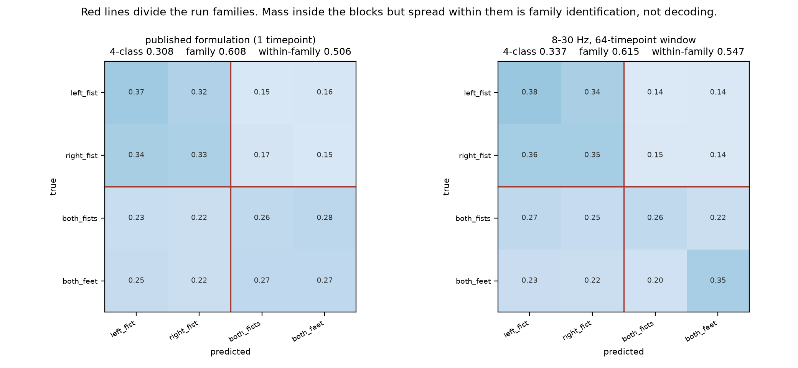
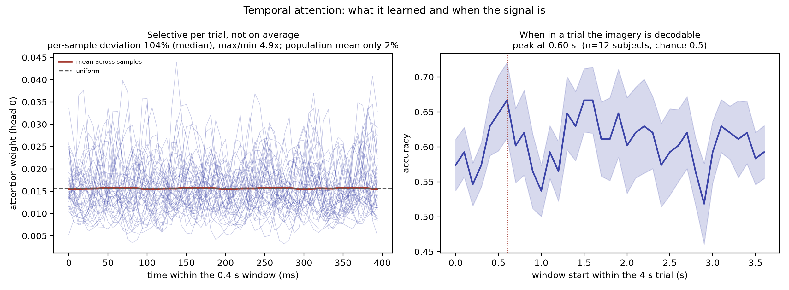

# A Reported 93 % on Four-Class Motor Imagery Is a Protocol, Not a Capability: Reassessing GCNs-Net

*Author list and affiliations to be completed.*

---

## Abstract

Graph convolutional networks have been proposed for electroencephalogram (EEG) motor
imagery decoding on the premise that an electrode correlation graph supplies a useful
spatial prior. GCNs-Net (Hou et al., 2024) reports 93.06 % within-subject and 88.57 %
"group-level" accuracy on four-class motor imagery from the PhysioNet EEG Motor
Movement/Imagery database. We reimplement the architecture in PyTorch, matching the
reference to 359,428 parameters, and reproduce its published protocol at 0.8975
(95 % CI [0.8794, 0.9147]) across 103 subjects and three seeds. Evaluating the identical
model under a trial-level split reduces performance to chance: within-family accuracy
0.5090 [0.4984, 0.5199] against a chance level of 0.500, a paired drop of 0.6096
[0.5767, 0.6411]. We identify three leakage paths in the published protocol and show that
the residual above-chance four-class accuracy is attributable to a structural confound in
the dataset — class pairs occur in disjoint recording runs — rather than to motor imagery.
A Common Spatial Patterns baseline with shrinkage LDA, run on identical subjects and folds,
outperforms every configuration we construct. Of three repairs, pre-registered with fixed
directions and Holm-corrected, only temporal attention succeeds (+0.0600, p = 0.0005);
explicit band power and a learnable adjacency do not. A post-hoc control establishes that
attention operates by weighting each trial differently rather than by averaging. Under
leave-one-subject-out evaluation the repaired model reaches 0.6040 [0.5823, 0.6268] with
88 of 103 subjects above chance — marginally *higher* than subject-dependent performance,
which we attribute to a hundredfold increase in training data per fold. We conclude that
the reported figure measures an evaluation protocol rather than a decoding capability, and
that on this task the graph-convolutional prior costs more than it contributes.

**Keywords:** EEG, motor imagery, brain–computer interface, graph convolutional networks,
data leakage, reproducibility, common spatial patterns

---

## 1. Introduction

Motor imagery decoding — inferring which movement a person is imagining from scalp EEG — is
a core problem in non-invasive brain–computer interfaces. Reported accuracies on public
datasets have risen steadily with the adoption of deep learning, and graph neural networks
in particular have been proposed on the argument that EEG electrodes form a graph whose
structure encodes functional connectivity, and that a spectral convolution over that graph
is a better inductive bias than a grid convolution or a fully connected layer.

GCNs-Net [1] is a prominent instance. It builds an adjacency matrix from the absolute
Pearson correlation between electrode time series, derives a normalised graph Laplacian,
applies six Chebyshev spectral convolutions interleaved with Graclus coarsening, and
reports 93.06 % four-class accuracy at the subject level on the PhysioNet EEG Motor
Movement/Imagery database (EEGMMIDB) [3, 7].

That figure is high. Four-class motor imagery on EEGMMIDB is generally regarded as
difficult, and classical pipelines typically report figures in the 60–70 % range for
binary sub-problems. A result of 93 % therefore invites scrutiny of the evaluation
protocol before the architecture.

This paper reports that scrutiny. Our central claim is not that the implementation is
faulty — we reproduce the published number when we run the published protocol — but that
the protocol does not measure what it is taken to measure.

### 1.1 Contributions

1. **A faithful reimplementation** of GCNs-Net in PyTorch, matched to the reference at
   359,428 parameters, which reproduces the published protocol at 0.8975 across 103
   subjects and three seeds (§5.1).

2. **Identification and quantification of three leakage paths** in the published protocol:
   single-timepoint samples with a shuffled split, BatchNorm fixed in training mode at
   test, and a correlation graph computed over all data including test (§4.4, §5.2). Under
   a correct protocol the identical model performs at chance.

3. **A structural confound in EEGMMIDB** that makes four-class accuracy on this dataset
   uninterpretable in isolation, together with a decomposition that isolates the
   confound-free component (§3.3, §4.5). We show that the entire above-chance four-class
   accuracy of the published formulation is attributable to this confound.

4. **A classical baseline under identical conditions.** CSP+LDA outperforms every
   configuration we build, including the repaired model (§5.4, §5.6).

5. **A pre-registered evaluation of three architectural repairs**, of which one succeeds,
   with a post-hoc control identifying the mechanism (§5.6, §5.7).

6. **The first correct subject-independent evaluation** of this architecture, which is
   *not* worse than subject-dependent evaluation (§5.8).

All code, the full experiment log covering 9,300 folds, and a record of the fourteen errors
made and corrected during this work are released with the paper.

---

## 2. Related work

### 2.1 GCNs-Net and its lineage

GCNs-Net [1] derives directly from Defferrard et al.'s ChebNet [6]: the graph
construction, Laplacian normalisation, Chebyshev polynomial filters and Graclus coarsening
[9] are inherited essentially unchanged, with the contribution being their application to
an EEG electrode graph built from signal correlation. The same group's subsequent work [2]
pairs a graph convolution with a bidirectional LSTM and attention, reporting 98.81 % on the
same dataset.

We examined the authors' released implementation directly. Three properties of that
implementation bear on the reported numbers and are documented in §4.4.

### 2.2 Graph networks for EEG

More recent work has moved toward *adaptive* graphs. MHD-GCN [4] combines spatiotemporal
attention with hierarchical global and local topologies constructed by community
clustering, and SAMGCN [5] learns inter-channel relationships through channel position
encoding and a self-attention graph embedding, updating the adjacency during training.
Both are evaluated on BCI Competition datasets; MHD-GCN also uses PhysioNet.

The convergent direction across this literature is that the graph should be learned rather
than fixed. Our results speak to that directly: we find that making the adjacency learnable
produces no measurable benefit on this task (§5.6), which suggests the limitation lies in
the graph-convolutional formulation rather than in the particular graph.

### 2.3 Classical motor imagery decoding

Common Spatial Patterns [10] and its regularised and filter-bank variants [11, 12] remain
the standard against which motor imagery decoders are measured. CSP finds spatial filters
maximising the ratio of between-class variances, which for motor imagery corresponds
directly to the event-related desynchronisation (ERD) of mu and beta rhythms over
sensorimotor cortex [13]. It is a linear method with few parameters and no capacity to
model temporal structure beyond band-limited variance.

We include CSP+LDA as a baseline not because it is competitive with modern deep learning in
general, but because a proposed architecture that cannot beat it under matched conditions
has not demonstrated the value of its additional machinery.

### 2.4 Leakage in machine-learning-based science

Kapoor and Narayanan [8] survey reproducibility failures across seventeen scientific
fields and find data leakage to be the dominant cause, cataloguing eight distinct types.
Several map onto what we find here: *no test set*, where the same data informs training and
evaluation; *temporal leakage*, where information from the evaluation period reaches
training; and *feature selection on the full dataset*, where a preprocessing step is fit
before splitting.

Our contribution to that literature is a quantified case study: we measure the size of the
inflation (0.6096 paired), isolate the mechanism (memorisation, visible as 99.85 % training
accuracy against chance validation), and show that after removing the leakage the residual
signal is a further artefact rather than the intended construct.

---

## 3. Dataset

### 3.1 PhysioNet EEG Motor Movement/Imagery

EEGMMIDB [3, 7] contains 109 subjects recorded with 64 electrodes at 160 Hz using the
BCI2000 system. Each subject performs 14 runs: two one-minute baselines and twelve
two-minute task runs comprising four conditions in three repetitions. We use the motor
*imagery* runs only — runs 4, 8, 12 (left versus right fist) and 6, 10, 14 (both fists
versus both feet). Annotations mark T0 (rest), T1 and T2, whose meaning depends on the run:
in runs 4/8/12, T1 is left fist and T2 right fist; in runs 6/10/14, T1 is both fists and T2
both feet.

**The class label is therefore a function of (run number, annotation code), never of the
code alone.** A loader that maps T1 to a single class merges left fist with both fists
silently. We assert on this mapping.

Trials are epoched from the annotation onset over 4.0 s, giving 640 samples, yielding 90
motor-imagery trials per subject (approximately 22–23 per class).

### 3.2 Data quality audit

Every EDF header and every imagery-run annotation channel was parsed rather than relying on
published exclusion lists. Of 109 subjects, six deviate:

| Subject | Sampling rate | Anomaly | Affects imagery runs |
|---|---|---|---|
| S088, S092 | 128 Hz | 38 events/run | yes, all six |
| S100 | 128 Hz | 24 events/run | yes, all six |
| S104 | 160 Hz | R08 truncated to 106 s | one run |
| S089 | 160 Hz | R03 is 181 s | no (execution run) |
| S106 | 160 Hz | R05 is 37 s | no (execution run) |

We note that the exclusion list circulated in this literature commonly names **S090**,
which we verify to be clean — all 14 runs at 160 Hz with 30 annotations in every imagery
run, a profile identical to its neighbour S091. The subject that carries a defect is
**S089**. Both spellings leave N = 103, but the substitution matters for reproducibility.

We retain the six-subject exclusion for comparability with prior work while noting that,
for an imagery-only protocol, only S088, S092 and S100 are strictly unusable.

### 3.3 A structural confound

Classes 0 and 1 (left, right fist) occur **only** in runs 4/8/12. Classes 2 and 3 (both
fists, both feet) occur **only** in runs 6/10/14. Consequently any signal that identifies
the recording run — electrode drift, impedance change over a session, changes in alertness
— separates the class pairs without decoding motor imagery at all.

This is a property of the dataset, not of any model, and it cannot be removed by analysis.
It means a four-class accuracy on EEGMMIDB is uninterpretable in isolation: a model can
score well above the 25 % chance level while decoding nothing about the imagined movement.
§4.5 describes the decomposition we use to separate the two contributions.

We are not aware of prior work on this dataset that reports this decomposition.

---

## 4. Methods

### 4.1 Preprocessing

Signals are read with MNE-Python, which separates the 65th "EDF Annotations" signal from
the 64 EEG channels. Channel names are normalised from the dataset's dotted Sharbrough
labels (`Fc5.`, `C3..`) to standard 10-05 names. Sampling rate, channel count and
annotation count are asserted per run; a run that deviates aborts the build rather than
being coerced.

Common Average Reference is applied, matching the reference implementation. Where a band-
pass is used it is 8–30 Hz, covering the mu and beta rhythms in which motor imagery ERD
manifests [13]; the reference applies no filter, a deviation we treat as an experimental
factor (§5.5).

Epochs are cut manually by annotation onset rather than with `mne.Epochs`, because run
lengths vary across subjects (123, 124 or 125 s) so any fixed offset into a run is
incorrect. Epochs are cached in microvolts **without normalisation**: mean and standard
deviation are estimated on the training split at training time, since the cache is built
before any split exists.

### 4.2 Architecture

The model reproduces the reference configuration: six Chebyshev graph convolutions with
filter counts (16, 32, 64, 128, 256, 512), polynomial order K = 2, and six stride-2 graph
max-pooling layers, followed by a linear classifier.

For a graph with adjacency **A**, the symmetric normalised Laplacian is

    L = I − D^(−1/2) A D^(−1/2)

rescaled to the Chebyshev domain as **L̃** = 2L/λ_max − I with λ_max fixed at 2, and the
Chebyshev basis computed by the recurrence

    T_0 = I,   T_1 = L̃,   T_k = 2 L̃ T_(k−1) − T_(k−2).

A layer maps features **X** ∈ ℝ^(M×F_in) to

    Y = [T_0 X ‖ T_1 X ‖ … ‖ T_(K−1) X] W,   W ∈ ℝ^(F_in·K × F_out).

Each convolution is followed by a per-vertex-per-filter bias of shape [1, M, F], batch
normalisation, and a softplus activation. The model has **359,428 parameters** at F_in = 1,
of which 264,192 (73 %) are in the final convolution operating on a two-node graph.

Two deviations from the reference are deliberate. Batch normalisation respects evaluation
mode; the reference hardcodes training mode, which we retain only for the replication arm.
And we correct an off-by-one in the reference's Graclus row-length scan that causes the
matching to consider a node outside the current row.

### 4.3 Graph construction and coarsening

The adjacency is **A = |P| − I**, where **P** is the Pearson correlation matrix between
electrode time series, matching the reference. **We compute P on the training split only.**
The reference computes it over all signals including test data, which is a leakage path
(§4.4).

Coarsening uses Graclus heavy-edge matching under the normalised-cut criterion
w(i,j)·(1/d_i + 1/d_j) [9], producing graphs of 64, 32, 16, 8, 4 and 2 nodes. Nodes are
permuted so that nodes 2i and 2i+1 are the children of node i in the coarser graph, after
which pooling is a stride-2 maximum over the node axis. Unmatched nodes receive zero-filled
fake siblings so that max-pooling selects the real node.

We note in passing that this coarsening recovers scalp topography without being given
electrode positions: level-0 clusters are anatomically adjacent pairs (AF7+F7, CP2+CP4,
FC5+C5, Oz+Iz), with a mean cluster edge length of 0.045 against 0.109 for a random
pairing.

### 4.4 Evaluation protocols

**The published protocol.** From the released implementation: each sample is a *single
timepoint* across 64 channels (`Fin = 1`); all samples are pooled and shuffled with
`randperm`, then cut 90/10. With 640 timepoints per trial, essentially every trial
contributes rows to both training and test. In addition, batch normalisation is fixed in
training mode so that test batches normalise using their own statistics, and the
correlation graph is computed over the pooled dataset before splitting.

We identify these as three distinct leakage paths. A fourth candidate — the mean-centring
step in the released preprocessing — is *not* leakage: inspection shows it operates on a
(channels × time) matrix and is therefore Common Average Reference.

**The correct protocol.** Stratified five-fold cross-validation at trial level; adjacency
and normalisation statistics fit on training trials only; batch normalisation respecting
evaluation mode; a further trial-level split of the training data for checkpoint selection.

**Leave-one-subject-out.** One fold per subject, training on the remaining 102, with five
*disjoint* validation subjects per fold so that model selection never observes the held-out
subject.

Trial-level predictions are formed by averaging logits across a trial's samples.

### 4.5 The within-family decomposition

Given the confound in §3.3, we decompose a four-class confusion matrix **C** into two
quantities. Writing f(c) for the run family of class c (f = 0 for classes 0, 1; f = 1 for
classes 2, 3):

- **Run-family accuracy** = Σ_{t,p : f(t)=f(p)} C_{t,p} / Σ C. Chance 0.5. This mixes
  run-level artefact with a genuine neurophysiological difference, since bilateral and
  unilateral imagery differ topographically.
- **Within-family accuracy** = tr(C) / Σ_{t,p : f(t)=f(p)} C_{t,p}. Chance 0.5. Both
  classes in each comparison originate in the *same* runs, so the run-family artefact
  cannot contribute.

**Within-family accuracy is our primary outcome.** For direct comparison with CSP, which is
inherently binary, we also train and evaluate the network on the two binary problems
separately; that variant is used for all confirmatory tests.

### 4.6 Contributed components

**Learnable adjacency.** A = relu(A_PCC + Δ), symmetrised and zero-diagonal by
construction, with Δ initialised to zero so that the model is numerically identical to the
fixed-graph baseline at initialisation. The coarsening hierarchy is held fixed, since
Graclus is discrete and recomputing the pooling tree during training would change which
electrodes are siblings mid-run. Cost is 5,460 parameters (1.5 %).

**Temporal attention.** For a windowed sample **X** ∈ ℝ^(M×T), scores are computed from the
full channel pattern at each instant, s_t = W_2 tanh(W_1 x_t), and normalised over time by
softmax to give α ∈ ℝ^(T×H). The output is Σ_t α_{t,h} x_t ∈ ℝ^(M×H). Profiles are shared
across nodes by default. Unlike the adjacency this is not initialisation-equivalent to the
baseline: the first convolution sees F_in = H rather than T.

### 4.7 Statistical procedure

All comparisons are paired on subject, because between-subject variance in EEG greatly
exceeds the effects under test. Intervals are 95 % bootstrap over subjects with 10,000
resamples; p-values are bootstrap under a re-centred null.

**Pre-registration.** Before running the confirmatory experiments we fixed five hypotheses
with directions, the primary outcome, the analysis plan, the stopping rules and the list of
exploratory analyses, and committed them to version control. Two clarifications — the
tag namespace and the resolution of an ambiguity in one hypothesis — were also recorded
before the corresponding runs began.

**Development and confirmation sets.** Every exploratory result was obtained on the same 20
subjects, which were inspected repeatedly while choosing what to try. Those subjects were
designated a development set, and **all confirmatory tests were run on the full 103**, of
which 83 had never influenced any design decision. Holm–Bonferroni correction is applied
across the five confirmatory tests at family-wise α = 0.05.

---

## 5. Experiments

Unless stated, results are over 103 subjects; "within-family" denotes the primary outcome of
§4.5 with a chance level of 0.500.

### 5.1 Reproduction of the published protocol

Three seeds, 103 subjects: timepoint accuracy **0.8975**, CI [0.8794, 0.9147], with a
between-seed spread of 0.0008. The paper reports 0.8835 at group level and 0.9306 at
subject level.

This reproduction is a precondition for everything that follows: it establishes that
subsequent results are properties of the protocol rather than of our implementation.

### 5.2 Correct evaluation

The identical model under the correct protocol, with identical training and test set sizes:

| Protocol | 4-class | Within-family | 95 % CI |
|---|---|---|---|
| Published | — | 0.8975 | [0.8794, 0.9147] |
| Correct | 0.3097 | **0.5090** | [0.4984, 0.5199] |

The within-family interval contains chance. The paired difference between protocols is
**0.6096** [0.5767, 0.6411].

The mechanism is visible in the training curve. Training accuracy reaches 99.85 % while
validation remains at chance: the model memorises trial-specific voltage patterns, which
under the published protocol are shared between training and test. A learning-rate sweep
from 10⁻⁶ to 10⁻² leaves held-out accuracy at chance throughout, so this is not an
optimisation artefact.

### 5.3 The residual is a confound, not decoding

| Measure | Value | Chance |
|---|---|---|
| 4-class accuracy | 0.3097 | 0.250 |
| Run-family accuracy | 0.6106 | 0.500 |
| **Within-family accuracy** | **0.5090** | 0.500 |

The model identifies the run family 11 points above chance and discriminates within a
family at chance. **Under correct evaluation, the published architecture and sample
definition decode no motor imagery.**

*Figure 1. Pooled trial confusion, 103 subjects; red lines divide the run families. Left:
the published formulation — mass concentrates within the diagonal blocks while cells inside
each block are near-equal (0.37/0.32, 0.34/0.33). Right: with band-pass and windowing,
`both_feet` reaches 0.35 against 0.20, indicating genuine within-family discrimination.*

### 5.4 Classical baseline

CSP (four components, Ledoit–Wolf regularised) with shrinkage LDA, on identical subjects,
folds, cache and metric, with CSP fit on training trials only:

| Binary problem | GCNs-Net | CSP+LDA | Paired difference |
|---|---|---|---|
| Left vs right fist | 0.5178 | 0.5711 | −0.0533 [−0.1000, −0.0044] |
| Both fists vs feet | 0.5767 | 0.6722 | −0.0956 [−0.1511, −0.0367] |
| Mean | 0.5472 | **0.6239** | −0.0744 [−0.1111, −0.0367] |

Both methods find fists-versus-feet easier than left-versus-right, consistent with the
separation of hand and foot representations on the motor homunculus. CSP was not tuned,
which makes this comparison conservative.

### 5.5 Representation ablation (exploratory, 20 subjects)

A 2×2 over band-pass and sample definition, plus a band-power variant:

| Band-pass | Sample | 4-class | Family | Within-family |
|---|---|---|---|---|
| none | 1 timepoint | 0.3000 | 0.6239 | 0.4859 |
| 8–30 Hz | 1 timepoint | 0.3472 | 0.6778 | 0.5110 |
| none | 64 timepoints | 0.3311 | 0.6544 | 0.5051 |
| 8–30 Hz | 64 timepoints | 0.3300 | 0.6100 | **0.5418** |
| log band power | 1 s | 0.4222 | 0.7378 | 0.5716 |

Only the fourth row's within-family interval excludes chance. The band-power row
illustrates why the decomposition is necessary: its four-class accuracy rises by 9 points
over the fourth row, but roughly four fifths of that is improved run-family identification.
On the confound-free binary problems, band power is indistinguishable from raw voltage.

### 5.6 Confirmatory results

| Configuration | Within-family | 95 % CI | Above chance |
|---|---|---|---|
| Fixed graph, no attention | 0.5438 | [0.5288, 0.5598] | 64/103 |
| + learnable adjacency | 0.5469 | [0.5317, 0.5632] | 70/103 |
| **+ temporal attention** | **0.6038** | [0.5805, 0.6278] | 83/103 |
| + both | 0.5976 | [0.5745, 0.6220] | 79/103 |
| CSP+LDA | 0.6239 | [0.5977, 0.6521] | 81/103 |

| | Hypothesis | Difference | p (Holm) | Verdict |
|---|---|---|---|---|
| H1 | Learnable adjacency > fixed graph | +0.0031 | 0.392 | not supported |
| H2 | Temporal attention > none | +0.0600 | 0.0005 | **supported** |
| H3 | Both > better single component | −0.0061 | 0.899 | not supported |
| H4 | Contribution ≠ CSP+LDA (two-sided) | −0.0263 | 0.0012 | **supported, negative** |
| H5 | LOSO within-family > chance | +0.1040 | 0.0005 | **supported** |

H4 was pre-specified two-sided; the significant difference is in CSP's favour.

**The learnable adjacency does not help, and this is not a failure to train.** Checkpoint
inspection shows 80–90 % of first-layer edges changed by more than 1 % of the mean base
weight, with ‖Δ‖ reaching 2.0. The graph was learned; it did not matter.

### 5.7 What attention learned (exploratory)

The population-mean attention profile deviates from uniform by only 2.1 %, which suggested
the H2 gain might be temporal averaging plus a sixteen-fold narrower first convolution
rather than attention. We tested this with a fixed segment-mean pool — same output shape,
identical downstream network, no learned temporal parameters:

| Configuration | Within-family | vs baseline |
|---|---|---|
| Fixed graph, no pooling | 0.5472 | — |
| Fixed mean pool | 0.5367 | −0.0106, p = 0.885 |
| Temporal attention | **0.5939** | +0.0467, p = 0.0001 |

Averaging confers no benefit; attention exceeds the fixed-weight control by 0.0572
(p = 0.0009). The hypothesis is refuted, and the near-uniform mean profile is an artefact of
aggregation:

| Statistic | Value |
|---|---|
| Population-mean deviation from uniform | 2.1 % |
| Per-sample deviation, median | 104.5 % |
| Max/min weight within a sample, median | 4.9× |
| Argmax timepoint across samples | spans all 64 |

Individual trials are strongly peaked but at *different* moments, so averaging flattens the
profile. This is the behaviour a signal with variable onset latency requires.

*Figure 2. Left: individual attention profiles (thin) against their mean (bold). Right:
decoding accuracy by window position within the trial, peaking at 0.60 s after cue onset —
the shape ERD predicts [13], measured without trial timing being supplied to the model.*

### 5.8 Subject-independent evaluation

| Protocol | Within-family | 95 % CI | Above chance |
|---|---|---|---|
| Subject-dependent | 0.6038 | [0.5805, 0.6278] | 83/103 |
| **Leave-one-subject-out** | **0.6040** | [0.5823, 0.6268] | 88/103 |

LOSO is marginally *higher*, contrary to the usual expectation and to our own
pre-experiment prediction. A LOSO fold trains on approximately 4,600 trials from 102
subjects against approximately 36 trials from one, and this hundredfold increase in data
outweighs the loss of subject-specific calibration. The implication is that the
subject-dependent protocol on this dataset is data-starved rather than that between-subject
transfer is easy.

Neither published headline for this architecture is subject-independent — the 88.57 %
"group-level" figure pools subjects and then splits across the pool — so we believe this to
be the first correct subject-independent evaluation of GCNs-Net.

---

## 6. Discussion

**The reported figure measures a protocol.** The gap between 0.8975 under the published
protocol and chance under a correct one is not a difference in implementation quality; the
same weights, data and training procedure produce both. This places GCNs-Net within the
pattern documented by Kapoor and Narayanan [8], and suggests that published accuracies on
EEGMMIDB should be read alongside an explicit description of the sample definition and
split.

**The sample definition is the root cause.** A single timepoint spans 6.25 ms and carries
no spectral content, while motor imagery is a band-power phenomenon [13]. Under a shuffled
split this is invisible, because neighbouring timepoints of the same trial appear on both
sides and the classifier can memorise trial-specific voltage. Under an honest split it is
fatal. Our repairs work by restoring temporal extent, not by improving the graph.

**The graph prior appears to be a handicap here.** Two independent attempts to close the
gap to CSP failed: supplying explicit band power, and letting the network reshape the
electrode graph discriminatively. What distinguishes CSP is that it fits an *unconstrained*
spatial projection over all 64 channels using the labels. An order-2 Chebyshev convolution
mixes only within one-hop neighbourhoods with weights shared across nodes; learning the
adjacency changes which nodes are neighbours without lifting either constraint. For a
signal that is a specific weighted contrast across the whole scalp, that restriction costs
more than it contributes.

We state this narrowly. It is not a claim that graph networks fail on EEG. It is that on
this dataset, under a correct protocol, with this formulation, the graph constraint is
worse than no prior at all — and that the recent turn toward learnable adjacencies [4, 5]
may not address the binding constraint, at least as measured here.

**A dataset-level caution.** The run-family confound in EEGMMIDB (§3.3) is structural and
affects any four-class result on this dataset, not only ours. We recommend that four-class
accuracies on EEGMMIDB be reported alongside the within-family decomposition, or that
analyses be restricted to within-family binary problems.

**On LOSO exceeding subject-dependent performance.** This inverts a widely held expectation
and has a practical consequence: for this dataset, pooling subjects is a more effective use
of data than per-subject calibration, and reported subject-dependent numbers may be limited
by training-set size rather than by inter-subject variability.

---

## 7. Limitations

- **One dataset, one architecture.** All conclusions concern GCNs-Net on EEGMMIDB. The
  inductive-bias argument is supported here and is not established in general.
- **The four-class problem cannot be de-confounded.** Only the within-family decomposition
  avoids the confound, and it does so by answering a binary question instead of the
  four-class one the original work poses.
- **Our primary outcome differs from the original's.** Comparisons to 0.9306 are
  comparisons of protocols, not of commensurable quantities.
- **The development set was inspected repeatedly.** It was demoted and all confirmatory
  tests moved to the full cohort; every development estimate subsequently fell inside its
  full-scale interval, but exploratory results remain exploratory.
- **§5.7 is post-hoc.** The mean-pool control was devised after observing H2. It is
  evidence about mechanism, not a pre-registered test.
- **Single seed for the confirmatory arms**, though a three-seed sweep elsewhere showed a
  between-seed spread of 0.0008.
- **CSP was not tuned**, which makes H4's negative result conservative.
- **Four-class LOSO was not measured**; the reported LOSO figure is binary within-family.

---

## 8. Conclusion

We reimplemented GCNs-Net, reproduced its published protocol at 0.8975 across 103 subjects,
and showed that the identical model under a trial-level split performs at chance. The
above-chance four-class accuracy that survives is attributable to a structural confound in
the dataset rather than to motor imagery. A CSP+LDA baseline under matched conditions
outperforms every configuration we constructed, including a repaired model incorporating
temporal attention that reaches 0.6038 within-family and 0.6040 under leave-one-subject-out
evaluation.

Of three architectural repairs evaluated under pre-registration, only temporal attention
succeeded, and a control establishes that it operates by weighting each trial adaptively
rather than by averaging. Neither explicit band power nor a learnable adjacency closed the
gap to the classical baseline, which locates the limitation in the graph-convolutional
formulation rather than in the choice of graph.

We conclude that the reported 93 % measures an evaluation protocol rather than a decoding
capability, and we recommend that four-class results on this dataset be accompanied by the
within-family decomposition.

---

## References

[1] Y. Hou, S. Jia, X. Lun, Z. Hao, Y. Shi, Y. Li, R. Zeng, J. Lv. "GCNs-Net: A Graph
Convolutional Neural Network Approach for Decoding Time-Resolved EEG Motor Imagery
Signals." *IEEE Transactions on Neural Networks and Learning Systems* 35(6):7312–7323,
2024. DOI: 10.1109/TNNLS.2022.3202569

[2] Y. Hou, S. Jia, X. Lun, S. Zhang, T. Chen, F. Wang, J. Lv. "Deep Feature Mining via the
Attention-Based Bidirectional Long Short Term Memory Graph Convolutional Neural Network for
Human Motor Imagery Recognition." *Frontiers in Bioengineering and Biotechnology* 9:706229,
2022. DOI: 10.3389/fbioe.2021.706229

[3] G. Schalk, D. J. McFarland, T. Hinterberger, N. Birbaumer, J. R. Wolpaw. "BCI2000: A
General-Purpose Brain-Computer Interface (BCI) System." *IEEE Transactions on Biomedical
Engineering* 51(6):1034–1043, 2004. DOI: 10.1109/TBME.2004.827072

[4] X. Deng, D. Xu, H. Huo, X. Hong, B. Liu. "Multi-level hierarchical dynamic graph
convolutional networks for motor imagery EEG analysis." *Neurocomputing* 626:129594, 2025.
DOI: 10.1016/j.neucom.2025.129594

[5] M. Meng, P. Yu, S. Zhang, F. Fang, Y. Ma, Q. She, Y. Zhang. "SAMGCN: A self-adaptive
multilevel graph convolutional network for motor imagery classification." *Biomedical
Signal Processing and Control* 116:109506, 2026. DOI: 10.1016/j.bspc.2026.109506

[6] M. Defferrard, X. Bresson, P. Vandergheynst. "Convolutional Neural Networks on Graphs
with Fast Localized Spectral Filtering." *Advances in Neural Information Processing
Systems* 29, 2016. arXiv:1606.09375

[7] A. L. Goldberger, L. A. N. Amaral, L. Glass, J. M. Hausdorff, P. Ch. Ivanov, R. G.
Mark, J. E. Mietus, G. B. Moody, C.-K. Peng, H. E. Stanley. "PhysioBank, PhysioToolkit, and
PhysioNet: Components of a New Research Resource for Complex Physiologic Signals."
*Circulation* 101(23):e215–e220, 2000. DOI: 10.1161/01.CIR.101.23.e215

[8] S. Kapoor, A. Narayanan. "Leakage and the reproducibility crisis in
machine-learning-based science." *Patterns* 4(9):100804, 2023.
DOI: 10.1016/j.patter.2023.100804

[9] I. S. Dhillon, Y. Guan, B. Kulis. "Weighted Graph Cuts without Eigenvectors: A
Multilevel Approach." *IEEE Transactions on Pattern Analysis and Machine Intelligence*
29(11):1944–1957, 2007. DOI: 10.1109/TPAMI.2007.1115

[10] H. Ramoser, J. Muller-Gerking, G. Pfurtscheller. "Optimal spatial filtering of single
trial EEG during imagined hand movement." *IEEE Transactions on Rehabilitation Engineering*
8(4):441–446, 2000. DOI: 10.1109/86.895946

[11] B. Blankertz, R. Tomioka, S. Lemm, M. Kawanabe, K.-R. Müller. "Optimizing Spatial
Filters for Robust EEG Single-Trial Analysis." *IEEE Signal Processing Magazine*
25(1):41–56, 2008. DOI: 10.1109/MSP.2008.4408441

[12] K. K. Ang, Z. Y. Chin, H. Zhang, C. Guan. "Filter Bank Common Spatial Pattern (FBCSP)
in Brain-Computer Interface." *IEEE International Joint Conference on Neural Networks*,
2390–2397, 2008. DOI: 10.1109/IJCNN.2008.4634130

[13] G. Pfurtscheller, F. H. Lopes da Silva. "Event-related EEG/MEG synchronization and
desynchronization: basic principles." *Clinical Neurophysiology* 110(11):1842–1857, 1999.
DOI: 10.1016/S1388-2457(99)00141-8

---

## Data and code availability

All code, configuration files and the complete experiment log — one row per fold for 9,300
folds, each recording the git commit, random seed and full configuration — are released
with this paper. `project_documentation.md` contains the full methods specification, the
pre-registration, per-experiment results, and a record of the fourteen errors made and
corrected during the work. Reproduction commands are given in §15 of that document.

The dataset is publicly available from PhysioNet [3, 7] and is not redistributed here; the
released code verifies it against the published SHA-256 manifest before use.
