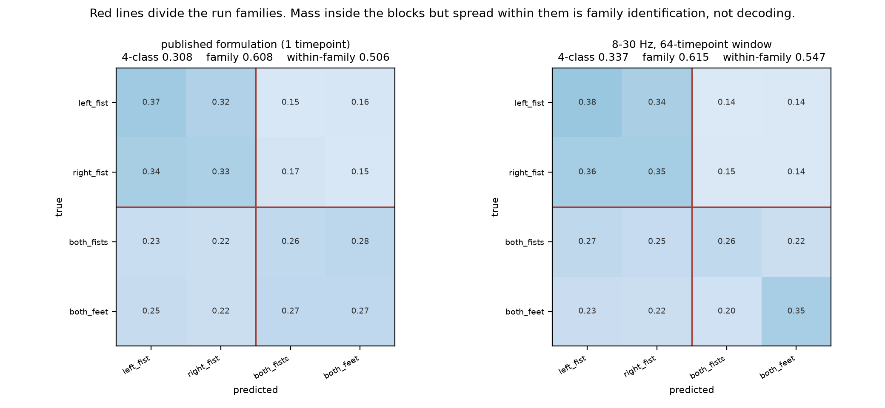
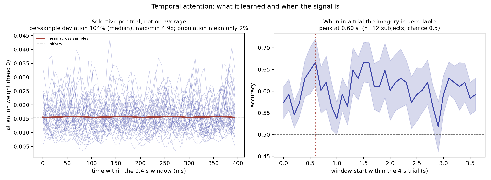

# GCNs-Net Reassessed

**A published graph convolutional network reports 93 % on four-class motor imagery.
Reimplemented faithfully, its protocol reproduces. Evaluated correctly, the same model
decodes nothing at all — and a linear method from 2000 beats every repair we tried.**

103 subjects · PhysioNet EEG Motor Movement/Imagery · 9,300 logged folds ·
five pre-registered hypotheses · 2 September 2026

| | value | |
|---|---|---|
| Published protocol | **0.8975** | reproduced; paper reports 0.8835 |
| Correct protocol | **0.5090** | within-family — chance is 0.500 |
| Best model | **0.6038** | with temporal attention |
| CSP+LDA | **0.6239** | still ahead, p = 0.0012 |
| Subject-independent | **0.6040** | 88 of 103 above chance |

---

## Summary

GCNs-Net (Hou et al., *IEEE TNNLS* 35(6):7312–7323, 2024) applies a Chebyshev graph
convolution over an electrode correlation graph and reports 93.06 % within-subject and
88.57 % at "group level" on PhysioNet EEGMMIDB.

We reimplemented it in PyTorch, matching the reference to 359,428 parameters, and
reproduced its published protocol at **0.8975**. We then evaluated the identical model
under a correct trial-level split. Performance fell to chance. The residual above-chance
signal in the four-class number turned out to be an artefact of how the dataset is
organised, not motor imagery. A classical CSP+LDA baseline, run on the same subjects and
folds, beat every configuration we built.

Of three repairs attempted, one worked. Explicit band power did not help. A learnable
electrode graph did not help. Temporal attention did, by a clear margin — and a control
shows it works by weighting each trial differently, not by averaging.

---

## R1 · The published protocol reproduces

103 subjects, three seeds. Timepoint accuracy **0.8975**, 95 % CI [0.8794, 0.9147], with a
spread across seeds of 0.0008. The paper reports 0.8835 at group level.

This matters more than it looks. Everything that follows is a claim about the protocol
rather than about our code, and that claim is only credible because the port reproduces
the original number when run the original way.

## R2 · Under a correct split it collapses to chance

Same model, same data, same train and test sizes. Only the protocol differs: trials are
split at trial level, and the graph and normalisation statistics are fit on the training
split alone.

| Protocol | 4-class | Within-family | 95 % CI |
|---|---|---|---|
| Published (leaky) | — | 0.8975 | [0.8794, 0.9147] |
| **Correct, published formulation** | 0.3097 | **0.5090** | [0.4984, 0.5199] |

The within-family interval **contains chance**. The paired gap between protocols is
**+0.6096**, CI [+0.5767, +0.6411], over 103 subjects.

### The mechanism is visible in training

```
epoch  1   train 0.2806   val 0.2283
epoch 10   train 0.9001   val 0.1634
epoch 25   train 0.9985   val 0.3403
```

Training accuracy reaches **99.85 %** while validation sits at chance. The model is not
failing to learn — it memorises trial-specific voltage patterns. Under the published
protocol each sample is a single 6.25 ms timepoint and the split shuffles timepoints, so
roughly 90 % of every trial is in training and the held-out remainder is trivially
recovered. A learning-rate sweep from 1e−6 to 1e−2 leaves held-out accuracy at chance
throughout.

> **Three leakage paths, not one.** Timepoint-level shuffled splitting; BatchNorm
> hardcoded to training mode so test batches normalise on their own statistics; and the
> correlation graph computed over all data including test. Any one alone would inflate the
> number.

## R3 · What survives is an artefact, not decoding

The four-class accuracy of 0.3097 sits above the 0.25 chance level, which invites the
reading that *something* is being decoded. It is not.

In this dataset, left and right fist occur *only* in runs 4/8/12, and both fists and both
feet *only* in runs 6/10/14. Any run-level signal — electrode drift, impedance change,
alertness — separates the two pairs without decoding imagery at all.

| Measure | Value | Chance | Reading |
|---|---|---|---|
| 4-class accuracy | 0.3097 | 0.250 | above chance |
| Run-family accuracy | 0.6106 | 0.500 | +11 points |
| **Within-family accuracy** | **0.5090** | 0.500 | **at chance** |

The model identifies *which pair of runs a trial came from* eleven points above chance,
and discriminates *within* a pair at chance. **Evaluated correctly, the published
architecture and sample definition decode no motor imagery.**



*Pooled trial confusion, 103 subjects. Red lines divide the run families. Left: the
published formulation — mass concentrates inside the blocks, but the cells within each
block are near-equal (0.37/0.32, 0.34/0.33), the signature of family identification with
no decoding. Right: with an 8–30 Hz band-pass and a 64-timepoint window, `both_feet`
reaches 0.35 against 0.20, which is real within-family signal.*

> **A diagnostic fixed in advance.** This decomposition was specified before it was run,
> precisely because a four-class number here is uninterpretable on its own. It earned its
> place twice more: two later configurations raised four-class accuracy while the rise was
> almost entirely better family identification.

## R4 · A linear method from 2000 wins

Common Spatial Patterns with shrinkage LDA, on the same subjects, folds, band-passed cache
and metric. CSP is fit on training trials only, since it is a supervised spatial filter and
fitting it on all data would leak exactly as the reference's adjacency does.

| Binary problem | GCNs-Net | CSP+LDA | Paired difference |
|---|---|---|---|
| Left vs right fist | 0.5178 | 0.5711 | −0.0533 [−0.1000, −0.0044] |
| Both fists vs both feet | 0.5767 | 0.6722 | −0.0956 [−0.1511, −0.0367] |
| **Mean within-family** | **0.5472** | **0.6239** | **−0.0744 [−0.1111, −0.0367]** |

CSP wins on 16 of 20 subjects in the development comparison and remains ahead in the
confirmatory test. Both methods find fists-versus-feet easier than left-versus-right, which
is what the motor homunculus predicts — hand and foot cortex are well separated, while
left-versus-right hand needs finer lateralisation. That ordering is mild evidence both
pipelines track real signal.

CSP was not tuned: four components, Ledoit–Wolf regularisation, no search. A tuned CSP
would likely be stronger, which makes this comparison conservative rather than flattering
to the baseline.

## R5 · One repair of three works

Five hypotheses were pre-registered before the confirmatory runs: fixed directions, a
primary outcome, Holm–Bonferroni correction across the family, and the twenty subjects used
during development demoted to a development set so that every confirmatory test ran on all
103.

| Configuration | Within-family | 95 % CI | Above chance |
|---|---|---|---|
| Fixed graph, no attention | 0.5438 | [0.5288, 0.5598] | 64/103 |
| + learnable adjacency | 0.5469 | [0.5317, 0.5632] | 70/103 |
| **+ temporal attention** | **0.6038** | [0.5805, 0.6278] | 83/103 |
| + both | 0.5976 | [0.5745, 0.6220] | 79/103 |
| CSP+LDA | 0.6239 | [0.5977, 0.6521] | 81/103 |

| | Hypothesis | Difference | p (Holm) | Verdict |
|---|---|---|---|---|
| H1 | Learnable adjacency beats the fixed graph | +0.0031 | 0.392 | not supported |
| H2 | Temporal attention beats none | +0.0600 | 0.0005 | **supported** |
| H3 | Both beat the better single component | −0.0061 | 0.899 | not supported |
| H4 | Full contribution differs from CSP+LDA | −0.0263 | 0.0012 | **supported, negative** |
| H5 | Subject-independent beats chance | +0.1040 | 0.0005 | **supported** |

> **H4 must be read with its sign.** The test was pre-specified two-sided, so "supported"
> means only that a difference exists — and the difference is **negative**. CSP+LDA beats
> the full contribution by 0.0263 [0.0112, 0.0413]. Quoting that row without the direction
> would be actively misleading.

### Why the graph does not help, and attention does

Two candidate explanations for the gap to CSP were tested and both failed. Giving the
network explicit log band power — the representation CSP effectively uses — changed nothing
on the confound-free comparisons. Letting the network reshape the electrode graph
discriminatively changed nothing either, and checkpoint inspection confirms the graph
genuinely moved: 80–90 % of first-layer edges changed.

What remains is the graph-convolutional inductive bias itself. CSP fits an unconstrained
discriminative projection over all 64 channels. An order-2 Chebyshev convolution mixes only
within one-hop neighbourhoods using weights shared across nodes; learning the adjacency
changes *which* nodes are neighbours without lifting the locality or the sharing. For a
signal that is a specific weighted contrast across the whole scalp, that prior appears to
cost more than it contributes.

This is not a claim that graph networks fail on EEG. It is that on this dataset, under a
correct protocol, with this Chebyshev formulation, the graph constraint is worse than no
prior at all.

## R6 · Attention weights each trial differently

A significant gain says attention helped; it does not say what it learned. Two analyses
answer that, and the first of them refuted our own initial explanation.

The population-mean attention profile deviates from uniform by only 2.1 %, which suggested
the gain was not attention at all but two side effects: temporal averaging, and a first
convolution layer sixteen times narrower. A fixed mean-pool control tests this directly —
same output shape, identical downstream network, no learned temporal parameters.

| Configuration | Within-family | vs baseline |
|---|---|---|
| Fixed graph, no pooling | 0.5472 | — |
| Fixed mean pool (control) | 0.5367 | −0.0106, p = 0.885 |
| **Temporal attention** | **0.5939** | +0.0467, p = 0.0001 |

**Averaging gains nothing.** Attention beats the identical architecture with fixed uniform
weights by +0.0572 (p = 0.0009). The explanation was wrong, and so was our reading of the
profile:

```
population-mean deviation from uniform        2.1 %
per-sample deviation from uniform (median)  104.5 %
max/min weight within one sample (median)     4.9x
argmax timepoint across samples: spans all 64
```

Individual trials are strongly peaked — roughly a fivefold ratio between the most and least
weighted moment — but they peak at *different* moments, so averaging across samples flattens
the profile. Attention is adaptive per trial, which is exactly what a signal with variable
onset requires.



*Left: individual attention profiles (thin) against their mean (bold). The mean is nearly
uniform; the individuals are not. Plotting only the mean supports exactly the wrong
conclusion. Right: decoding accuracy by window position within the trial, peaking at
**0.60 s** after cue onset — the shape event-related desynchronisation predicts, measured
rather than assumed, with no trial timing built into the model.*

## R7 · Subject-independent decoding is not worse

Leave-one-subject-out, 103 folds, with five disjoint validation subjects per fold so that
model selection never sees the held-out subject.

| Protocol | Within-family | 95 % CI | Above chance |
|---|---|---|---|
| Subject-dependent | 0.6038 | [0.5805, 0.6278] | 83/103 |
| **Subject-independent (LOSO)** | **0.6040** | [0.5823, 0.6268] | 88/103 |

LOSO is **marginally better**, not worse, and more subjects clear chance. This contradicts
the expectation we recorded in advance, and the explanation is data volume: a LOSO fold
trains on roughly 4,600 trials from 102 subjects against roughly 36 trials from one. A
hundredfold increase in training data outweighs never having seen the test subject.

The implication is that the *subject-dependent* protocol is data-starved, not that
between-subject transfer is easy. Neither published headline for this architecture is
subject-independent — the 88.57 % "group level" figure pools subjects and then splits
across the pool — so this appears to be the first correct subject-independent evaluation
of it.

---

## A result we did not expect

Graclus coarsening groups electrodes by correlation alone. No electrode position enters the
pipeline at any point. The clusters it produces are nonetheless anatomically adjacent pairs:
AF7+F7, CP2+CP4, FC5+C5, Oz+Iz, F1+Fz.


*The graph recovers scalp topography unprompted. Mean cluster edge length is **0.045**
against **0.109** for a random pairing — clusters are about 2.4 times more local than
chance. A few long edges do cross, which the mean reflects honestly.*

This is a genuine point in the correlation graph's favour, and worth stating alongside the
negative results: the graph encodes real spatial structure. It simply is not the structure
this task needs.

---

## Limitations

- **One dataset, one architecture.** Every conclusion concerns GCNs-Net on PhysioNet
  EEGMMIDB. The inductive-bias argument is supported here, not in general.
- **The four-class problem cannot be de-confounded.** No analysis separates run-family
  signal from neural signal in a four-class number; only the within-family decomposition
  avoids it, at the cost of answering a binary question instead.
- **Our primary outcome is not the paper's.** Ours is binary within-family; theirs is
  four-class. Comparing to 0.9306 compares protocols, not commensurable numbers.
- **The development set was inspected repeatedly.** Twenty subjects guided every design
  choice. They were demoted and all confirmatory tests moved to 103, and every development
  estimate later fell inside its full-scale interval — but exploratory results remain
  exploratory.
- **Post-hoc analyses are labelled as such.** The mean-pool control was devised after
  seeing H2. It is strong evidence about mechanism; it is not a pre-registered test.
- **Single seed for the confirmatory arms**, though a three-seed sweep elsewhere showed a
  spread of 0.0008.
- **CSP was left untuned**, which makes H4's negative result conservative.
- **4-class LOSO was never measured.** The 0.6040 figure is binary within-family.

## Conclusion

The published result does not survive correct evaluation. Its protocol reproduces at
0.8975; the same model under a trial-level split reaches within-family 0.5090, which is
chance, and the four-class number that looks above chance is a run-family artefact.

The failure is in the sample definition rather than the graph. A single 6.25 ms timepoint
carries no spectral content, and motor imagery is a band-power phenomenon. Repairing the
representation — band-passing to mu and beta, widening the sample to 0.4 s, and weighting
time by attention — produces a model that genuinely decodes, at 0.6038 within-family and
0.6040 subject-independent.

That model is still beaten by CSP+LDA. Neither explicit band power nor a learnable graph
closed the gap, which points at the graph-convolutional prior itself rather than at any
particular graph. The honest summary is that this architecture, correctly evaluated on this
dataset, is outperformed by a linear method a quarter of a century older, and that the
reported 93 % measures a protocol rather than a capability.

---

Full methods, per-fold results and a complete record of the fourteen errors made and
corrected during this work are in [`project_documentation.md`](project_documentation.md).
Every number here traces to a row in `runs/experiments.jsonl`, which records the git commit,
seed and full configuration for each of 9,300 folds. Reproduction commands are in the
[README](README.md) and in §15 of the documentation.
