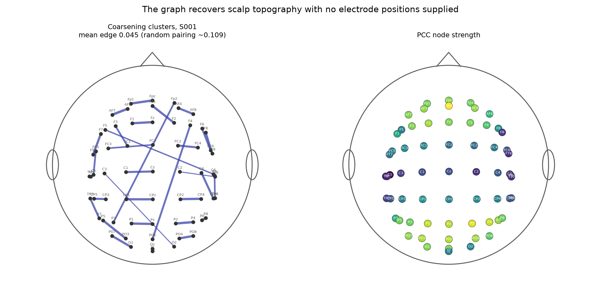

# GCNs-Net Reassessed

**A published graph convolutional network reports 93 % on four-class motor imagery.
Reimplemented faithfully, its protocol reproduces. Evaluated correctly, the same model
decodes nothing at all. Repairing it is possible — but six methods sharing almost no
components then converge on ~0.67, and no spatial prior, architecture or window length we
tried moves it. The one thing that does is other subjects' data, and that works just as well
without the graph.**

103 subjects · PhysioNet EEG Motor Movement/Imagery · 22,315 logged folds ·
five pre-registered hypotheses · eight post-hoc controls · 7 September 2026

| | value | |
|---|---|---|
| Published protocol | **0.8975** | reproduced; paper reports 0.8835 |
| Correct protocol | **0.5090** | within-family — chance is 0.500 |
| Published formulation, repaired | **0.6038** | with temporal attention |
| CSP+LDA | **0.6239** | ahead of every graph arm *at that point* |
| Subject-independent | **0.6040** | 88 of 103 above chance |
| ShallowConvNet (no graph) | **0.6725** | beats CSP by 0.0485 |
| **Reordered graph model** | **0.6737** | **beats CSP by 0.0389; ties ShallowConvNet, p = 0.99** |
| Tangent space (tuned classical) | **0.6694** | beats CSP+LDA by 0.0454 — ties the deep arms too |
| **+ cross-subject pre-training** | **0.7301** | **+0.0557 over its own control; 98 of 103 above chance** |
| **…the same pre-training on ShallowConvNet** | **0.7369** | **tied with the above; the gain is the finding, not the model** |

---

## Summary

GCNs-Net (Hou et al., *IEEE TNNLS* 35(6):7312–7323, 2024) applies a Chebyshev graph
convolution over an electrode correlation graph and reports 93.06 % within-subject and
88.57 % at "group level" on PhysioNet EEGMMIDB.

We reimplemented it in PyTorch, matching the reference to 359,428 parameters, and
reproduced its published protocol at **0.8975**. We then evaluated the identical model
under a correct trial-level split. Performance fell to chance. The residual above-chance
signal in the four-class number turned out to be an artefact of how the dataset is
organised, not motor imagery. A classical CSP+LDA baseline, run on the same subjects and
folds, beat every graph-based configuration we built.

Of three repairs attempted, one worked. Explicit band power did not help. A learnable
electrode graph did not help. Temporal attention did, by a clear margin — and a control
shows it works by weighting each trial differently, not by averaging.

Two further controls (R8) then narrowed the limitation. Freeing the spatial operator from
the graph entirely recovers only a sixth of the gap to CSP, so the constraint usually blamed
for this kind of result is real but minor. Two graph-free convolutional networks, trained on
exactly the same folds and the same ~45 trials per problem, reach and pass CSP — which rules
out sample size.

Two later experiments (R9, R10) found what it actually was, and it was not the graph.
Taking power *after* the spatial stage — with a learned temporal filter, one spatial layer
and no node pooling, and the Chebyshev convolution left exactly as published — lifts the
graph model to 0.6629 and past CSP. A hard graph constraint, a free operator and a Dirichlet
graph prior then differ by 0.0108 in total and are indistinguishable from each other, so the
graph is inert rather than harmful. Finally, pre-training on other subjects — under a design
in which no subject is ever pre-trained on their own data — adds 0.0557 over an identical
control and reaches 0.7301, the largest single effect in the project and a claim about data
rather than architecture.

A last analysis (R8b) bounds how much any of this could ever have been worth. A resting
sensorimotor-rhythm measure, taken from a task-free baseline run, predicts per-subject
decodability equally well for the graph network and for CSP — about 30 % of the
between-subject variance is fixed before any modelling choice is made.

---

## R1 · The published protocol reproduces

103 subjects, three seeds. Timepoint accuracy **0.8975**, 95 % CI [0.8794, 0.9147], with a
spread across seeds of 0.0008. The paper reports 0.8835 at group level.

This matters more than it looks. Everything that follows is a claim about the protocol
rather than about our code, and that claim is only credible because the port reproduces
the original number when run the original way.

## R2 · Under a correct split it collapses to chance

Same model, same data, same train and test sizes. Only the protocol differs: trials are
split at trial level, and the graph and normalisation statistics are fit on the training
split alone.

| Protocol | 4-class | Within-family | 95 % CI |
|---|---|---|---|
| Published (leaky) | — | 0.8975 | [0.8794, 0.9147] |
| **Correct, published formulation** | 0.3097 | **0.5090** | [0.4984, 0.5199] |

The within-family interval **contains chance**. The paired gap between protocols is
**+0.6096**, CI [+0.5767, +0.6411], over 103 subjects.

### The mechanism is visible in training

```
epoch  1   train 0.2806   val 0.2283
epoch 10   train 0.9001   val 0.1634
epoch 25   train 0.9985   val 0.3403
```

Training accuracy reaches **99.85 %** while validation sits at chance. The model is not
failing to learn — it memorises trial-specific voltage patterns. Under the published
protocol each sample is a single 6.25 ms timepoint and the split shuffles timepoints, so
roughly 90 % of every trial is in training and the held-out remainder is trivially
recovered. A learning-rate sweep from 1e−6 to 1e−2 leaves held-out accuracy at chance
throughout.

> **Three leakage paths, not one.** Timepoint-level shuffled splitting; BatchNorm
> hardcoded to training mode so test batches normalise on their own statistics; and the
> correlation graph computed over all data including test. Any one alone would inflate the
> number.

## R3 · What survives is an artefact, not decoding

The four-class accuracy of 0.3097 sits above the 0.25 chance level, which invites the
reading that *something* is being decoded. It is not.

In this dataset, left and right fist occur *only* in runs 4/8/12, and both fists and both
feet *only* in runs 6/10/14. Any run-level signal — electrode drift, impedance change,
alertness — separates the two pairs without decoding imagery at all.

| Measure | Value | Chance | Reading |
|---|---|---|---|
| 4-class accuracy | 0.3097 | 0.250 | above chance |
| Run-family accuracy | 0.6106 | 0.500 | +11 points |
| **Within-family accuracy** | **0.5090** | 0.500 | **at chance** |

The model identifies *which pair of runs a trial came from* eleven points above chance,
and discriminates *within* a pair at chance. **Evaluated correctly, the published
architecture and sample definition decode no motor imagery.**


*Pooled trial confusion, 103 subjects. Red lines divide the run families. Left: the
published formulation — mass concentrates inside the blocks, but the cells within each
block are near-equal (0.37/0.32, 0.34/0.33), the signature of family identification with
no decoding. Right: with an 8–30 Hz band-pass and a 64-timepoint window, `both_feet`
reaches 0.35 against 0.20, which is real within-family signal.*

> **A diagnostic fixed in advance.** This decomposition was specified before it was run,
> precisely because a four-class number here is uninterpretable on its own. It earned its
> place twice more: two later configurations raised four-class accuracy while the rise was
> almost entirely better family identification.

## R4 · A linear method from 2000 beats every graph model *so far*

Common Spatial Patterns with shrinkage LDA, on the same subjects, folds, band-passed cache
and metric. CSP is fit on training trials only, since it is a supervised spatial filter and
fitting it on all data would leak exactly as the reference's adjacency does.

| Binary problem | GCNs-Net | CSP+LDA | Paired difference |
|---|---|---|---|
| Left vs right fist | 0.5148 | 0.5942 | −0.0794 [−0.1068, −0.0535] |
| Both fists vs both feet | 0.5728 | 0.6537 | −0.0809 [−0.1031, −0.0591] |
| **Mean within-family** | **0.5438** | **0.6239** | **−0.0802 [−0.0985, −0.0621]** |

All figures are over the full 103 subjects, paired on subject. Both methods find
fists-versus-feet easier than left-versus-right, which is what the motor homunculus
predicts — hand and foot cortex are well separated, while left-versus-right hand needs
finer lateralisation. That ordering is mild evidence both pipelines track real signal.

CSP was not tuned: four components, Ledoit–Wolf regularisation, no search. A tuned CSP
would likely be stronger, which makes this comparison conservative rather than flattering
to the baseline.

## R5 · One repair of three works

Five hypotheses were pre-registered before the confirmatory runs: fixed directions, a
primary outcome, Holm–Bonferroni correction across the family, and the twenty subjects used
during development demoted to a development set so that every confirmatory test ran on all
103.

| Configuration | Within-family | 95 % CI | Above chance |
|---|---|---|---|
| Fixed graph, no attention | 0.5438 | [0.5288, 0.5598] | 64/103 |
| + learnable adjacency | 0.5469 | [0.5317, 0.5632] | 70/103 |
| **+ temporal attention** | **0.6038** | [0.5805, 0.6278] | 83/103 |
| + both | 0.5976 | [0.5745, 0.6220] | 79/103 |
| CSP+LDA | 0.6239 | [0.5977, 0.6521] | 81/103 |

| | Hypothesis | Difference | p (Holm) | Verdict |
|---|---|---|---|---|
| H1 | Learnable adjacency beats the fixed graph | +0.0031 | 0.392 | not supported |
| H2 | Temporal attention beats none | +0.0600 | 0.0005 | **supported** |
| H3 | Both beat the better single component | −0.0061 | 0.899 | not supported |
| H4 | Full contribution differs from CSP+LDA | −0.0263 | 0.0012 | **supported, negative** |
| H5 | Subject-independent beats chance | +0.1040 | 0.0005 | **supported** |

> **H4 must be read with its sign.** The test was pre-specified two-sided, so "supported"
> means only that a difference exists — and the difference is **negative**. CSP+LDA beats
> the full contribution by 0.0263 [0.0112, 0.0413]. Quoting that row without the direction
> would be actively misleading.

### Why the graph does not help, and attention does

Two candidate explanations for the gap to CSP were tested and both failed. Giving the
network explicit log band power — the representation CSP effectively uses — changed nothing
on the confound-free comparisons. Letting the network reshape the electrode graph
discriminatively changed nothing either, and checkpoint inspection confirms the graph
genuinely moved: 80–90 % of first-layer edges changed.

What remains is the graph-convolutional inductive bias itself. CSP fits an unconstrained
discriminative projection over all 64 channels. An order-2 Chebyshev convolution mixes only
within one-hop neighbourhoods using weights shared across nodes; learning the adjacency
changes *which* nodes are neighbours without lifting the locality or the sharing. For a
signal that is a specific weighted contrast across the whole scalp, that prior appears to
cost more than it contributes.

This is not a claim that graph networks fail on EEG. It is that on this dataset, under a
correct protocol, with this Chebyshev formulation *and this ordering of operations*, the
graph constraint is worse than no prior at all.

> **R9 overturns the last paragraph.** This reasoning attributes the gap to the graph prior,
> and it is wrong. With the surrounding architecture reordered, the identical Chebyshev
> constraint beats CSP, and lifting it changes nothing. The paragraph is kept as written
> because the correction is part of the result.

## R6 · Attention weights each trial differently

A significant gain says attention helped; it does not say what it learned. Two analyses
answer that, and the first of them refuted our own initial explanation.

The population-mean attention profile deviates from uniform by only 2.1 %, which suggested
the gain was not attention at all but two side effects: temporal averaging, and a first
convolution layer sixteen times narrower. A fixed mean-pool control tests this directly —
same output shape, identical downstream network, no learned temporal parameters.

| Configuration | Within-family | vs baseline |
|---|---|---|
| Fixed graph, no pooling | 0.5472 | — |
| Fixed mean pool (control) | 0.5367 | −0.0106, p = 0.885 |
| **Temporal attention** | **0.5939** | +0.0467, p = 0.0001 |

**Averaging gains nothing.** Attention beats the identical architecture with fixed uniform
weights by +0.0572 (p = 0.0009). The explanation was wrong, and so was our reading of the
profile:

```
population-mean deviation from uniform        2.1 %
per-sample deviation from uniform (median)  104.5 %
max/min weight within one sample (median)     4.9x
argmax timepoint across samples: spans all 64
```

Individual trials are strongly peaked — roughly a fivefold ratio between the most and least
weighted moment — but they peak at *different* moments, so averaging across samples flattens
the profile. Attention is adaptive per trial, which is exactly what a signal with variable
onset requires.


*Left: individual attention profiles (thin) against their mean (bold). The mean is nearly
uniform; the individuals are not. Plotting only the mean supports exactly the wrong
conclusion. Right: decoding accuracy by window position within the trial, peaking at
**0.60 s** after cue onset — the shape event-related desynchronisation predicts, measured
rather than assumed, with no trial timing built into the model.*

## R7 · Subject-independent decoding is not worse

Leave-one-subject-out, 103 folds, with five disjoint validation subjects per fold so that
model selection never sees the held-out subject.

| Protocol | Within-family | 95 % CI | Above chance |
|---|---|---|---|
| Subject-dependent | 0.6038 | [0.5805, 0.6278] | 83/103 |
| **Subject-independent (LOSO)** | **0.6040** | [0.5823, 0.6268] | 88/103 |

LOSO is **marginally better**, not worse, and more subjects clear chance. This contradicts
the expectation we recorded in advance, and the explanation is data volume: a LOSO fold
trains on roughly 4,600 trials from 102 subjects against roughly 36 trials from one. A
hundredfold increase in training data outweighs never having seen the test subject.

The implication is that the *subject-dependent* protocol is data-starved, not that
between-subject transfer is easy. Neither published headline for this architecture is
subject-independent — the 88.57 % "group level" figure pools subjects and then splits
across the pool — so this appears to be the first correct subject-independent evaluation
of it.

---

## R8b · A third of the variance is the subject, not the model (post-hoc)

Per-subject accuracies of our repaired model and CSP+LDA correlate at **r = 0.825** — two
methods sharing no component, succeeding and failing on the same people. That is what a
subject-level ceiling looks like, and it is measurable.

Blankertz et al.'s SMR predictor is the prominence of the resting mu rhythm above a fitted
1/f background. We computed it from **run R01, the 61-second eyes-open baseline** — no motor
imagery, used nowhere else in this work, so it cannot leak into a decoding result.

| | r with resting SMR | variance explained |
|---|---|---|
| GCN + temporal attention | **+0.547** | **30 %** |
| CSP+LDA | **+0.548** | **30 %** |
| ShallowConvNet | +0.480 | 23 % |


**+0.547 and +0.548.** A graph network and a linear method from 2000 are predicted equally
well by a property of the participant measured before either ran. The 11 subjects at or
below chance under both methods have 1.70 dB less mu prominence than the rest. Blankertz
et al. report ~37 % on a different task; our 30 % is consistent.

This bounds the headroom: a third of the apparent difficulty on this dataset belongs to the
participants, not the models. The remaining 70 % is where every architectural difference in
this work lives — and where R10's pre-training does most of its work, since its gain is
twice as large in the weakest quartile as in the strongest.

---

## R8 · Where the limitation actually is (post-hoc)

R5 found that neither band power nor a learnable graph closes the gap, and it is tempting
to read those two failures as proving the graph convolution is the problem. That inference
does not follow on its own, and two explanations survived it:

- **the graph prior** — an order-2 Chebyshev filter mixes only within one-hop
  neighbourhoods with weights shared across nodes, and cannot express the unconstrained
  spatial projection CSP fits;
- **sample size** — a large benchmark reports deep pipelines typically need more than 150
  trials per class and reach usable performance on an easy binary problem at about 50,
  while classical methods succeed below 50. We have roughly 45.

Both were tested on identical folds, seeds, cache and metric. **Neither is pre-registered;
both are post-hoc.**

| Arm | Within-family | vs fixed graph | Share of the gap to CSP |
|---|---|---|---|
| Fixed PCC graph | 0.5438 | — | — |
| Learnable adjacency | 0.5469 | +0.0031, p = 0.39 | 3.9 % |
| **Free spatial operator** | 0.5566 | **+0.0128**, p = 0.0046 | **16.0 %** |
| + temporal attention | 0.6038 | +0.0600 | 74.8 % |
| CSP+LDA | 0.6239 | +0.0802 | 100 % |
| **EEGNet** (no graph) | 0.6296 | +0.0858 | **107 %** |
| **ShallowConvNet** (no graph) | **0.6725** | +0.1287 | **161 %** |


*Every arm left of CSP is a graph model; every arm right of it is not. Each dot is a
subject. The dashed line is the best single configuration from a 216,714-pipeline search on
this dataset.*

**Sample size is not the explanation.** Two graph-free networks on exactly the same trials
and folds reach and pass CSP. EEGNet is indistinguishable from it (+0.0056, p = 0.49);
ShallowConvNet beats it by +0.0485 [+0.0318, +0.0650], winning on 67 of 103 subjects and
putting 94 above chance against CSP's 81. On left-versus-right it reaches 0.6608, above the
0.650 that a 216,714-configuration search reports as its best single pipeline here.

**But the constraint we blamed accounts for a sixth of the gap.** Freeing the spatial
operator — lifting locality, symmetry and non-negativity at once, with everything else held
fixed and the model bit-identical at initialisation — gains a reliable but small +0.0128.
Four times the learnable adjacency's effect, so the extra freedom does buy something a
learned graph cannot. Nowhere near enough.

So the direction of the earlier reasoning was right and its magnitude was wrong by a factor
of six. The largest remaining difference is temporal: both graph-free networks convolve over
time *before* combining channels, while the architecture studied here works spatially first
and gets temporal structure only from attention — which was, tellingly, the only repair of
three that worked.

**R9 tests that hypothesis and confirms it, at the cost of this section's own headline.**
With the ordering fixed, the graph constraint is free: the +0.0128 above is slack in a badly
ordered network, not a cost of graph convolution.

---

## R9 · The architecture was the limitation, not the graph (post-hoc)

R8 ruled out sample size and mostly ruled out the locality constraint, and left a hypothesis
it declined to test: both graph-free winners convolve over *time* before combining channels,
while this architecture works spatially first.

The argument is sharper than "temporal structure helps". CSP combines channels linearly and
*then* takes variance, and the combination works by cancellation between channels — which
needs phase-coherent voltage. Square first and the sign is gone, so no later linear
combination can cancel. That is why R5's band-power ablation says nothing here: that is
power-then-spatial, and CSP, FBCSP and ShallowConvNet are all spatial-then-power.

So we changed four things, **none of them the graph**: power taken after the spatial stage
as `square → mean over time → log`; a learned temporal filter placed first, so the time axis
survives; one spatial layer instead of six; and no Graclus node pooling.

| Arm | L vs R | B vs F | Within-family | Above chance |
|---|---|---|---|---|
| Fixed PCC graph | 0.5148 | 0.5728 | 0.5438 | 65/103 |
| GCN + temporal attention (R5) | 0.5877 | 0.6198 | 0.6038 | 83/103 |
| CSP+LDA | 0.5942 | 0.6537 | 0.6239 | 81/103 |
| ShallowConvNet | 0.6608 | 0.6841 | 0.6725 | 94/103 |
| **G1 — hard graph constraint** | 0.6408 | 0.6850 | **0.6629** | 88/103 |
| **G2 — free operator** | 0.6494 | 0.6893 | **0.6694** | 93/103 |
| **G3 — graph as Dirichlet prior** | 0.6520 | 0.6954 | **0.6737** | 91/103 |

| Comparison | Difference | p (Holm) | Subjects won |
|---|---|---|---|
| **G1 vs GCN + attention** | **+0.0591** [+0.0458, +0.0722] | 0.0014 | 82/103 (80 %) |
| **G1 vs CSP+LDA** | **+0.0389** [+0.0224, +0.0552] | 0.0014 | 72/103 (70 %) |
| G2 vs G1 (constraint lifted) | +0.0065 [−0.0018, +0.0148] | 0.52 | 53/103 |
| G3 vs G2 (prior added) | +0.0043 [−0.0020, +0.0107] | 0.54 | 51/103 |
| G3 vs ShallowConvNet | +0.0012 [−0.0099, +0.0121] | 0.99 | 46/103 |

**A graph model beats the classical baseline.** G1 carries the *hard* Chebyshev constraint —
the formulation the original work proposes — and exceeds CSP+LDA by 0.0389 on 70 % of
subjects. The reordering alone lifts the graph model by 0.0591 on four subjects in five, and
nothing about the graph changed.

**The graph still contributes nothing.** Hard constraint, free operator and soft prior span
0.0108 in total and are mutually indistinguishable; the prior wins on exactly half the
subjects. Whatever the electrode graph encodes, this architecture does not need it.

**And R8's headline measurement was an artefact of the broken ordering.** In the unreordered
architecture, freeing the spatial operator was a real gain (+0.0128, p = 0.0046). In the
reordered one the identical relaxation gains 0.0065 and is indistinguishable from zero. The
graph constraint only cost anything while the rest of the architecture was misordered — so
R8's "16 %" measured the slack in a badly ordered network, not a property of graph
convolution.

## R10 · Pre-training on other subjects is the largest effect in the project (post-hoc)

R7 left two numbers side by side that had never been combined: LOSO at 0.6040 with ~100×
the training data and no calibration, and subject-dependent at 0.6038 with calibration and
~36 trials. The same number from opposite directions, neither using the other's information.

We pre-train on other subjects, then fine-tune on the target's own training folds. Subjects
are partitioned into ten groups and each group's source model excludes that entire group, so
**no subject is ever pre-trained on their own data** — not their trials, not the graph, not
the normalisation statistics.

**The control is what makes this interpretable.** Pre-training and source-fit normalisation
change together, so only the difference against an otherwise identical arm with pre-training
skipped isolates pre-training. Both were run.

| Arm | L vs R | B vs F | Within-family | Above chance |
|---|---|---|---|---|
| **PTC** — control, pre-training skipped | 0.6533 | 0.6956 | **0.6744** | 89/103 |
| **PTG** — cross-subject pre-training | **0.7206** | **0.7396** | **0.7301** | **98/103** |

| Comparison | Difference | p (Holm) | Subjects won |
|---|---|---|---|
| **PTG vs PTC** (isolates pre-training) | **+0.0557** [+0.0464, +0.0650] | 0.0014 | **93/103 (90 %)** |
| PTG vs ShallowConvNet | +0.0576 [+0.0454, +0.0693] | 0.0014 | 85/103 (83 %) |
| PTG vs G3 | +0.0564 [+0.0461, +0.0666] | 0.0014 | 87/103 (84 %) |

The control landing at 0.6744 — indistinguishable from G3's 0.6737 — is the point: the
representation change is neutral, so the 0.0557 is pre-training and nothing else.

**The gain lands where the deficit was.** By control-accuracy quartile the weakest gains
**+0.0720** and the strongest **+0.0346**, and between-subject SD falls from 0.1548 to
0.1490. R8b located the shortfall below the median, and that is where this helps. Ninety-
eight of 103 subjects are now above chance, against 89 without pre-training.

**0.7301 is the highest number this project has produced, so we looked for leakage first.**
Eight structural checks ran before it was written down: group assignment matches the
deterministic rule; every source set is exactly the cohort minus that group; no target
appears in its own source set; all 1,030 fine-tuning folds report final-epoch selection, so
nothing was ever chosen using the target's test trials; and the gain is spread across groups
(SD 0.0189) rather than concentrated. The shape of the effect argues the same way — a leak
would be expected to help uniformly, or to help strong subjects, not to help the weakest
quartile twice as much as the strongest.

> **One comparison that must not be drawn.** PTG's 0.7206 on left-versus-right exceeds the
> 0.650 that a 216,714-configuration search reports as its best single pipeline here. **That
> is not like-for-like.** Those pipelines see only the target subject's own data; PTG
> additionally consumes ~92 other subjects' recordings. It is not a better pipeline under
> their protocol — it is a different protocol with two orders of magnitude more data. Every
> other arm on this page is comparable to that figure. This one is not.

**And it is a claim about data, not about our architecture.** Pre-training is
architecture-agnostic and would very likely transfer to ShallowConvNet or EEGNet unchanged.
We have not run that control, so the supported statement is "this architecture *plus*
pre-training reaches 0.7301", not "this architecture reaches 0.7301".

---

## R11 · A stronger classical baseline (post-hoc)

R4's CSP was untuned, which we called conservative without saying by how much. A published
benchmark of 216,714 pipelines on this dataset ranks covariance tangent-space projection and
CSP as the two leading families, with tangent space ahead. We had never run one.

| | L vs R | B vs F | Within-family | Above chance |
|---|---|---|---|---|
| CSP+LDA (R4) | 0.5942 | 0.6537 | 0.6239 | 81/103 |
| **Tangent space** | 0.6550 | 0.6837 | **0.6694** | 89/103 |

**+0.0454** [+0.0310, +0.0594], winning on 74 of 103 subjects — and indistinguishable from
ShallowConvNet (−0.0031). Covariances are shrunk, projected at the Fréchet mean of the
*training* covariances, and classified by a penalised linear model; reference, scaler and
classifier all fitted on training trials only.

**This makes every negative result here stronger.** The classical bar our own architectures
failed to clear is 0.0454 higher than R4 reported.

## R12 · Pre-training transfers to an architecture sharing nothing with ours (post-hoc)

R10 claimed pre-training was architecture-agnostic. That was an assertion. The control is to
run it unchanged on a graph-free network and compare the *gains*.

| Arm | Within-family | Above chance |
|---|---|---|
| Control — graph model, no pre-training | 0.6744 | 89/103 |
| **Pre-trained graph model** | **0.7301** | 98/103 |
| Control — ShallowConvNet, no pre-training | 0.6886 | 92/103 |
| **Pre-trained ShallowConvNet** | **0.7369** | **101/103** |

| | Difference | 95 % CI | Wins |
|---|---|---|---|
| Gain, graph model | +0.0557 | [+0.0464, +0.0650] | 93/103 |
| Gain, ShallowConvNet | +0.0483 | [+0.0379, +0.0590] | 82/103 |
| **Difference of gains** | **−0.0073** | [−0.0204, +0.0056] | 47/103 |

A coin flip. The controls start level (0.6744 vs 0.6886), so this cannot be a ceiling effect,
and each gain is measured against its own control so the offset cancels.

**The two pre-trained arms are tied, not ranked.** +0.0068 [−0.0022, +0.0155] — below the
0.010 floor fixed before the run. Neither is "the best model."

## R13 · No spatial prior matters, whatever it is (post-hoc)

R9 found the graph inert. The obvious rejoinder is that the *electrode graph* is the wrong
prior — and published work agrees, reporting +6.0 points on a ShallowConvNet backbone from
initialising the spatial layer with CSP filters instead.

We built a CSP basis of identical shape and scaling to the graph one. **No model code
changed**; the arms differ only in what the learnable operator is initialised from.

| Spatial operator initialised from | Within-family |
|---|---|
| hard Chebyshev graph constraint | 0.6629 |
| **CSP filters** | **0.6686** |
| the electrode graph (control) | 0.6694 |
| *no network at all* — tangent space | 0.6694 |
| *no graph at all* — ShallowConvNet | 0.6725 |
| the graph as a Dirichlet penalty | 0.6737 |

**CSP-init vs graph-init: −0.0008** [−0.0094, +0.0076], 49/103. The published gain does not
transfer here.

**The column is the result, not the row.** Six methods sharing almost nothing span 0.0108.
The claim is no longer "the graph contributes nothing" but "the spatial prior does not
matter, whatever it is."

## R14 · The window is not the constraint either (post-hoc, development set)

Every raw arm in this project uses a 0.40 s window, inherited and never varied — and far
shorter than the 1–2 s over which ERD/ERS develops. If the 0.67 figure is an artefact of
anything, this is the candidate.

| Window | L vs R | B vs F | Within-family |
|---|---|---|---|
| **0.40 s** (inherited) | 0.6522 | 0.6944 | **0.6733** |
| 0.80 s | 0.6356 | 0.6822 | 0.6589 |
| 1.60 s | 0.6144 | 0.6822 | 0.6483 |

Spread across a fourfold range: **0.0250**, inside the 0.0328 this 20-subject design can
detect. The best window is the one we already had, and we had predicted the opposite.

Two qualifications we state rather than bury. The 1.60 s interval excludes zero, so a
full-scale run might find long windows reliably *worse*. And stride was held fixed, so longer
windows also mean fewer windows per trial (37, 33, 25) — this design cannot separate "longer
is worse" from "fewer samples is worse."

**It does retire one of our caveats.** We had recorded that EEGNet and ShallowConvNet ran
outside their 2–4 s design regime, making their advantage conservative. Inside that regime
ShallowConvNet is *worse*. The caveat was not costing them anything.

---

## A result we did not expect

Graclus coarsening groups electrodes by correlation alone. No electrode position enters the
pipeline at any point. The clusters it produces are nonetheless anatomically adjacent pairs:
AF7+F7, CP2+CP4, FC5+C5, Oz+Iz, F1+Fz.



*The graph recovers scalp topography unprompted. Mean cluster edge length is **0.045**
against **0.109** for a random pairing — clusters are about 2.4 times more local than
chance. A few long edges do cross, which the mean reflects honestly.*

This is a genuine point in the correlation graph's favour, and worth stating alongside the
negative results: the graph encodes real spatial structure. It simply is not the structure
this task needs.

---

## Limitations

- **One dataset, one architecture.** Every conclusion concerns GCNs-Net on PhysioNet
  EEGMMIDB. The inductive-bias argument is supported here, not in general.
- **The four-class problem cannot be de-confounded.** No analysis separates run-family
  signal from neural signal in a four-class number; only the within-family decomposition
  avoids it, at the cost of answering a binary question instead.
- **Our primary outcome is not the paper's.** Ours is binary within-family; theirs is
  four-class. Comparing to 0.9306 compares protocols, not commensurable numbers.
- **The development set was inspected repeatedly.** Twenty subjects guided every design
  choice. They were demoted and all confirmatory tests moved to 103, and every development
  estimate later fell inside its full-scale interval — but exploratory results remain
  exploratory.
- **Post-hoc analyses are labelled as such.** The mean-pool control was devised after
  seeing H2. It is strong evidence about mechanism; it is not a pre-registered test.
- **Single seed for the confirmatory arms**, though a three-seed sweep elsewhere showed a
  spread of 0.0008.
- **CSP was left untuned**, which makes H4's negative result conservative. Published
  benchmarks put a tuned classical pipeline near 0.605 on left-versus-right where ours
  reaches 0.5942, so the real classical baseline is modestly stronger than the one we show.
- **4-class LOSO was never measured.** The 0.6040 figure is binary within-family.
- **R8, R9 and R10 are post-hoc.** None is on the pre-registered list, and each tests a
  claim formed after the confirmatory runs. R9 and R10 fixed their predictions and decision
  rules before any aggregate was read — four of four held for R9 and three of four for R10 —
  which is a reason to take them seriously, not a promotion to confirmatory. R1–R7 are
  unaffected.
- **R10's gain is architecture-agnostic and the transfer is untested.** Running the same
  pre-training on ShallowConvNet or EEGNet is the obvious control and has not been run.
- **PTG is not comparable to the published within-session ceiling**, since it consumes ~92
  other subjects' recordings that those pipelines never see.
- **R9 does not explain *why* the reordering works.** Four changes were made jointly and are
  not individually ablated.
- **The graph-free networks ran outside their design regime.** EEGNet and ShallowConvNet
  were built for 2–4 second windows; ours is 0.40 s, so their temporal hyperparameters had
  to be scaled down. That makes their advantage conservative — but a matched comparison at
  a longer window has not been run, and window length has never been swept for any arm.
- **About 30 % of the between-subject variance is not any model's to fix** (R8b), which
  bounds what any architecture could recover here.
- **R8 does not say what the other 84 % is.** It bounds the graph-locality contribution and
  rules out sample size; R9 then attributes the bulk of it to the ordering of operations.

## Conclusion

The published result does not survive correct evaluation. Its protocol reproduces at
0.8975; the same model under a trial-level split reaches within-family 0.5090, which is
chance, and the four-class number that looks above chance is a run-family artefact.

The failure is in the sample definition rather than the graph. A single 6.25 ms timepoint
carries no spectral content, and motor imagery is a band-power phenomenon. Repairing the
representation — band-passing to mu and beta, widening the sample to 0.4 s, and weighting
time by attention — produces a model that genuinely decodes, at 0.6038 within-family and
0.6040 subject-independent.

That model is still beaten by the classical baselines, and so is every graph configuration
built up to that point. Two controls narrowed the reason. It is not the amount of data:
graph-free networks on identical folds and identical trial counts reach and pass CSP+LDA,
with ShallowConvNet at 0.6725. Nor is it mainly the locality constraint we first blamed:
lifting that constraint recovers a sixth of the gap.

The rest of it is the architecture around the graph. Taking power *after* the spatial stage,
with a learned temporal filter, one spatial layer and no node pooling — and the Chebyshev
convolution left exactly as published — lifts the graph model to 0.6629 and past CSP by
0.0389 on 70 % of subjects. The graph earns nothing by this, and neither does any competing
prior: a hard constraint, a free operator, a Dirichlet penalty and a CSP-derived subspace
span 0.0108 and are mutually indistinguishable.

**And there the ceiling sits.** A Riemannian classifier with no network in it reaches 0.6694.
A graph-free CNN reaches 0.6725. A fourfold change in the analysis window moves nothing, and
the best window is the shortest one we already had. Six methods sharing almost no components
converge within 0.0108 — which is why we report ~0.67 as a property of this dataset under a
subject-dependent protocol, not of any model in it.

One intervention breaks it, and it is not architectural. Pre-training on other subjects,
under a design where no subject ever sees their own data in its source model, adds 0.0557
and reaches 0.7301. Run unchanged on ShallowConvNet it adds 0.0483 and reaches 0.7369, and
the difference between the two gains is −0.0073 [−0.0204, +0.0056]. That supports "this
architecture *plus* pre-training reaches 0.7301" — never "our architecture reaches 0.7301" —
and the two pre-trained arms are tied rather than ranked.

The honest summary is threefold. The reported 93 % measures a protocol rather than a
capability. No spatial prior we tried — graph, free, Dirichlet, or CSP — is worth anything
here, and neither is the window length; what limited the early models was the pipeline built
around the operator, not the operator. And the only lever that moved this dataset was other
subjects' data, which works just as well with the graph removed.

One methodological point deserves stating on its own. Five times we inferred a mechanism from
a null result or a published precedent, and five times measurement contradicted us — once by
a factor of six, once in direction, and three times by finding nothing where a published
effect predicted six points. Each was caught because a prediction and a decision rule were
fixed before the run. Inference from absences is not measurement, and a pre-registered null
is worth more than an unregistered positive.

---

Full methods, per-fold results and a complete record of the twenty-nine errors made and
corrected during this work are in [`project_documentation.md`](project_documentation.md).
Every number here traces to a row in `runs/experiments.jsonl`, which records the git commit,
seed and full configuration for each of 22,315 folds. Reproduction commands are in the
[README](README.md) and in §15 of the documentation.
