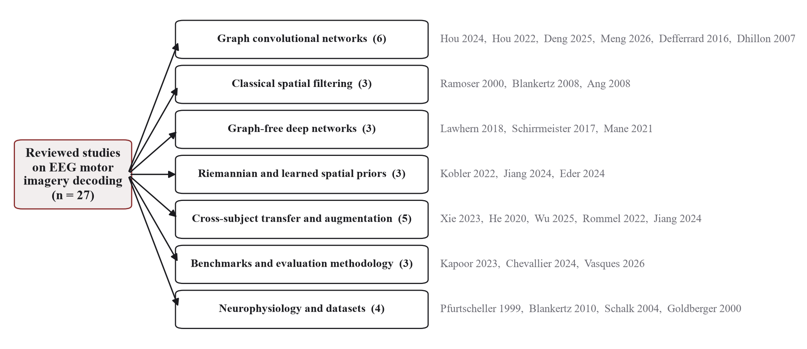
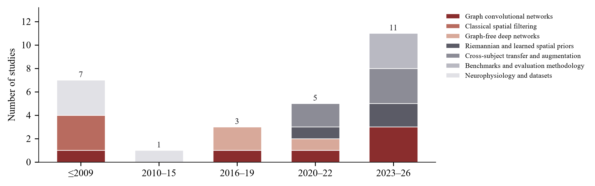

## Abstract

Decoding imagined movement from the electroencephalogram (EEG) is the basis of motor imagery
(MI) brain–computer interfaces. Graph convolutional networks (GCNs), which treat electrodes as
the nodes of a graph, have been proposed as a way to exploit the spatial structure of the
signal, and some report accuracies above 90 % on the widely used PhysioNet EEG Motor
Movement/Imagery dataset. This review examines 27 studies spanning graph convolutional
networks, classical spatial filtering, graph-free deep networks, Riemannian and learned spatial
priors, cross-subject transfer and augmentation, benchmarking practice, and the
neurophysiology that constrains the task. Rather than summarising papers individually, it
compares them along four axes: whether channels are combined before or after band power is
computed, what prior constrains the spatial operator, how the scarcity of per-subject training
data is addressed, and how models are evaluated. Four observations follow. Reported results on
the same dataset differ far more than model design can explain, and the difference coincides
with how samples are defined and how data are split. The strongest classical and shallow deep
methods share one ordering — spatial combination first, then power — which many graph models
invert. No graph study we reviewed isolates the graph's contribution against a graph-free
model trained on identical data splits. And the interventions with the most consistent
support act on data scarcity rather than on architecture. We derive five research gaps from
these observations and show how they motivate GBP-Net, a graph band-power network with
cross-subject pre-training, evaluated under a leakage-free protocol.

**Keywords:** electroencephalography, motor imagery, graph convolutional network,
brain–computer interface, evaluation protocol, data leakage, transfer learning,
common spatial patterns

## 1. Introduction

A brain–computer interface (BCI) translates measured brain activity into commands without
requiring muscular output. Motor imagery — rehearsing a movement mentally without performing
it — is among the most studied BCI paradigms, because imagining a movement of the hand or foot
produces a reproducible change in the rhythmic activity over the corresponding area of motor
cortex. The amplitude of the mu (8–13 Hz) and beta (roughly 13–30 Hz) rhythms falls during
imagery and recovers afterwards, a phenomenon known as event-related desynchronisation and
synchronisation (ERD/ERS) [@pfurtscheller1999]. A decoder must therefore recognise, from noisy
multichannel scalp recordings, *where* on the scalp and *in which frequency band* the power
changed.

For two decades the dominant solution was a linear spatial filter. Common Spatial Patterns
(CSP) learns channel weightings whose output variance differs maximally between two classes
[@ramoser2000], and its regularised and filter-bank variants remain strong baselines
[@blankertz2008; @ang2008]. Deep learning later replaced hand-designed stages with learned ones:
compact convolutional networks such as EEGNet [@lawhern2018] and ShallowConvNet
[@schirrmeister2017] learn temporal and spatial filters jointly, and FBCNet reintroduced an
explicit filter bank into this family [@mane2021].

Graph neural networks offer a different view. If electrodes are nodes and their relationships
are edges, spectral graph convolution [@defferrard2016] can learn filters that respect that
structure. GCNs-Net applied this idea to motor imagery on the PhysioNet dataset, using a
correlation-based electrode graph, Chebyshev graph filters and multilevel graph coarsening
[@dhillon2007], and reported 93.06 % subject-level accuracy on a four-class task [@hou2024].
Subsequent work added temporal modelling [@hou2022], multilevel dynamic graphs [@deng2025] and
self-adaptive graphs designed to mitigate over-smoothing [@meng2026]. A recent survey of 63
GNN-based EEG studies found that Chebyshev spectral convolution is the most common choice in
this literature, frequently adopted without justification, and that transfer learning is
largely unexplored [@klepl2024]. Two adjacent surveys bound the same territory from other
directions: a systematic review of deep learning for motor imagery decoding [@saibene2024],
which covers our task but not the graph formulation specifically, and a review of transfer
learning for EEG-based brain-computer interfaces [@wu2022], which surveys cross-subject
adaptation across BCI paradigms without treating graph models as a class.

Those three surveys organise the literature by *architecture*, by *task* and by *adaptation
method* respectively. None of them examines whether the numbers being compared were obtained
under comparable conditions. This matters because accuracy in machine-learning-based science is sensitive to
how evaluation is performed: a systematic study of 294 papers across 17 fields found data
leakage to be widespread and a frequent cause of inflated, irreproducible results
[@kapoor2023]. Large-scale benchmarks of motor imagery decoding [@chevallier2024;
@vasques2026; @eder2024] offer a calibration point that architecture-focused reviews rarely use.

**Contributions.** This review makes four contributions:

1. It classifies 27 studies along four analytical axes — the ordering of spatial and spectral
   processing, the prior on the spatial operator, the treatment of data scarcity, and the
   evaluation protocol — rather than by application or by module alone.
2. It compares reported results against independent benchmarks on the same dataset and
   identifies evaluation protocol, rather than model capacity, as the dominant source of
   disagreement.
3. It identifies five research gaps grounded in the reviewed evidence.
4. It shows how those gaps motivate the design and evaluation of a proposed model, GBP-Net.

The remainder of the paper is organised as follows. Section 2 describes the review method.
Section 3 summarises the neurophysiological and dataset background that constrains any
decoder. Section 4 classifies and critically analyses the reviewed approaches. Section 5
presents comparative tables and cross-cutting observations. Section 6 states the research gaps,
Section 7 the proposed work, Section 8 the limitations of this review and future directions,
and Section 9 concludes.

## 2. Review Methodology

### 2.1 Scope and research questions

The review is scoped to decoding motor imagery from non-invasive scalp EEG, with particular
attention to the PhysioNet EEG Motor Movement/Imagery Database (EEGMMIDB) [@goldberger2000],
on which the graph-based work that motivates this project is evaluated. It addresses four
questions:

- **RQ1.** How do graph-based decoders differ from classical and graph-free deep decoders in
  the way they combine spatial and spectral information?
- **RQ2.** What evidence exists that an electrode graph, as a prior on the spatial operator,
  improves decoding compared with other priors or none?
- **RQ3.** How does the literature address the small number of training trials available per
  subject?
- **RQ4.** How are models evaluated, and are published results on the same dataset
  comparable?

### 2.2 Identification and selection

Studies were identified in three stages. The starting point was the baseline graph model
[@hou2024] and its predecessor [@hou2022]. Their reference lists were traced backwards to the
methods they build on — spectral graph convolution, graph coarsening, the dataset and its
acquisition system. Forward searches were then run on Google Scholar, IEEE Xplore,
ScienceDirect, IOPscience and arXiv using combinations of the terms *graph convolutional
network*, *graph neural network*, *EEG*, *motor imagery*, *common spatial pattern*,
*Riemannian*, *transfer learning*, *pre-training*, *alignment*, *data augmentation* and
*benchmark*.

A study was included if it (i) proposes or evaluates a method for decoding motor imagery from
scalp EEG, or (ii) supplies a method, dataset, benchmark or neurophysiological result on which
such decoders directly depend. Preference was given to work published between 2020 and 2026,
while foundational studies were retained where later work builds on them. Studies of executed
rather than imagined movement, of invasive recordings, and studies whose full text or abstract
was unavailable were excluded. Twenty-seven studies were retained. Because selection proceeded
iteratively through citation tracing rather than through a single database query, we do not
report screening counts; this is a structured review, not a systematic one in the PRISMA sense.

Two of the retained studies [@deng2025; @meng2026] could be assessed from their abstracts and
metadata only, because the full texts were not accessible to us. They are included because
they are the most recent graph-based work on motor imagery, and conclusions drawn from them are
limited accordingly. Bibliographic details of every study were checked against Crossref or
arXiv records.

### 2.3 Classification scheme

The retained studies fall into seven categories (Fig. 1): graph convolutional networks (6);
classical spatial filtering (3); graph-free deep networks (3); Riemannian and learned spatial
priors (3); cross-subject transfer and augmentation (5); benchmarks and evaluation
methodology (3); and neurophysiology and datasets (4). Sixteen of the 27 were published in 2020
or later (Fig. 2). Within and across these categories, each study is further characterised on
the four axes of RQ1–RQ4.

## 3. Background

### 3.1 What a decoder must detect

Motor imagery is a band-power phenomenon. The mu and beta rhythms over sensorimotor cortex lose
amplitude during imagery, and the change is spatially organised: imagining the left hand
affects the right hemisphere more strongly, and vice versa, while foot imagery is concentrated
near the midline [@pfurtscheller1999]. The change also develops over time — on the order of a
second — so a single time sample carries no information about rhythmic power at all.

Subjects differ markedly in how strongly they modulate these rhythms. Blankertz et al. showed
that a two-minute resting recording with the eyes open predicts later BCI accuracy: their
neurophysiological predictor correlated with feedback performance at r = 0.53 across 80
BCI-naive participants, and roughly one potential user in five does not reach a usable level of
control [@blankertz2010]. A substantial part of the variation in decoding accuracy is therefore
fixed by the participant before any model is chosen, which bounds what architectural changes
can achieve.

### 3.2 The PhysioNet EEGMMIDB dataset

EEGMMIDB contains recordings from 109 subjects on 64 electrodes at 160 Hz, acquired with the
BCI2000 system [@goldberger2000; @schalk2004]. Each subject performs several runs of executed
and imagined movement. Two features of its design matter for evaluation. First, each subject
provides only around 45 trials per imagery task, so a subject-dependent model is trained on
very little data. Second, the classes are not interleaved within runs: imagined left and right
fist occur only in runs 4, 8 and 12, while imagined both fists and both feet occur only in runs
6, 10 and 14. Any difference between these two groups of runs that is unrelated to the imagery
itself — electrode impedance drifting over the session, fatigue, changing attention — separates
two pairs of classes without any motor imagery being decoded. A four-class accuracy on this
dataset therefore mixes genuine decoding with run identification, and the two can only be
separated by also reporting accuracy *within* each pair of runs.

## 4. Classification and Critical Analysis

### 4.1 Classical spatial filtering

CSP band-pass filters the signal, then learns a small set of spatial filters that maximise the
ratio of output variance between two classes; the log-variance of the filtered signals forms
the feature vector [@ramoser2000]. The ordering of operations is worth stating precisely,
because it recurs throughout this review: channels are combined *linearly, while still signed*,
and only then is power computed. A spatial filter can therefore subtract one electrode from
another, cancelling activity common to both — such as a widespread artefact or a rhythm that
does not differ between classes — before variance is taken. That cancellation is only possible
while the signal retains its sign and phase.

CSP's weaknesses are equally well documented. It is defined for two classes, and its
covariance estimates become unreliable when there are few trials relative to channels, which
is why regularisation is treated as necessary rather than optional [@blankertz2008]. It also
depends on choosing the right frequency band. Filter Bank CSP addressed this by running CSP in
several sub-bands and selecting the most informative features, improving on single-band CSP
[@ang2008]. Despite its age, the family remains competitive:
independent benchmarks place CSP among the strongest within-session methods on EEGMMIDB
[@vasques2026].

### 4.2 Graph-free deep networks

ShallowConvNet was explicitly designed to mirror FBCSP inside a network: a temporal
convolution plays the role of the band-pass filter, a spatial convolution across all
electrodes plays the role of CSP, and squaring, averaging over time and taking the logarithm
compute log band power [@schirrmeister2017]. EEGNet follows the same broad sequence with far
fewer parameters, using depthwise spatial convolution after a temporal stage [@lawhern2018].
FBCNet restores the two FBCSP ingredients the earlier networks lacked — a multi-band input and
an explicit variance-based aggregation over time [@mane2021].

Compared side by side, these three networks share the ordering of Section 4.1: spatial
combination happens on filtered voltage, before any power or nonlinear aggregation. They
differ mainly in capacity and in how explicitly they encode the filter bank. All three were
designed around analysis windows of two to four seconds, consistent with the timescale of
ERD/ERS [@pfurtscheller1999].

How much do these networks gain over the classical methods they imitate? Within-session, the
answer from benchmarks is: not reliably. The MOABB benchmark found convolutional networks and
Riemannian methods statistically indistinguishable in this setting [@chevallier2024], and a
direct comparison reached the same conclusion [@eder2024]. The deep networks' advantage, where
it exists, tends to appear with more data or across sessions and subjects rather than within a
single session.

### 4.3 Graph convolutional networks

Spectral graph convolution defines filtering in the eigenbasis of the graph Laplacian and
approximates it with Chebyshev polynomials, so that each filter is localised to a fixed number
of hops on the graph [@defferrard2016]. Graph coarsening by Graclus clustering allows pooling
[@dhillon2007]. GCNs-Net combined these components for motor imagery: electrodes are nodes, the
adjacency is the absolute Pearson correlation between channels, and six Chebyshev graph
convolution layers with pooling produce a four-class decision [@hou2024].

Two properties of this design deserve scrutiny. The first is the definition of a sample. The
model is described as decoding *time-resolved* EEG, and in its publicly released
implementation each sample is the vector of 64 voltages at a single time point [@eegdl]. At
160 Hz, one sample spans 6.25 ms and contains no information about rhythmic power, which is
what motor imagery modulates (Section 3.1). The second is the data split. In the same
implementation, samples are divided into training and test sets by random permutation over
time points, and the correlation graph is computed from all available data [@eegdl]. A random
split over time points places adjacent, nearly identical samples from the same trial on both
sides of the split — a textbook instance of the leakage patterns catalogued by Kapoor and
Narayanan [@kapoor2023]. A reported accuracy obtained this way measures the ability to
recognise a trial already seen in training, not the ability to decode an unseen one.

The attention-based BiLSTM graph network from the same authors adds temporal modelling on top
of the graph backbone [@hou2022], and more recent work moves toward graphs that are learned
rather than fixed. MHD-GCN combines spatiotemporal attention with hierarchical global and
local graph topologies and multi-level wavelet blocks [@deng2025]; SAMGCN learns inter-channel
relationships through position encoding and self-attention, and is explicitly motivated by the
over-smoothing that deep graph convolution induces [@meng2026]. From their abstracts, both
evaluate on BCI competition data and, in MHD-GCN's case, on EEGMMIDB; we could not verify
their evaluation protocols from the material available to us.

Across this category, three critical observations emerge. **First**, improvements are reported
relative to other published figures rather than against a graph-free model trained and tested
on identical splits, so it is not possible to tell how much of any gain is due to the graph and
how much to the rest of the pipeline. **Second**, a common design in the wider GNN–EEG
literature supplies per-electrode spectral features — power spectral density or differential
entropy — as node features [@klepl2024]. That inverts the ordering of Section 4.1: power is
computed at each electrode *before* channels are combined, discarding the sign and phase
relations that allow spatial cancellation (Fig. 3). **Third**, stacking many graph convolution
layers over a dense correlation graph invites over-smoothing, in which node representations
converge; SAMGCN's motivation is direct evidence that the lineage has encountered this
[@meng2026].

### 4.4 Riemannian geometry and learned spatial priors

Riemannian methods represent each trial by its spatial covariance matrix, which lives on the
manifold of symmetric positive-definite matrices, and project these matrices onto a tangent
space where linear classifiers apply. Covariance retains the full second-order relationship
between every pair of channels, including their sign, so this family is compatible with the
reasoning of Section 4.1. On EEGMMIDB the best single pipeline in a benchmark of 216,714
configurations was tangent-space projection with a linear support vector machine, reaching
0.650 on binary left-versus-right imagery within-session; at the level of method families,
tangent space and CSP were nearly tied at the top [@vasques2026].

Two recent studies test what happens when such knowledge is used as a *prior* inside a
network. TSMNet combines a ShallowConvNet-style stem with covariance pooling on the
positive-definite manifold and domain-specific batch normalisation; in inter-session and
inter-subject transfer across five datasets and 158 subjects, its ablation attributes 3–4.5 %
to the manifold and 2.4–3.9 % to domain-specific normalisation [@kobler2022]. CSP-Net
initialises a network's spatial layer with CSP filters computed from the training data. On a
ShallowConvNet backbone it improved average within-subject accuracy by about six percentage
points across four datasets, and a randomly initialised variant of the same layer gave little
benefit — indicating that the *prior*, not the extra capacity, produced the gain [@jiang2024].

Read together with Section 4.3, these results sharpen the question about graphs. There is
direct evidence that *some* priors on the spatial operator help — CSP-derived weights, and
covariance structure. The electrode graph is also a prior on the spatial operator. Yet no
reviewed study compares a graph prior against these alternatives, or against no prior, under
otherwise identical conditions.

### 4.5 Cross-subject transfer, alignment and augmentation

A subject-dependent model on EEGMMIDB is trained on a few dozen trials per task. Benchmarking
indicates that deep pipelines are more sensitive than classical ones to the number of
available trials [@chevallier2024], so data scarcity is a plausible limit on any deep decoder
evaluated this way. Three families of methods address it.

*Pre-training across subjects or datasets.* Xie et al. pre-trained on other datasets with a
multi-task objective and then fine-tuned on the target, reporting higher accuracy and reduced
between-subject variance [@xie2023]. At a much larger scale, LaBraM learns general-purpose EEG
representations from roughly 2,500 hours of recordings drawn from about twenty datasets
[@jiang2024b]. Whether scale of that order is needed for motor imagery, as opposed to
pre-training on other subjects of the same dataset, remains an open question.

*Alignment.* Euclidean Alignment whitens each subject's trials by the inverse square root of
that subject's mean covariance, so that all subjects share an identity reference; it needs no
labels from the target and costs almost nothing [@he2020]. A later review consolidates its use
across 13 BCI paradigms and clarifies how it should be applied [@wu2025].

*Augmentation.* A systematic comparison of 13 augmentations found that Fourier-transform
surrogates — randomising the phase of each frequency component — gave the largest gains for
motor imagery, up to 45 % relative improvement when training data were scarce [@rommel2022].
Two of its details bear directly on this review. For BCI data, the phase perturbation had to be
applied identically across channels to preserve cross-channel relationships; perturbing each
channel independently degraded results. And augmentations that swap channels, such as
shuffling or mirroring the hemispheres, *harmed* performance on lateralised tasks such as
left-versus-right imagery. Both findings are independent evidence that the signed relationship
between channels carries the information (Section 4.1).

The critical observation for this category is that these techniques are, in principle,
independent of architecture — yet studies rarely separate their effect from the changes that
accompany them, such as a different normalisation or input representation. A control that
applies the identical pipeline with the transfer step removed is uncommon.

### 4.6 Benchmarks, evaluation methodology and bounds

Three reviewed studies concern evaluation itself. Kapoor and Narayanan provide a taxonomy of
leakage — including overlap between training and test samples and preprocessing fitted on all
data — and document its prevalence across fields [@kapoor2023]. MOABB standardises
within-session, cross-session and cross-subject evaluation across many datasets
[@chevallier2024]. Vasques et al. evaluated 216,714 pipeline configurations and showed that on
EEGMMIDB no single pipeline is best for most subjects: 93 distinct configurations were optimal
across 109 subjects, and selecting from a small portfolio of pipelines per subject recovered
about eight accuracy points over any single one [@vasques2026].

These benchmarks establish a calibration point, but they compare pipelines under one fixed
protocol; they do not audit individual published results obtained under different protocols.
That audit is where the next section begins.

## 5. Comparative Analysis

Table 1 characterises the principal methods reviewed. Table 2 compares the method families,
and Table 3 compares how evaluation was performed.

**Table 1.** Characteristics of the principal methods reviewed.

| Method | Category | Spatial model | Where power is taken | Temporal extent of a sample | Key reported outcome |
|---|---|---|---|---|---|
| CSP [@ramoser2000] | Classical | Learned linear filters | After spatial filtering | Trial segment | Standard two-class baseline |
| FBCSP [@ang2008] | Classical | CSP per sub-band | After spatial filtering | Trial segment | Improves on single-band CSP |
| EEGNet [@lawhern2018] | Graph-free CNN | Depthwise spatial convolution | Implicit, after spatial stage | 2–4 s window | Compact; generalises across four paradigms |
| ShallowConvNet [@schirrmeister2017] | Graph-free CNN | Spatial convolution | After spatial stage (square · mean · log) | 2–4 s window | Matches or exceeds FBCSP |
| FBCNet [@mane2021] | Graph-free CNN | Spatial convolution per band | Variance layer after spatial stage | Trial window | Restores FBCSP's multi-band input and variance aggregation |
| GCNs-Net [@hou2024] | GCN | Chebyshev graph filters on correlation graph | Not computed — single time point | 6.25 ms (one sample) | 93.06 % four-class (reported) |
| BiLSTM-GCN [@hou2022] | GCN | Graph convolution + attention BiLSTM | Temporal model over graph features | Sequence of samples | Adds temporal modelling to [@hou2024] |
| MHD-GCN [@deng2025] | GCN | Multi-level dynamic graphs | Not verifiable (abstract only) | Not verifiable | Multi-level inter-channel structure |
| SAMGCN [@meng2026] | GCN | Self-attention adaptive graph | Not verifiable (abstract only) | Not verifiable | Targets over-smoothing |
| Tangent space [@vasques2026] | Riemannian | Covariance on SPD manifold | Second-order, all channel pairs | Trial segment | Best single pipeline, 0.650 binary |
| TSMNet [@kobler2022] | Learned prior | CNN stem + SPD covariance pooling | After spatial stage | ≤ 3 s segment | +3–4.5 % (manifold), +2.4–3.9 % (DSBN), in transfer |
| CSP-Net [@jiang2024] | Learned prior | CSP-initialised spatial layer | After spatial stage | Trial window | ≈ +6 points over ShallowConvNet backbone |

**Table 2.** Comparison of method families.

| Family | Studies | Advantages | Limitations |
|---|---|---|---|
| Classical spatial filtering | 3 | Interpretable; effective with few trials; spatial-then-power by construction | Two-class; unreliable covariance without regularisation; band choice is manual |
| Graph-free deep networks | 3 | Learn bands and spatial filters jointly; compact; spatial-then-power | Designed for 2–4 s windows; no advantage over Riemannian methods within-session |
| Graph convolutional networks | 6 | Explicit inter-electrode structure; adaptive graphs possible | Graph's contribution never isolated; often power-then-spatial; over-smoothing at depth |
| Riemannian and learned priors | 3 | Among the strongest within-session; priors demonstrably help CNNs | High-dimensional features need strong regularisation; gains shown in transfer settings |
| Transfer and augmentation | 5 | Target data scarcity directly; largely architecture-independent | Effect rarely separated from accompanying changes by a matched control |
| Benchmarks and evaluation | 3 | Calibrate what is achievable; document leakage | Compare pipelines under one protocol; do not audit published results |

**Table 3.** Evaluation practice in the reviewed decoding studies.

| Study | Sample unit | How data are split | Statistics fitted on | Reported task | Comparable to benchmark? |
|---|---|---|---|---|---|
| GCNs-Net [@hou2024] | Single time point | Random over time points (public implementation) | All data, incl. test (public implementation) | Four-class | No — sample unit and split differ |
| MHD-GCN, SAMGCN [@deng2025; @meng2026] | Not verifiable | Not verifiable | Not verifiable | Four-class / binary | Cannot be assessed |
| EEGNet [@lawhern2018] | Trial window | Within- and cross-subject | Training data | Multiple paradigms | In principle |
| ShallowConvNet [@schirrmeister2017] | Trial window | Session-based train/test | Training data | Four-class, BCI IV-2a | In principle |
| CSP-Net [@jiang2024] | Trial window | Within- and cross-subject | Training data | Two- and multi-class | In principle |
| TSMNet [@kobler2022] | ≤ 3 s segment | Leave sessions/subjects out | Source domains | Various | Transfer setting |
| MOABB, Vasques et al. [@chevallier2024; @vasques2026] | Trial | Within-session CV (plus cross-session/subject in MOABB) | Training folds | Binary left vs right on EEGMMIDB | Reference point |

### 5.1 Cross-cutting observations

**Reported results on the same dataset are not comparable.** On EEGMMIDB, a four-class
accuracy of 93.06 % has been reported for a graph model [@hou2024], while the best of 216,714
benchmarked configurations reaches 0.650 on the *easier*, binary left-versus-right task
[@vasques2026]. A four-class problem has a chance level of 25 % against 50 % for a binary one,
so a four-class result exceeding the best binary result by almost thirty points cannot be
explained by a better model. It coincides instead with the differences in Table 3: a
single-time-point sample, a random split over time points, and a graph computed from all data.
This is the most consequential observation of the review, because it means architectural
comparisons built on these figures compare protocols rather than architectures.

**The strongest methods combine channels before computing power.** CSP, FBCSP, ShallowConvNet
and FBCNet all combine signed signals across channels and take power afterwards; tangent-space
methods retain the signed covariance between every channel pair. The augmentation evidence
that phase must be perturbed consistently across channels, and that channel-swapping
augmentations harm lateralised tasks [@rommel2022], points the same way. Graph models that
feed per-electrode power into the graph reverse this ordering (Fig. 3).

**Evidence for the graph as a prior is indirect.** Priors on the spatial operator demonstrably
help — CSP-derived weights by about six points [@jiang2024], covariance structure in transfer
settings [@kobler2022]. But the electrode graph has never been compared against them, or
against an unconstrained operator, with everything else held fixed. The claim that the graph
helps therefore rests on comparisons across studies whose protocols differ.

**Data, more than architecture, is the documented bottleneck.** Deep pipelines are sensitive
to trial counts [@chevallier2024]; within-session, deep and Riemannian methods are
indistinguishable [@chevallier2024; @eder2024]; and roughly a quarter of between-subject
variation in BCI performance is predictable before modelling [@blankertz2010]. The
interventions with the most consistent support — pre-training [@xie2023], alignment
[@he2020; @wu2025] and augmentation [@rommel2022] — all act on the quantity or consistency of
data rather than on the network.

**The temporal extent of a sample is rarely justified.** ERD/ERS unfolds over roughly a second
[@pfurtscheller1999], and the graph-free networks were designed for windows of two to four
seconds [@lawhern2018; @schirrmeister2017]. The baseline graph model uses a single time point.
Few studies report how sensitive their results are to window length.

## 6. Research Gaps

The observations above yield five gaps. Table 4 links each to its supporting evidence and to
the part of the proposed work that addresses it.

**G1 — Results on EEGMMIDB are reported under incomparable protocols.** Published graph-model
accuracies sit far outside the range established by independent benchmarks, and the difference
coincides with sample definition, split and where preprocessing statistics are fitted. No
reviewed study re-evaluates a published graph model under a leakage-free protocol.

**G2 — The dataset's class–run structure is not controlled for.** Because two pairs of classes
occur in disjoint sets of runs, four-class accuracy mixes decoding with run identification.
None of the reviewed decoding studies reports accuracy within each pair of runs, which would
separate the two.

**G3 — Graph models often compute power before combining channels.** The ordering shared by
the strongest classical and shallow deep methods is inverted in graph designs that use
per-electrode spectral node features, and the consequence has not been measured.

**G4 — The graph's contribution has not been isolated.** No study compares a graph-constrained
spatial operator against an unconstrained one, a differently derived prior, or a graph-free
network on identical folds with all else fixed.

**G5 — Data scarcity is under-addressed in graph models for motor imagery.** Transfer learning
is largely absent from graph-based EEG work [@klepl2024], and interventions shown to help
elsewhere — pre-training, alignment, CSP-derived priors, domain-specific normalisation,
augmentation — have not been tested on EEGMMIDB under a corrected protocol, nor separated from
their accompanying changes by matched controls.

**Table 4.** Research gaps, supporting evidence, and how the proposed work addresses them.

| Gap | Supporting evidence | Addressed in the proposed work by |
|---|---|---|
| G1 Incomparable protocols | [@hou2024; @eegdl; @vasques2026; @kapoor2023] | Trial-level splits; graph and normalisation fitted on training folds only; the published protocol reproduced alongside the corrected one |
| G2 Class–run confound | [@goldberger2000; @schalk2004] | Accuracy reported within each pair of runs, not only four-class |
| G3 Power before spatial combination | [@ramoser2000; @schirrmeister2017; @mane2021; @klepl2024; @rommel2022] | GBP-Net computes log band power after the graph convolution |
| G4 Graph contribution not isolated | [@hou2024; @hou2022; @jiang2024; @kobler2022] | Graph-constrained, unconstrained and graph-free variants compared on identical folds |
| G5 Data scarcity | [@klepl2024; @xie2023; @he2020; @chevallier2024] | Cross-subject pre-training with a matched no-pre-training control |

## 7. Proposed Work: GBP-Net

The gaps above motivate GBP-Net, a graph band-power network with cross-subject pre-training
(Fig. 4). Its design choices follow from the gaps rather than from architectural novelty for
its own sake.

**Architecture (G3).** Each input is a multichannel window of EEG. A learned bank of temporal
filters is applied to every electrode, playing the role of the band-pass stage. A graph
convolution then combines electrodes while the signal is still signed — retaining the
Chebyshev graph filter of the baseline [@defferrard2016; @hou2024] so that the graph can be
*tested* rather than assumed. Only after this spatial stage is band power computed, by
squaring, averaging over time and taking the logarithm, before a linear classifier. A single
spatial layer and no node pooling avoid the over-smoothing identified in Section 4.3. The
resulting ordering is the one shared by CSP, ShallowConvNet and FBCNet (Fig. 3b).

**Cross-subject pre-training (G5).** Before a model is fitted to a target subject, it is
pre-trained on other subjects of the dataset. Subjects are partitioned into groups, and each
group's source model is trained with that entire group excluded, so that no subject is ever
part of its own pre-training data. The pre-trained weights are then fine-tuned on the target
subject's own training folds only.

**Evaluation design (G1, G2, G4).** Data are split at the level of whole trials, never time
points, and the correlation graph and all normalisation statistics are fitted on the training
folds alone. Accuracy is reported within each pair of runs as well as over four classes, which
separates decoding from run identification. The published protocol is reproduced alongside
the corrected one, so that the difference between them can be measured directly. Each
component is evaluated against a control that differs from it in that component alone: a
graph-constrained against an unconstrained spatial operator and a graph-free network on
identical folds, and pre-training against an identical pipeline with pre-training skipped.
Comparisons are paired by subject, with predictions and decision rules fixed before each
experiment is run. The experimental results of this evaluation are reported separately in the
project report.

## 8. Limitations and Future Scope

### 8.1 Limitations of this review

This is a structured rather than a systematic review. Its 27 studies were selected through
citation tracing and targeted searches, so it is not exhaustive, and it does not report PRISMA
screening counts. Two recent graph-based studies [@deng2025; @meng2026] could be assessed only
from their abstracts, and statements about their protocols are correspondingly limited. The
evaluation-protocol analysis relies on the public implementation of the baseline model
[@eegdl], which may differ from unpublished variants the original authors used. Finally, the
review concentrates on EEGMMIDB; conclusions about comparability are specific to that dataset,
although the reasoning behind them is general.

### 8.2 Future scope

- **Controlled comparisons of graph layers and priors.** The survey by Klepl et al. calls for a
  systematic comparison of graph convolution types [@klepl2024]; that comparison should be run
  under a leakage-free protocol and should include CSP-derived and covariance-based priors
  [@jiang2024; @kobler2022] alongside the electrode graph.
- **Reporting standards.** Studies on EEGMMIDB should state the sample unit, the unit at which
  data are split, the data from which graphs and normalisation are fitted, and accuracy within
  each pair of runs.
- **Composing data-side interventions.** Pre-training, alignment and augmentation
  [@xie2023; @he2020; @rommel2022] are rarely combined or compared; whether their effects add up
  is untested.
- **Window length and spectral resolution.** Given the timescale of ERD/ERS, the effect of the
  analysis window on each family of methods deserves direct measurement, particularly as short
  windows limit the frequency resolution that filter banks and spectral augmentation rely on.
- **External validation.** Findings obtained on EEGMMIDB should be tested on other motor
  imagery datasets with different electrode counts and session structures.
- **Participant-aware decoding.** Since no single pipeline is best for most subjects and part
  of the variance is predictable from resting activity [@vasques2026; @blankertz2010],
  selecting or adapting decoders per participant is a promising direction.

## 9. Conclusion

This review examined 27 studies on decoding motor imagery from EEG, with a focus on graph
convolutional networks and on the dataset where they have reported their strongest results.
Organising the literature by how it processes signals and how it evaluates models, rather than
by module alone, leads to conclusions that an architecture-centred review would miss. Reported
accuracies on EEGMMIDB differ by more than any architectural choice could explain, and the
difference coincides with protocol. The most successful methods share one ordering — combine
channels, then compute power — which several graph designs reverse. Evidence that the
electrode graph itself improves decoding is indirect, because its contribution has never been
isolated. And the interventions with the most consistent support act on data scarcity rather
than on network design. These findings define five research gaps and motivate GBP-Net, a graph
band-power network that restores the spatial-then-power ordering, adds cross-subject
pre-training, and is evaluated under a protocol designed so that each of its components can be
credited or ruled out.

## References

<!-- generated by scripts/build_review_pdf.py from the citation keys above -->
