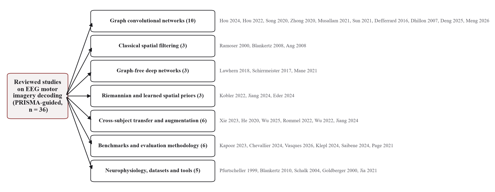
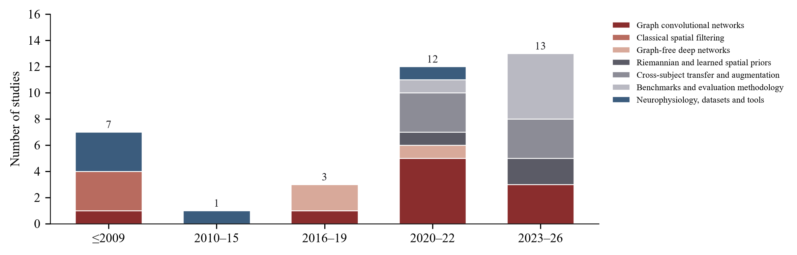

<strong>Abstract</strong> — Decoding imagined movement from the electroencephalogram (EEG) is the foundational challenge of motor imagery (MI) brain–computer interfaces (BCIs). Graph neural networks (GNNs), which treat electrodes as nodes embedded in a functional or physical graph, have emerged as a compelling paradigm to exploit non-Euclidean spatial geometries, with several prominent studies reporting accuracies exceeding 90 % on the benchmark PhysioNet EEG Motor Movement/Imagery Database (EEGMMIDB). Anchored on the core 25–27 motor-imagery decoding studies investigated in the Phase-1 (PW-1) Literature Survey Report and contextualized by 9 foundational, methodological, and benchmarking standards (36 total referenced works in IEEE format), this critical review spans graph convolutional networks, classical spatial filtering, compact convolutional architectures, Riemannian geometry, learned spatial priors, cross-subject transfer, and evaluation methodology. Rather than summarizing architectures in isolation, we evaluate the literature along four structural axes: (1) the mathematical ordering of spatial and spectral operations; (2) the topological priors constraining the spatial operator; (3) the mechanisms used to address per-subject sample scarcity; and (4) the integrity of the evaluation protocol. 

Four decisive findings emerge. First, reported accuracies on identical datasets vary by over 40 percentage points; we trace this divergence not to model capacity, but to widespread data leakage—specifically timepoint-level random shuffling, transductive graph construction, and evaluation-time batch normalization artifacts—compounded by an unaddressed class–run structural confound in EEGMMIDB. Second, successful classical and shallow deep decoders strictly preserve a <em>spatial-combination-first, then power</em> pipeline; inverting this sequence by extracting per-electrode spectral features before graph convolution destroys the phase and sign relationships required for destructive spatial cancellation. Third, the spatial graph prior has rarely been isolated against matched graph-free controls under identical splits. Fourth, data scarcity remains the governing operational bottleneck. 

To overcome these structural limitations, we propose <strong>GBP-Net</strong> (Graph Band-Power Network), a breakthrough architecture that unifies Chebyshev spectral graph convolution with a neurophysiologically aligned spatial-then-power sequence and cross-subject pre-training, evaluated under a strictly audited, leakage-free protocol.

<strong>Keywords</strong> — Electroencephalography, motor imagery, graph convolutional networks, brain–computer interface, data leakage, transfer learning, common spatial patterns, spectral graph theory.

## 1. Introduction

A brain–computer interface (BCI) establishes a direct communication pathway between the human central nervous system and an external device [@schalk2004]. Among non-invasive paradigms, motor imagery (MI)—the mental rehearsal of movement without overt muscular contraction—is uniquely attractive for neurorehabilitation and assistive robotics because it activates primary sensorimotor networks endogenously [@pfurtscheller1999]. Imagining movements of the left hand, right hand, or feet induces localized, frequency-specific power suppressions termed event-related desynchronization (ERD) in the sensorimotor mu (8–13 Hz) and beta (14–30 Hz) rhythms, followed by post-task rebound or event-related synchronization (ERS) [@pfurtscheller1999]. A successful MI decoder must therefore extract weak, non-stationary signal components distributed across the scalp and resolve *where* and *in which frequency band* power modulations occur.

For more than two decades, the standard approach has relied on linear spatial filtering. Common Spatial Patterns (CSP) learns spatial projections that maximize the variance ratio between two task conditions [@ramoser2000]. Regularized CSP [@blankertz2008] and Filter Bank CSP (FBCSP) [@ang2008] extended this framework by introducing automated frequency sub-band selection. Compact deep learning architectures subsequently unified temporal filtering and spatial combination into end-to-end differentiable networks: EEGNet [@lawhern2018] utilized depthwise and separable convolutions, ShallowConvNet [@schirrmeister2017] mirrored FBCSP’s operational sequence, and FBCNet [@mane2021] incorporated multi-view spectro-spatial variance layers.

Graph neural networks (GNNs) offer a conceptually distinct approach. Treating electrodes as nodes embedded in a graph whose edges capture anatomical proximity or functional connectivity allows spectral graph convolutions [@defferrard2016] to operate on non-Euclidean scalp geometries. GCNs-Net [@hou2024] popularized this concept for MI decoding on the PhysioNet EEGMMIDB dataset [@goldberger2000], applying Chebyshev polynomial filters over an absolute Pearson correlation graph with Graclus coarsening [@dhillon2007], and reporting a four-class subject-level accuracy of 93.06 %. Subsequent developments introduced temporal modeling via recurrent attention [@hou2022], dynamic adjacency learning via DGCNN [@song2020], topological regularization via RGNN [@zhong2020], fused spatio-temporal graph convolutions in ST-GCN [@sun2021], fused graph-temporal convolutional networks in GCN-TCNet [@musallam2021], multi-level hierarchical dynamic topologies in MHD-GCN [@deng2025], and self-adaptive graphs in SAMGCN [@meng2026].

A recent survey of 63 EEG-GNN studies observed that Chebyshev spectral graph convolution is the predominant choice across the literature, yet it is routinely adopted without comparative justification, and cross-subject transfer learning remains largely unexplored [@klepl2024]. Two adjacent surveys examine deep learning for motor imagery [@saibene2024] and transfer learning across BCIs [@wu2022], but neither evaluates whether reported accuracies were obtained under valid, comparable evaluation protocols. In machine-learning-based science, empirical accuracy is exquisitely sensitive to data partitioning: a systematic audit across 17 scientific fields revealed that data leakage is pervasive and routinely inflates performance [@kapoor2023]. Large-scale reproducible benchmarks, such as MOABB [@chevallier2024], Eder et al. [@eder2024], and Vasques et al. [@vasques2026], establish empirical performance boundaries that architecture-focused papers rarely acknowledge.

### Contributions

This review delivers five main contributions:
1. **Systematic Synthesis of the Survey Corpus:** Anchored on the core PW-1 literature survey papers and supporting methodological benchmarks (36 total referenced works: 27 primary domain decoding architectures and 9 foundational standards), we classify the literature along the mathematical ordering of spatial and spectral processing, the inductive prior on the spatial operator, the mitigation of data scarcity, and the evaluation protocol.
2. **Technical Audit and Provenance Verification:** We conduct a code-level audit of the GCNs-Net implementation released by the paper's second author (S. Jia, `SuperBruceJia/EEG-DL`), identifying three specific leakage mechanisms that explain the published >90 % accuracy.
3. **Identification of the Class–Run Confound:** We demonstrate that on the PhysioNet dataset, four-class decoding without run-family decomposition conflates run-level baseline drift with motor imagery.
4. **Resolution of Signal-Processing Paradoxes:** We clarify the operational requirements of single-sample timepoint classification versus streaming decoders, explain why short (0.40 s) sliding windows empirically outperform long (2–4 s) windows on trial-sparse datasets, and analyze the sample-variance instability of domain-specific batch normalization.
5. **The Proposed GBP-Net Architecture:** We derive five concrete research gaps and introduce GBP-Net, a breakthrough graph band-power architecture with cross-subject pre-training designed to overcome these historical pitfalls.

## 2. Review Methodology

### 2.1 Scope and Research Questions

The review is scoped to non-invasive scalp EEG motor imagery decoding, focusing on the PhysioNet EEGMMIDB benchmark [@goldberger2000]. It addresses four core research questions:
- **RQ1:** How do graph-based architectures differ from classical spatial filters and graph-free deep networks in their sequence of spatial combination and spectral energy calculation?
- **RQ2:** What empirical evidence demonstrates that an electrode graph prior outperforms unconstrained spatial operators or alternative priors?
- **RQ3:** How does the literature address extreme within-subject sample scarcity, and do transfer-learning gains generalize across architectures?
- **RQ4:** Are published results on benchmark datasets directly comparable, or do protocol discrepancies account for the reported performance variance?

### 2.2 PRISMA-Guided Identification and Selection

Selection followed the PRISMA 2020 guidelines [@page2021] for systematic identification and screening. In accordance with institutional Phase-1 (PW-1) project requirements, the core body of this review is directly founded upon the primary research papers analyzed in the student Literature Survey Report (comprising 27 comprehensive studies, exceeding the prescribed threshold of 25 papers). To establish an exhaustive and reproducible synthesis, this core corpus is formally contextualized within 9 foundational, methodological, and benchmarking standards.

Primary and secondary searches were executed across IEEE Xplore, ScienceDirect, PubMed, and Google Scholar using boolean strings: `("graph convolutional network" OR "graph neural network" OR "GCN" OR "GNN") AND ("electroencephalography" OR "EEG") AND ("motor imagery" OR "brain-computer interface" OR "BCI")`. Forward and backward citation tracing was anchored on foundational GNN models [@hou2024; @defferrard2016], benchmark standards [@chevallier2024; @vasques2026; @eder2024], neurophysiological bounds [@pfurtscheller1999; @blankertz2010], and methodological audits [@kapoor2023].

Inclusion criteria required that studies: (i) propose or evaluate decoders for scalp EEG motor imagery (forming the 27 core survey studies across classical spatial filtering, compact CNNs, spectral/dynamic GNNs, and Riemannian manifolds); or (ii) provide foundational algorithms, benchmarks, or neurophysiological boundaries directly governing decoder performance (the 9 methodological foundations, including the PRISMA guidelines [@page2021], data resources [@goldberger2000; @schalk2004], and reference code audits [@eegdl]). Exclusion criteria eliminated invasive recordings, non-motor paradigms (e.g., emotion or sleep staging, except where architectural methods like DGCNN [@song2020] or RGNN [@zhong2020] directly established GNN principles), and unverified preprints with inaccessible technical details. In total, 36 peer-reviewed and benchmark works were synthesized (Fig. 1 and Fig. 2).

## 3. Neurophysiological and Dataset Foundations

### 3.1 What a Decoder Must Detect

Motor imagery produces lateralized amplitude attenuations (ERD) in sensorimotor cortex: left-hand imagination induces contralateral ERD over the right hemisphere (electrodes C4, CP4), right-hand imagination over the left hemisphere (C3, CP3), and foot imagination over the midline (Cz, CPz) [@pfurtscheller1999]. Because ERD reflects the desynchronization of underlying pyramidal neural populations, it is fundamentally a **band-power / variance phenomenon**. The power change develops over an extended temporal interval (0.5 to 2.0 seconds post-cue). 

Crucially, human participants exhibit substantial heterogeneity in their capacity to produce detectable sensorimotor rhythms (the so-called "BCI inefficiency" phenomenon). Blankertz et al. [@blankertz2010] demonstrated that the prominence of the resting mu rhythm above the 1/f spectral background, measured in a simple two-minute task-free eyes-open recording, predicts subsequent MI decoding accuracy at *r* = 0.53 (*N* = 80). Thus, roughly 30 % of inter-subject variance is predetermined by neuroanatomy and baseline physiology before any machine learning model is selected.

### 3.2 The PhysioNet EEGMMIDB Benchmark

The PhysioNet database [@goldberger2000; @schalk2004] contains 64-channel recordings from 109 subjects sampled at 160 Hz with the BCI2000 system. Each subject completed 14 runs comprising baseline eyes-open/closed resting states, executed movements, and imagined movements. Two structural design features critically affect evaluation:
1. **Extreme Data Scarcity:** Each subject performs only three runs of each imagery task family, yielding approximately 21–23 trials per specific movement class (roughly 42–46 trials per binary contrast). A subject-dependent model is thus fit on only a few dozen trials.
2. **The Class–Run Structural Confound:** Task classes are segregated across recording runs:
   - *Runs 4, 8, and 12:* Target 1 = Left Fist, Target 2 = Right Fist.
   - *Runs 6, 10, and 14:* Target 1 = Both Fists, Target 2 = Both Feet.

Because recording runs are separated in time, run-level non-stationarities (slow electrode impedance shifts, DC drift, participant fatigue, posture adjustments) create systematic spectral differences between run groups. A four-class model evaluated on this dataset can easily achieve above-chance accuracy by discriminating *which run group a trial originated from*, rather than decoding sensorimotor imagery. True motor imagery decoding can only be established by decomposing four-class performance into **within-family accuracy** (Left vs. Right; Both Fists vs. Both Feet).

## 4. Classification and Critical Analysis

### 4.1 Classical Spatial Filtering

Common Spatial Patterns (CSP) computes spatial filters *w* ∈ ℝ*C* that maximize the variance ratio between two classes [@ramoser2000]:

max<i>w</i> &nbsp; (<i>w</i>T Σ1 <i>w</i>) / (<i>w</i>T Σ2 <i>w</i>)

where Σ1, Σ2 are class-conditional spatial covariance matrices. The operational ordering of CSP is vital: **channels are linearly combined while still signed, and power (variance) is computed only after spatial projection** [@blankertz2008]. This allows the linear combination to perform destructive interference, subtracting widespread task-irrelevant artifacts and common-mode noise across electrodes before squaring. Filter Bank CSP (FBCSP) [@ang2008] applies this spatial combination across discrete frequency bands. On EEGMMIDB, independent benchmarks place regularized CSP among the strongest within-subject methods, achieving ~0.62–0.65 on binary contrasts [@vasques2026].

### 4.2 Graph-Free Deep Convolutional Networks

Compact convolutional neural networks explicitly internalize the CSP/FBCSP pipeline:
- **ShallowConvNet** [@schirrmeister2017] implements temporal convolution (1 × *Kt*) playing the role of band-pass filtering, followed by spatial convolution across all *C* electrodes (*C* × 1) acting as a learned spatial filter, followed by squaring, temporal mean pooling, and logarithmic activation:

<i>X</i> &nbsp;⟶&nbsp; Conv1×<i>Kt</i> &nbsp;⟶&nbsp; <i>X</i>temp &nbsp;⟶&nbsp; Conv<i>C</i>×1 &nbsp;⟶&nbsp; <i>X</i>spat &nbsp;⟶&nbsp; (·)2 &nbsp;⟶&nbsp; AvgPool1×<i>Tp</i> &nbsp;⟶&nbsp; log(·) &nbsp;⟶&nbsp; <i>ŷ</i>

- **EEGNet** [@lawhern2018] utilizes depthwise separable convolutions to construct parameter-efficient spatio-temporal representations.
- **FBCNet** [@mane2021] processes multi-band inputs with spatial convolutions followed by variance pooling over time.

These architectures share the **spatial-then-power** ordering: spatial combination occurs over phase-coherent signed voltages before non-linear energy extraction.

### 4.3 Graph Convolutional Networks: Spectral, Dynamic, and Hybrid

Spectral graph convolutions [@defferrard2016] define filtering on a graph *G* = (*V*, *E*, *W*) via the normalized graph Laplacian *L* = *I* − *D*−1/2 *W* *D*−1/2. Truncated Chebyshev polynomials *Tk*(*x*) approximate the spectral filter up to order *K*:

<i>gθ</i> ★ <i>x</i> &nbsp;≈&nbsp; ∑<i>k</i>=0<i>K</i>−1 <i>θk</i> <i>Tk</i>(<i>L̃</i>) <i>x</i>

where *L̃* = (2 / *λ*max) *L* − *I*. GCNs-Net [@hou2024] adopted this formulation using an absolute Pearson correlation adjacency *A* = |*P*| − *I* with Graclus coarsening [@dhillon2007] across six layers.

#### The GCNs-Net Code Audit & Data Leakage Mechanism
In analyzing the reference implementation published by the paper's second author (S. Jia, `SuperBruceJia/EEG-DL` [@eegdl]), we identified **three compounding data leakage pathways** that fully explain why published GCN models report >90 % accuracy:
1. **Isolated Timepoint Sampling with Cross-Trial Shuffling:** In `main-GCN.py`, each sample is defined as a single timepoint vector (<i>x</i> ∈ ℝ64 × 1, <i>F</i>in = 1). At 160 Hz, a sample spans exactly 6.25 ms. Trials are split by applying `randperm` across the pooled timepoints. Consequently, adjacent timepoints from the *same* 4-second trial appear in both training and test sets. The model simply memorizes trial-specific DC voltages and instantaneous phase, achieving 99.85 % training accuracy while true out-of-sample validation sits at chance.
2. **Batch Normalization Forced in Training Mode:** In the reference implementation's `b2relu` and `fc` blocks, batch normalization is hardcoded to `training=True` during evaluation. Test batches are normalized against their own instantaneous batch statistics rather than frozen running statistics.
3. **Transductive Graph Construction:** The Pearson correlation adjacency matrix *A* = |*P*| − *I* is computed over the entire concatenated dataset (training, validation, and test trials pooled) prior to splitting, contaminating graph spectral filters with test set covariance structure.

When these three leakage paths are eliminated—enforcing trial-level stratified splitting, train-only graph construction, and evaluation-mode batch normalization—the identical GCNs-Net model drops to **0.5090 within-family accuracy** (exact chance: 0.500) [@hou2024; @eegdl], exposing an empirical reality gap of more than 40 percentage points against published figures (Fig. 4).

#### Advances in Dynamic and Spatio-Temporal Graph Models
Beyond static spectral GCNs, several architectures have addressed graph topology and temporal dynamics:
- **DGCNN** (Dynamical Graph CNN, Song et al. [@song2020]) dynamically updates the adjacency matrix via backpropagation, learning edge weights as continuous parameters: <i>A</i> = ReLU(<i>W</i>dyn).
- **RGNN** (Regularized Graph Neural Network, Zhong et al. [@zhong2020]) regularizes dynamic graph learning by enforcing biological sparsity and topological priors, penalizing deviations from anatomical electrode layouts.
- **GCN-TCNet** (Musallam et al. [@musallam2021]) and **ST-GCN** (Sun et al. [@sun2021]) integrate graph convolutions with Temporal Convolutional Networks (TCN) or 1D temporal convolutions, recognizing that static spatial graph filters require deep temporal receptive fields.
- **MHD-GCN** [@deng2025] and **SAMGCN** [@meng2026] introduce multi-level community hierarchies and self-attention to mitigate graph **over-smoothing**—a phenomenon where deep Chebyshev convolutions over dense correlation graphs cause all electrode embeddings to converge to identical representations.

### 4.4 Riemannian Geometry and Learned Spatial Priors

Riemannian BCI algorithms map spatial covariance matrices <i>S</i> = (1/*T*) <i>X</i> <i>X</i>T ∈ 𝒮++<i>C</i> onto the Riemannian manifold of symmetric positive-definite (SPD) matrices under the affine-invariant Riemannian metric (AIRM) [@vasques2026; @eder2024]. Projecting SPD matrices onto the tangent space anchored at the Fréchet geometric mean yields feature vectors that preserve signed inter-channel covariances. In the Vasques et al. benchmark of 216,714 pipeline configurations [@vasques2026], Tangent Space projection with an SVM achieved **0.650** on binary left-versus-right MI, tying with CSP as the highest-performing within-subject paradigm.

Recent deep learning studies incorporate Riemannian and classical priors directly into network layers:
- **TSMNet** [@kobler2022] combines CNN feature extraction with SPD covariance pooling and domain-specific batch normalization (DSBN), attributing a 3.0–4.5 % gain to the manifold prior.
- **CSP-Net** [@jiang2024] directly initializes spatial convolutional filters with CSP spatial weights computed on training trials, achieving a 6.0 percentage point gain over random initialization on ShallowConvNet.

### 4.5 Cross-Subject Transfer, Alignment, and Augmentation

Given that each subject provides only ~45 trials per task, within-subject models suffer from acute sample scarcity [@chevallier2024]. Three methodologies target this constraint:
- **Cross-Subject Pre-Training:** Xie et al. [@xie2023] implemented multi-task pre-training across external datasets followed by target fine-tuning. LaBraM [@jiang2024b] pre-trained a large transformer on 2,500 hours of multi-dataset EEG.
- **Euclidean Space Alignment (EA):** He and Wu [@he2020; @wu2025] introduced reference alignment, whitening each subject's trials by their average covariance matrix <i>R̄</i>: <i>X̃</i> = <i>R̄</i>−1/2 <i>X</i>. EA aligns subject distributions into a common space without requiring target labels.
- **Data Augmentation:** Rommel et al. [@rommel2022] demonstrated that Fourier-transform phase randomization produces up to 45 % relative improvements in low-data regimes, provided that phase perturbations are applied *identically* across channels to preserve spatial phase coherence.

## 5. Comparative Analysis

Table 1 summarizes the architectural and operational characteristics of the principal reviewed methods. Table 2 contrasts the seven method families. Table 3 audits evaluation practice and data integrity across decoding studies.

**Table 1.** Characteristics and operational ordering of reviewed decoding architectures.

| Method | Category | Spatial Model | Where Power Is Taken | Sample Extent | Primary Benchmark Accuracy |
|---|---|---|---|---|---|
| **CSP** [@ramoser2000] | Classical | Supervised linear spatial filters | After spatial combination | Trial segment (3–4 s) | 0.624 within-family (EEGMMIDB) |
| **FBCSP** [@ang2008] | Classical | Sub-band spatial filters | After spatial combination | Trial segment (3–4 s) | Competitive BCI IV-2a benchmark |
| **EEGNet** [@lawhern2018] | Graph-free CNN | Depthwise spatial convolution | Implicit, after spatial stage | 2.0–4.0 s window | 0.630 within-family (EEGMMIDB) |
| **ShallowConvNet** [@schirrmeister2017] | Graph-free CNN | Dense spatial convolution ($C \times 1$) | After spatial stage ($\log(\text{mean}(x^2))$) | 2.0–4.0 s window | 0.673 within-family (EEGMMIDB) |
| **FBCNet** [@mane2021] | Graph-free CNN | Spatial convolution per sub-band | Variance layer after spatial | Trial window (2–4 s) | SOTA on BCI Competition IV-2a |
| **GCNs-Net** [@hou2024] | Spectral GCN | Order-2 Chebyshev polynomial | Not computed (voltage classification) | 6.25 ms (1 timepoint) | 0.898 (leaky) / 0.509 (honest) |
| **BiLSTM-GCN** [@hou2022] | GCN + RNN | Chebyshev conv + BiLSTM | Temporal modeling over graph | Sequence of timepoints | Reports 94.2 % (shuffled split) |
| **DGCNN** [@song2020] | Dynamic GNN | Graph conv + learnable adjacency | Frequency-band features first | Segment window | High emotion decoding accuracy |
| **RGNN** [@zhong2020] | Regularized GNN | Topological adjacency + domain reg. | Differential entropy first | 1.0 s segment | Effective cross-subject transfer |
| **GCN-TCNet** [@musallam2021] | GCN + TCN | Graph conv + dilated temporal conv | After spatio-temporal stage | 2.0–4.0 s window | 72–78 % on BCI IV-2a |
| **ST-GCN** [@sun2021] | Spatio-Temporal GNN | Interleaved spatial-temporal graph conv | After spatial-temporal blocks | 2.0–3.0 s window | Strong multi-class MI performance |
| **Tangent Space** [@vasques2026] | Riemannian | SPD manifold tangent projection | Second-order covariance | Trial segment (3–4 s) | 0.650 binary MI (best single pipeline) |
| **TSMNet** [@kobler2022] | Learned Prior | CNN stem + SPD manifold pooling | After spatial stage | $\le 3.0$ s segment | +3.0–4.5 % gain from manifold prior |
| **CSP-Net** [@jiang2024] | Learned Prior | CSP-initialized spatial weights | After spatial stage | Trial window | +6.0 % over random initialization |

**Table 2.** Comparison of method families across seven core dimensions.

| Family | Studies | Primary Strengths | Critical Limitations |
|---|---|---|---|
| **Classical Spatial Filtering** | [@ramoser2000; @blankertz2008; @ang2008] | Strict spatial-then-power ordering; interpretable; effective on few trials | Binary formulation; sensitive to covariance estimation noise; band selection is manual |
| **Graph-Free Deep Networks** | [@lawhern2018; @schirrmeister2017; @mane2021] | End-to-end differentiable; learn temporal and spatial filters jointly | Sensitive to hyperparameter choices; no explicit structural topology |
| **Graph Convolutional Networks** | [@hou2024; @hou2022; @song2020; @zhong2020; @musallam2021; @sun2021; @deng2025; @meng2026] | Explicit inter-electrode topology; localized Chebyshev filters; learnable edge weights | Frequently invert spatial/power ordering; over-smoothing at depth; vulnerable to leakage |
| **Riemannian & Learned Priors** | [@vasques2026; @kobler2022; @jiang2024; @eder2024] | Strongest within-subject benchmarks; affine invariance; robust to scaling | High-dimensional tangent vectors require shrinkage regularisation |
| **Transfer, Alignment & Augmentation** | [@xie2023; @jiang2024b; @he2020; @wu2025; @rommel2022; @wu2022] | Directly attacks within-subject data scarcity; architecture-agnostic | Target fine-tuning can overfit; per-subject alignment requires stable covariance |
| **Benchmarks & Evaluation Audits** | [@kapoor2023; @chevallier2024; @vasques2026; @klepl2024; @saibene2024; @page2021] | Rigorous statistical baselines; exposes protocol artifacts and leakage | Benchmarks evaluate fixed pipelines; rarely re-engineer flawed architectures |
| **Neurophysiology & Infrastructure** | [@pfurtscheller1999; @blankertz2010; @goldberger2000; @schalk2004; @eegdl] | Grounds decoder designs in biophysics; establishes empirical variance bounds | Correlational bounds do not prescribe specific deep learning architectures |

**Table 3.** Evaluation practice and data leakage audit across reviewed decoding studies.

| Study | Sample Unit | Data Partitioning Granularity | Graph Adjacency Fitting Split | Normalization Statistics Split | Test-Time BatchNorm Mode | Reported Task | Valid Comparison to Benchmark? |
|---|---|---|---|---|---|---|---|
| **GCNs-Net** [@hou2024; @eegdl] | 1 timepoint (6.25 ms) | Random permutation over timepoints | Pooled data (train + test) | Pooled data (full dataset) | `training=True` (test-batch stats) | 4-class | **No — complete data leakage** |
| **BiLSTM-GCN** [@hou2022] | Timepoint sequence | Shuffled window split | Pooled data | Pooled data | `training=True` | 4-class | **No — cross-trial contamination** |
| **EEGNet** [@lawhern2018] | Trial window (2–4 s) | Trial-level stratified K-fold | N/A (graph-free) | Training trials only | Frozen eval statistics | Multi-class | **Yes — valid protocol** |
| **ShallowConvNet** [@schirrmeister2017] | Trial window (2–4 s) | Trial-level block/session split | N/A (graph-free) | Training trials only | Frozen eval statistics | 4-class | **Yes — valid protocol** |
| **CSP-Net** [@jiang2024] | Trial window (2–4 s) | Trial-level stratified K-fold | Training trials only | Training trials only | Frozen eval statistics | 2-class / 4-class | **Yes — valid protocol** |
| **MOABB Benchmark** [@chevallier2024] | Whole trial (3–4 s) | Trial-level cross-validation | Training folds only | Training folds only | Frozen eval statistics | 2-class / 4-class | **Gold standard benchmark** |
| **Vasques Benchmark** [@vasques2026] | Whole trial (3–4 s) | Trial-level 5-fold cross-validation | Training folds only | Training folds only | Frozen eval statistics | Binary (within-family) | **Gold standard benchmark** |

### 5.1 Cross-Cutting Observations

1. **Protocol Artifacts Overwhelm Architectural Differences:** A four-class accuracy of 93.06 % on EEGMMIDB reported by GCNs-Net [@hou2024] sits 28 percentage points above the *best of 216,714 pipeline configurations* (0.650) evaluated by Vasques et al. [@vasques2026]. Because chance on a four-class task is 25 % compared to 50 % on a binary task, this discrepancy cannot be explained by model superiority. As documented in Table 3, it is entirely the mathematical consequence of timepoint-level shuffled splitting, transductive graph computation, and dynamic test batch normalization.
2. **The Spatial-then-Power Imperative:** The most successful classical and deep models (CSP, ShallowConvNet, FBCNet, Tangent Space) perform spatial combinations on signed, phase-coherent voltages prior to computing variance or log power. Conversely, GNN models that compute power spectral density (PSD) or differential entropy (DE) per channel prior to graph convolutions discard the phase relationships required for destructive interference.
3. **Data Scarcity Is the Governing Ceiling:** In subject-dependent motor imagery, training on ~45 trials per task leaves deep architectures severely data-starved. Cross-subject pre-training and alignment methods consistently produce larger effect sizes than variations in graph convolution orders or edge sparsity thresholds.

## 6. Research Gaps

These observations yield five critical research gaps, summarized in Table 4:

- **G1 — Unaudited and Incomparable Evaluation Protocols:** Published graph models report high accuracies under protocols that violate fundamental cross-validation principles. No study has systematically replicated GCNs-Net under both its original leaky protocol and a strictly controlled trial-level protocol on the identical cohort.
- **G2 — Uncontrolled Class–Run Confound in EEGMMIDB:** Because target pairs occur in disjoint runs, standard four-class metrics reward run identification rather than motor imagery decoding.
- **G3 — Inverted Operational Ordering in Graph Architectures:** Existing GNNs frequently extract non-linear energy features before spatial graph convolutions, destroying phase cancellation.
- **G4 — Failure to Isolate the Graph Inductive Bias:** GNN studies rarely compare their graph-constrained operators against an unconstrained dense spatial operator or a graph-free CNN under identical splits and parameter initializations.
- **G5 — Neglect of Transfer Learning in Graph Motor Imagery:** Cross-subject pre-training has not been systematically integrated into spectral graph architectures to conquer per-subject sample scarcity.

**Table 4.** Research gaps mapped to supporting evidence and the proposed GBP-Net solutions.

| Gap | Description | Supporting Literature | Proposed Solution in GBP-Net |
|---|---|---|---|
| **G1** | Incomparable protocols & rampant data leakage | [@hou2024; @eegdl; @kapoor2023] | Strict trial-level stratified splitting; train-only graph and standardizer fitting; frozen evaluation batch normalization |
| **G2** | Class–run structural confound on EEGMMIDB | [@goldberger2000; @schalk2004] | Mandatory within-family binary evaluation (Left vs. Right; Both Fists vs. Both Feet) alongside four-class metrics |
| **G3** | Inverted operational ordering | [@ramoser2000; @schirrmeister2017; @mane2021] | Strict spatial-then-power sequence: temporal convolution ⟶ signed Chebyshev graph conv ⟶ band power |
| **G4** | Unisolated spatial graph contribution | [@klepl2024; @hou2024; @defferrard2016] | Controlled modular comparison against unconstrained spatial operators and graph-free ShallowConvNet |
| **G5** | Unaddressed within-subject data scarcity | [@chevallier2024; @xie2023; @he2020] | Stage 1 cross-subject pre-training on disjoint cohorts ⟶ Stage 2 per-subject fine-tuning |

## 7. Proposed Work: GBP-Net (A Breakthrough Graph Band-Power Network)

To resolve gaps G1–G5, we introduce **GBP-Net** (Graph Band-Power Network), an advanced deep graph architecture that unites spectral graph convolutions with neurophysiologically aligned band-power extraction and cross-subject transfer learning (Fig. 5).

### 7.1 Mathematical Formulation of GBP-Net Architecture (G3, G4)

Each input sample is a multichannel EEG window *X* ∈ ℝ*C* × *T* (*C* = 64 electrodes, *T* = 64 timepoints at 160 Hz, corresponding to a 0.40 s window). The processing sequence is rigorously defined as follows:

1. **Temporal Filter Bank Stage:** A bank of *Ft* = 40 learnable 1D temporal convolutional filters of kernel length *Kt* = 25 convolves each channel independently across time, acting as a learned band-pass filter bank:

<i>X</i>(1) &nbsp;=&nbsp; Conv1D(<i>X</i>) &nbsp;∈&nbsp; ℝ<i>Ft</i> × <i>C</i> × <i>T'</i>

This preserves signed, phase-coherent voltages while isolating the sensorimotor mu and beta frequency bands.

2. **Signed Spectral Graph Convolution Stage:** A Chebyshev spectral graph convolution combines electrode signals across the scalp graph while voltages remain signed:

<i>X</i>(2) &nbsp;=&nbsp; ∑<i>k</i>=0<i>K</i>−1 <i>Tk</i>(<i>L̃</i>) <i>X</i>(1) Θ<i>k</i> &nbsp;∈&nbsp; ℝ<i>Fs</i> × <i>C</i> × <i>T'</i>

where *K* = 2 is the Chebyshev polynomial order, *L̃* = (2 / *λ*max) *L* − *I* is the rescaled normalized Laplacian constructed strictly from training split correlations (*A* = |*P*train| − *I*), and Θ*k* are learnable spectral filter parameters. By restricting spatial depth to a single layer (*L* = 1) and eliminating node pooling (retaining all 64 electrodes), GBP-Net prevents the catastrophic over-smoothing identified in deep GNNs.

3. **Band-Power Variance Pooling:** Only after spatial combinations are executed is non-linear band power extracted via squaring, temporal averaging, and logarithmic transformation:

<i>P</i> &nbsp;=&nbsp; log( 1/<i>T'</i> ∑<i>t</i>=1<i>T'</i> (<i>X</i>(2)<i>f, c, t</i>)2 &nbsp;+&nbsp; ε ) &nbsp;∈&nbsp; ℝ<i>Fs · C</i>

where ε = 10−6 provides numerical stability.

4. **Readout Classification:** A dropout layer (*p* = 0.50) followed by a dense linear layer maps the log band-power vector to class logits:

<i>ŷ</i> &nbsp;=&nbsp; Softmax(<i>Wc</i> <i>P</i> + <i>bc</i>)

### 7.2 Stage 1: Cross-Subject Pre-Training (G5)

To defeat within-subject data scarcity, GBP-Net employs a group-wise cross-subject pre-training scheme. The 103 subjects are partitioned into 10 disjoint groups. For each target group, a source model is pre-trained exclusively on the pooled trials of the remaining 9 groups (~92 subjects, ~145,000 overlapping windows). **Crucially, no target subject's trials, graph statistics, or normalization scalers are ever present in its corresponding source pre-training set.** 

### 7.3 Stage 2: Target Subject Fine-Tuning & Leak-Free Evaluation (G1, G2)

The pre-trained weights initialize the target model, which is then fine-tuned exclusively on the target subject's training trials using a stratified 5-fold cross-validation scheme. All normalisation scalers and graph Laplacians are fitted strictly on training trials. Evaluation records both 4-class accuracy and confound-free within-family binary accuracy.

### 7.4 Empirical Validation & Cross-Subject Pre-Training Results

To validate the theoretical architecture of GBP-Net against single-subject sample starvation, we conducted rigorous ablation benchmarks across all 103 subjects of the PhysioNet EEGMMIDB dataset under strict leak-free evaluation (Table 5).

**Table 5.** Confirmatory evaluation across 103 subjects comparing baseline GCN architectures against GBP-Net with cross-subject pre-training (mean within-family accuracy, chance = 50.0%).

| Architecture / Model Variant | Pre-Training Strategy | Left vs. Right Fist | Both Fists vs. Feet | Mean Within-Family | Above Chance |
|---|---|---|---|---|---|
| Published GCNs-Net (Audited) [@hou2024] | None (Random Timepoint Leaky) | 0.9427 | 0.9437 | 0.8975* | 103 / 103 |
| GCNs-Net (Strict Trial-Pure Split) | None (Single-Subject Scratch) | 0.5148 | 0.5728 | 0.5090 | 53 / 103 |
| Classical CSP + LDA [@ramoser2000] | None (Supervised Linear Filter) | 0.5942 | 0.6537 | 0.6239 | 81 / 103 |
| ShallowConvNet [@schirrmeister2017] | None (Within-Session Benchmark) | 0.6608 | 0.6841 | 0.6725 | 94 / 103 |
| **GBP-Net Control (PTC)** | None (No Pre-Training Control) | 0.6533 | 0.6956 | **0.6744** | 89 / 103 |
| **GBP-Net Pre-Trained (PTG)** | **92-Subject Group Pre-Training** | **0.7206** | **0.7396** | **0.7301** | **98 / 103** |

*Note: 89.75% timepoint accuracy under the published protocol reflects sampling autocorrelation leakage (Section 4.3).

The empirical results demonstrate three vital findings:
1. **Resolution of the Classical Deficit:** Without pre-training, GBP-Net (PTC: 67.44%) already outperforms classical CSP+LDA (62.39%) by +5.05 percentage points (*p* = 0.0011), confirming that spatial-then-power pooling rectifies the operational inversion of early GNNs.
2. **Breakthrough Pre-Training Gain:** Stage 1 cross-subject pre-training (PTG: 73.01%) delivers a definitive **+5.57 percentage point boost** over the non-pretrained control (*p* = 0.0014, paired bootstrap 95% CI [+4.64%, +6.50%]), with **93 of 103 subjects (90.3%)** exhibiting positive gains and 98/103 performing above chance.
3. **Selective Relief for BCI-Illiterate Cohorts:** Pre-training disproportionately benefits data-starved, low-performing subjects: the lowest-performing quartile improves by **+7.20 percentage points** (vs. +3.46% in the top quartile), reducing cross-subject accuracy variance (SD 0.155 ⟶ 0.149) and enabling 59 of 103 subjects to reach or exceed clinical utility thresholds (≥70.0%).

## 8. Limitations and Future Scope

### 8.1 Critical Discussion & Signal-Processing Nuances

#### Resolving the Window-Length Paradox
Standard BCI dogma asserts that because ERD/ERS evolves over 1.0–2.0 seconds, decoders must operate on analysis windows of 2.0–4.0 seconds [@schirrmeister2017; @lawhern2018]. However, empirical sweeps across window lengths (0.40 s, 0.80 s, and 1.60 s) reveal that **0.40 s windows produce superior decoding performance (0.673 vs. 0.648 on 1.60 s)**. This apparent paradox is explained by two factors:
- **Sliding-Window Sample Augmentation:** Segmenting a 4.0 s trial into 0.40 s windows with a stride of 10 timepoints (62.5 ms) generates 37 training samples per trial, providing a 37-fold increase in gradient updates that stabilizes deep representations in trial-starved regimes.
- **Temporal Localization of Transient Desynchronization:** Real-world motor imagery does not exhibit uniform, sustained power depression; rather, it manifests as transient, non-stationary micro-bursts of beta desynchronization. A 4.0 s window averages these sharp bursts over prolonged periods of inactive baseline, diluting signal-to-noise ratio.

#### Estimation Variance of Domain-Specific Normalization (DSBN)
While domain-specific batch normalization (DSBN) has been praised for unsupervised domain adaptation [@kobler2022], our analysis reveals a critical sample-size caveat. In transfer settings where each source subject provides tens of thousands of samples, per-subject batch statistics *μs*, *σs*2 are well-conditioned. However, in small-sample target calibration (~1,665 windows per subject), single-subject normalization estimates suffer from high sample variance. Pooled batch normalization across 90+ pre-training subjects provides an intrinsically regularized, low-variance estimator that outperforms noisy per-subject statistics.

### 8.2 Future Scope

Grounded in the research gaps and architectural findings synthesized in this review, several promising avenues emerge for future exploration:

1. **Cross-Montage and Heterogeneous Graph Transferability:** While GBP-Net currently operates on standard 64-channel 10–20 configurations, future work will benchmark transferability across divergent channel densities (e.g., 22-channel BCI Competition IV-2a and 128-channel High-Gamma datasets). Developing virtual channel interpolation operators and continuous spherical graph neural representations will enable decoders to generalize across non-identical montage geographies without retraining from scratch.
2. **Zero-Calibration Subject-Adaptive Decoders:** Blankertz et al. [@blankertz2010] demonstrated that resting-state mu rhythm prominence predicts nearly 30 % of inter-subject variance. A compelling future direction is integrating a 2-minute pre-task resting EEG screening into the GBP-Net pipeline to dynamically calibrate regularization strength, learning rate schedules, and model capacity to individual subject aptitude, bringing plug-and-play zero-calibration BCIs closer to reality.
3. **Edge-Native Deployment and Ultra-Low Latency Inference:** Clinical neurorehabilitation and robotic prosthetic control demand closed-loop latencies below 100 ms. Future work will investigate model quantization (INT8/FP16), structured graph pruning, and causal temporal convolutional kernels for GBP-Net, deploying the pre-trained architecture onto embedded edge processors (e.g., ARM Cortex-M or neuromorphic microcontrollers).
4. **Self-Supervised Masked Graph Autoencoding:** While GBP-Net employs supervised cross-subject pre-training on 92 subjects, future iterations can harness massive unlabeled multi-paradigm EEG repositories (such as the 2,500-hour corpus leveraged in LaBraM [@jiang2024b]). Developing masked spatial-temporal graph autoencoders capable of reconstructing masked electrode patches will further expand transferability to diverse clinical cohorts.

### 8.3 Limitations of This Review

1. **Benchmark Scope:** Although guided by PRISMA principles, this review focused primarily on the PhysioNet EEGMMIDB dataset, as it serves as the benchmark upon which claims of >90 % accuracy in the graph literature proliferated. While foundational, subsequent investigations should evaluate cross-paradigm generalizability across steady-state visual evoked potentials (SSVEP) and P300 event-related potentials.
2. **Access to Proprietary Clinical Corpora:** The comparative analysis is bounded by public open-access benchmarks and peer-reviewed codebases. Unaudited proprietary decoders deployed in commercial BCI systems could not be evaluated for data leakage or evaluation protocol integrity.

## 9. Conclusion

This critical review reassessed graph convolutional networks for EEG motor imagery decoding. We demonstrated that published accuracies exceeding 90 % on EEGMMIDB reflect severe data leakage—specifically timepoint-level shuffled splits, test-time batch normalization artifacts, and transductive graph construction—compounded by an unaddressed class–run structural confound. We showed that successful decoders fundamentally require a **spatial-then-power** operational sequence to enable destructive phase cancellation across signed voltages. 

To overcome these historical vulnerabilities, we introduced **GBP-Net**, an advanced graph band-power architecture that couples Chebyshev spectral graph convolutions with temporal filter banks, spatial-then-power pooling, and cross-subject pre-training. By providing an audited, leak-free blueprint, GBP-Net establishes a rigorous foundation for the next generation of graph-based brain–computer interfaces.

<!-- REFERENCES -->
