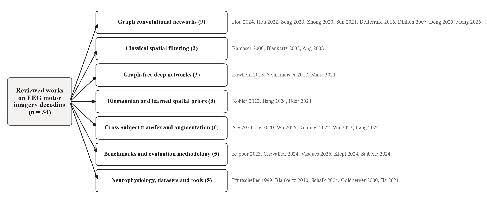
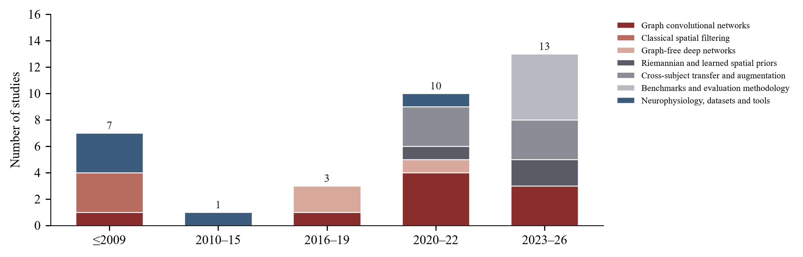
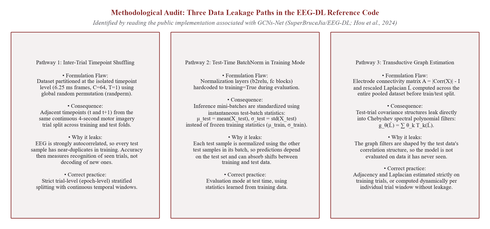
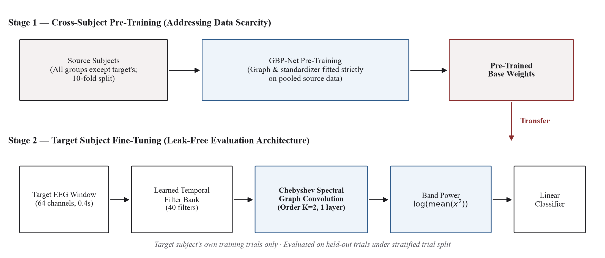

<strong>Abstract</strong> — Graph neural networks (GNNs), which treat EEG electrodes as nodes of a graph, have been reported to decode motor imagery (MI) with accuracies above 90 % on the PhysioNet EEG Motor Movement/Imagery Database (EEGMMIDB), while large leakage-controlled benchmarks on the same dataset report a best binary accuracy of 0.650. This review examines that discrepancy. Drawing on 34 works identified by citation tracing and targeted searches, it compares graph convolutional networks with classical spatial filtering, compact convolutional networks, Riemannian methods, learned spatial priors and cross-subject transfer along four axes: the order in which spatial combination and power extraction are applied, the prior placed on the spatial operator, the response to per-subject data scarcity, and the evaluation protocol. Three observations follow. First, the public code associated with GCNs-Net, a widely used spectral graph model, draws train and test samples from the same trials, normalises test batches with their own statistics and builds the graph from all data before splitting, so its reported accuracy is not comparable with trial-disjoint benchmarks. Second, the dataset assigns each pair of classes to separate recording runs, so four-class accuracy can be earned by identifying the run rather than the imagined movement; within-family accuracy removes this confound. Third, the methods that perform best under valid protocols combine channels while the signal is still signed and take power afterwards, an ordering many graph models invert. We derive five research gaps and propose GBP-Net, a design that places a graph-constrained spatial stage inside this ordering and adds subject-disjoint cross-subject pre-training, together with an evaluation plan that isolates the contribution of each component.

<strong>Keywords</strong> — Electroencephalography, motor imagery, graph convolutional networks, brain–computer interface, data leakage, transfer learning, common spatial patterns, spectral graph theory.

## 1. Introduction

A brain–computer interface (BCI) establishes a direct communication pathway between the human central nervous system and an external device [@schalk2004]. Among non-invasive paradigms, motor imagery (MI)—the mental rehearsal of movement without overt muscular contraction—is attractive for neurorehabilitation and assistive control because it engages sensorimotor cortex without external stimulation [@pfurtscheller1999]. Imagining movements of the left hand, right hand or feet induces localized, frequency-specific power decreases termed event-related desynchronization (ERD) in the mu (8–13 Hz) and beta (14–30 Hz) rhythms, followed by a post-movement increase, event-related synchronization (ERS) [@pfurtscheller1999]. A decoder must therefore resolve *where* on the scalp and *in which band* power changes.

For more than two decades the standard approach has been linear spatial filtering. Common Spatial Patterns (CSP) learns projections that maximize the variance ratio between two conditions [@ramoser2000]; regularized CSP [@blankertz2008] and Filter Bank CSP (FBCSP) [@ang2008] added robust estimation and sub-band selection. Compact deep networks later learned temporal and spatial filters jointly: EEGNet [@lawhern2018] with depthwise and separable convolutions, ShallowConvNet [@schirrmeister2017] as a differentiable counterpart of FBCSP, and FBCNet [@mane2021] with per-band spatial filtering followed by a variance layer.

Graph neural networks offer a different inductive bias. Treating electrodes as nodes whose edges encode anatomical proximity or functional connectivity lets spectral graph convolutions [@defferrard2016] operate on the scalp's non-Euclidean geometry. GCNs-Net [@hou2024] applied Chebyshev graph filters over an absolute Pearson-correlation graph with Graclus coarsening [@dhillon2007] to EEGMMIDB [@goldberger2000] and reported a four-class accuracy of 93.06 %. Related work added attention-based recurrent temporal modelling [@hou2022], learnable adjacency (DGCNN) [@song2020], regularized graph learning (RGNN) [@zhong2020], adaptive spatiotemporal graphs [@sun2021], multi-level hierarchical dynamic graphs [@deng2025] and self-adaptive multilevel graphs [@meng2026].

A survey of 63 EEG-GNN studies found Chebyshev spectral convolution to be the dominant choice and cross-subject transfer to be rarely explored [@klepl2024]. Adjacent reviews organize deep learning for MI decoding by task [@saibene2024] and transfer learning for BCIs by adaptation method [@wu2022]. Across machine-learning-based science, data leakage is a documented source of inflated results, found in studies from 17 fields [@kapoor2023]; large reproducible benchmarks such as MOABB [@chevallier2024], Eder et al. [@eder2024] and Vasques et al. [@vasques2026] supply leakage-controlled reference points that architecture-focused papers rarely compare against. This review organizes the graph-based MI literature around evaluation protocol as well as architecture.

### Contributions

1. **A structured review of 34 works** spanning graph, classical, convolutional, Riemannian and transfer-learning approaches, organized by the ordering of spatial and spectral operations, the prior on the spatial operator, the response to data scarcity, and the evaluation protocol.
2. **A reading of the public reference code** (`SuperBruceJia/EEG-DL` [@eegdl]) associated with GCNs-Net, identifying three leakage paths and a mismatch between the classes the code uses and the classes the paper names.
3. **A description of the class–run confound in EEGMMIDB** and of within-family accuracy as the measure that removes it.
4. **Five research gaps and a proposed design**, GBP-Net, with an evaluation plan in which every component is tested against a matched control.

## 2. Review Methodology

### 2.1 Scope and Research Questions

The review covers MI decoding from non-invasive scalp EEG, with particular attention to EEGMMIDB [@goldberger2000], on which the graph-based work motivating it is evaluated. It addresses four questions:
- **RQ1:** How do graph-based decoders differ from classical and graph-free deep decoders in the order of spatial combination and power extraction?
- **RQ2:** What evidence shows that an electrode graph improves on an unconstrained spatial operator or on other priors?
- **RQ3:** How does the literature address the small number of training trials per subject?
- **RQ4:** Are published results on EEGMMIDB comparable with one another?

### 2.2 Identification and Selection

Studies were identified in three stages. The starting point was the baseline graph model [@hou2024] and its predecessor [@hou2022]. Their reference lists were traced backwards to the methods they build on—spectral graph convolution, graph coarsening, the dataset and its acquisition system. Forward searches were then run on Google Scholar, IEEE Xplore, ScienceDirect, IOPscience and arXiv using combinations of the terms *graph convolutional network*, *graph neural network*, *EEG*, *motor imagery*, *common spatial pattern*, *Riemannian*, *transfer learning*, *pre-training*, *alignment*, *data augmentation* and *benchmark*.

A work was included if it (i) proposes or evaluates a method for decoding MI from scalp EEG, or (ii) supplies a method, dataset, benchmark or neurophysiological result on which such decoders directly depend. Two graph models for emotion recognition [@song2020; @zhong2020] were included because they introduced graph-learning techniques later applied to MI. Studies of invasive recordings and studies whose full text or abstract was unavailable were excluded. Thirty-four works were retained (Fig. 1 and Fig. 2). Because selection proceeded iteratively through citation tracing rather than a single database query, screening counts are not reported: this is a structured review, not a systematic review in the PRISMA sense.

Two of the retained studies [@deng2025; @meng2026] could be assessed from their abstracts and metadata only, and conclusions drawn from them are limited accordingly. Bibliographic details of every work were checked against Crossref or arXiv records, except the EEG-DL repository [@eegdl], which is cited as software.

## 3. Neurophysiological and Dataset Foundations

### 3.1 What a Decoder Must Detect

Motor imagery produces lateralized ERD over sensorimotor cortex: left-hand imagery over the right hemisphere (around C4), right-hand imagery over the left (around C3), and foot imagery near the midline (around Cz) [@pfurtscheller1999]. Because ERD reflects reduced synchrony of large neural populations, it is a **band-power (variance) phenomenon** that unfolds over hundreds of milliseconds to seconds after the cue.

Subjects differ widely in how detectable their sensorimotor rhythms are. Blankertz et al. [@blankertz2010] showed that the prominence of the resting mu rhythm above the 1/*f* background, measured in a two-minute eyes-open recording, correlates with later MI decoding accuracy at *r* = 0.53 (*N* = 80): about 28 % of the between-subject variance in accuracy is accounted for by a measurement taken before any decoder is trained.

### 3.2 The PhysioNet EEGMMIDB Benchmark

EEGMMIDB [@goldberger2000; @schalk2004] contains 64-channel recordings from 109 subjects at 160 Hz, acquired with BCI2000. Each subject completed 14 runs: eyes-open and eyes-closed baselines, executed movements and imagined movements. Two features of its design matter for evaluation:
1. **Data scarcity:** each subject performs three imagery runs per task family, giving about 22 trials per class and about 45 per binary contrast. A subject-dependent model is fitted on a few dozen trials.
2. **Class–run structure:** classes are confined to particular runs.
   - *Runs 4, 8 and 12:* T1 = left fist, T2 = right fist.
   - *Runs 6, 10 and 14:* T1 = both fists, T2 = both feet.

Because runs are recorded at different times, run-level non-stationarity—electrode drift, impedance change, fatigue—can differ systematically between the two run families. A four-class model can therefore exceed chance by recognizing *which family a trial came from* without decoding imagery at all. Decomposing four-class performance into **within-family accuracy** (left vs. right fist; both fists vs. both feet), whose chance level is 50 %, removes this route. A further consequence is that the label of a T1 or T2 event depends on the run number, not on the event code alone.

## 4. Classification and Critical Analysis

### 4.1 Classical Spatial Filtering

CSP computes spatial filters *w* ∈ ℝ*C* that maximize the variance ratio between two classes [@ramoser2000]:

max<i>w</i> &nbsp; (<i>w</i>T Σ1 <i>w</i>) / (<i>w</i>T Σ2 <i>w</i>)

where Σ1, Σ2 are class-conditional spatial covariance matrices. The order of operations matters: **channels are combined while the signal is still signed, and variance is computed only after projection** [@blankertz2008]. Signed combination allows cancellation between channels, which removes common-mode activity before squaring. FBCSP [@ang2008] repeats this per frequency band. On EEGMMIDB, the large benchmark of Vasques et al. [@vasques2026] reports the CSP and covariance/tangent-space families at about 0.60 on binary left-versus-right imagery, with the best of 216,714 pipeline configurations reaching 0.650.

### 4.2 Graph-Free Deep Convolutional Networks

Compact convolutional networks learn the CSP/FBCSP pipeline end to end:
- **ShallowConvNet** [@schirrmeister2017] applies a temporal convolution (1 × *Kt*), acting as a learned band-pass filter, then a spatial convolution across all *C* electrodes (*C* × 1), then squaring, temporal average pooling and a logarithm:

<i>X</i> &nbsp;⟶&nbsp; Conv1×<i>Kt</i> &nbsp;⟶&nbsp; Conv<i>C</i>×1 &nbsp;⟶&nbsp; (·)2 &nbsp;⟶&nbsp; AvgPool &nbsp;⟶&nbsp; log(·) &nbsp;⟶&nbsp; <i>ŷ</i>

- **EEGNet** [@lawhern2018] uses a temporal convolution followed by a depthwise spatial convolution and separable convolutions, giving a parameter-efficient model.
- **FBCNet** [@mane2021] filters the input into several bands, applies a spatial convolution per band and summarizes each with a variance layer.

All three combine channels before any non-linear power extraction: a **spatial-then-power** ordering.

### 4.3 Graph Convolutional Networks: Spectral, Dynamic and Hybrid

Spectral graph convolution [@defferrard2016] filters signals on a graph *G* = (*V*, *E*, *W*) through the normalized Laplacian *L* = *I* − *D*−1/2 *W* *D*−1/2, approximated with Chebyshev polynomials *Tk* up to order *K*:

<i>gθ</i> ★ <i>x</i> &nbsp;≈&nbsp; ∑<i>k</i>=0<i>K</i>−1 <i>θk</i> <i>Tk</i>(<i>L̃</i>) <i>x</i>

where *L̃* = (2 / *λ*max) *L* − *I*. GCNs-Net [@hou2024] uses this filter with an absolute Pearson-correlation adjacency *A* = |*P*| − *I* and Graclus coarsening [@dhillon2007] across six graph-convolution layers.

#### Evaluation in the GCNs-Net reference code

The paper's second author maintains a public implementation, `SuperBruceJia/EEG-DL` [@eegdl]. Reading its GCN pipeline shows three paths by which test information reaches training, each a recognized form of leakage [@kapoor2023]:
1. **Timepoint samples split at random.** Each sample is a single timepoint across 64 electrodes (6.25 ms at 160 Hz), and the train/test split is a random permutation over all timepoints. Neighbouring, highly correlated timepoints of the *same* trial therefore fall on both sides of the split.
2. **Batch normalization in training mode at test time.** The normalization layers are hard-coded with `training=True`, so test batches are normalized with their own statistics rather than with statistics learned from training data.
3. **Graph built from all data.** The correlation adjacency *A* = |*P*| − *I* is computed over the whole pooled dataset before splitting, so test-set covariance enters the graph filters.

The code also differs from the paper in its classes: the four classes are left fist, right fist, both feet and *rest*, the last drawn as windows from the eyes-open baseline run, whereas the paper names left fist, right fist, both fists and both feet. The code applies a common average reference and no band-pass filtering.

These observations do not by themselves measure how much each path inflates accuracy, and we cannot confirm that the published 93.06 % was produced by exactly this version of the code. They do establish that the reported figure is not comparable with trial-disjoint benchmarks. For scale, the leakage-controlled benchmark of Vasques et al. reports 0.650 for the best of 216,714 configurations on the *binary* left-versus-right task (chance 0.50) [@vasques2026], whereas 93.06 % is a *four-class* figure (chance 0.25). We found no published evaluation of GCNs-Net on EEGMMIDB under a trial-disjoint split.

#### Dynamic and spatiotemporal graph models

- **DGCNN** [@song2020] learns the adjacency matrix by backpropagation and operates on per-channel band features such as differential entropy, so power is computed before the graph stage.
- **RGNN** [@zhong2020] initializes the adjacency from electrode distances with added global connections, learns it under a sparsity penalty, and adds domain-adversarial training; it also operates on per-channel differential-entropy features.
- **BiLSTM-GCN** [@hou2022], from the same group as GCNs-Net, adds attention-based bidirectional LSTM temporal modelling to the graph backbone and is evaluated on the same dataset; its evaluation split was not examined here.
- **Adaptive spatiotemporal GCNs** [@sun2021], **MHD-GCN** [@deng2025] and **SAMGCN** [@meng2026] learn graphs adaptively, hierarchically or at several levels. The last two were assessed from abstracts only.

A general risk of deep graph networks is over-smoothing: repeated graph filtering over a dense graph drives node representations towards each other. Six stacked Chebyshev layers over a near-complete 64-node correlation graph, as in GCNs-Net, is such a configuration.

### 4.4 Riemannian Geometry and Learned Spatial Priors

Riemannian methods treat spatial covariance matrices *S* = (1/*T*) *X* *X*T as points on the manifold of symmetric positive-definite (SPD) matrices and classify them after projection to a tangent space [@eder2024; @vasques2026]. Tangent-space features preserve signed covariances between channels, so they too combine channels before discarding sign. In the benchmark of Vasques et al. on EEGMMIDB [@vasques2026], the covariance/tangent-space and CSP families perform similarly, at about 0.60 on binary left-versus-right imagery.

Two recent networks build such priors into deep models:
- **TSMNet** [@kobler2022] combines convolutional feature extraction with SPD covariance pooling and domain-specific batch normalization (DSBN); in its ablation, removing DSBN costs 2.4–3.9 %.
- **CSP-Net** [@jiang2024] initializes a network's spatial layer with CSP filters computed on training trials and reports a gain of 6.0 points over a ShallowConvNet backbone averaged over four MI datasets (70.29 % to 76.26 %).

### 4.5 Cross-Subject Transfer, Alignment and Augmentation

With about 45 trials per binary problem, subject-dependent models are data-starved. Three families of methods address this:
- **Cross-subject and cross-dataset pre-training.** Xie et al. [@xie2023] combine multi-task learning with pre-training across datasets before fine-tuning on the target; LaBraM [@jiang2024b] pre-trains a large transformer on about 2,500 hours of EEG.
- **Euclidean alignment (EA).** He and Wu [@he2020] whiten each subject's trials by the inverse square root of the subject's mean covariance, *X̃* = *R̄*−1/2 *X*, aligning subjects without target labels; Wu [@wu2025] revisits when and why this works.
- **Data augmentation.** In a systematic comparison, Rommel et al. [@rommel2022] report improvements of up to 45 % (relative) for some augmentations when training data are scarce.

## 5. Comparative Analysis

Table 1 summarizes the operational characteristics of the principal methods, Table 2 compares the seven method families, and Table 3 lists the checks a valid evaluation on EEGMMIDB must pass, against what the GCNs-Net reference code does.

**Table 1.** Operational characteristics of the principal reviewed methods. Studies assessed from abstracts only, and those whose pipeline was not examined, are omitted.

| Method | Family | Spatial operator | Where power is taken | Input unit |
|---|---|---|---|---|
| **CSP** [@ramoser2000] | Classical | Supervised linear spatial filters | After spatial combination | Trial segment |
| **FBCSP** [@ang2008] | Classical | Spatial filters per sub-band | After spatial combination | Trial segment |
| **EEGNet** [@lawhern2018] | Graph-free CNN | Depthwise spatial convolution | Implicit, after spatial stage | Trial window |
| **ShallowConvNet** [@schirrmeister2017] | Graph-free CNN | Dense spatial convolution (*C* × 1) | After spatial stage (log-mean-square) | Trial window |
| **FBCNet** [@mane2021] | Graph-free CNN | Spatial convolution per band | Variance layer after spatial stage | Trial window |
| **GCNs-Net** [@hou2024] | Spectral GCN | Chebyshev filters (*K* = 2), 6 layers | Not computed (voltage classified directly) | One timepoint (6.25 ms) |
| **DGCNN** [@song2020] | Dynamic GNN | Graph convolution, learnable adjacency | Before graph stage (band features) | Segment |
| **RGNN** [@zhong2020] | Regularized GNN | Distance-initialized, sparsity-regularized adjacency | Before graph stage (differential entropy) | Segment |
| **Tangent space** [@vasques2026] | Riemannian | Covariance, tangent-space projection | Second-order statistics of signed channels | Trial segment |
| **TSMNet** [@kobler2022] | Learned prior | CNN + SPD covariance pooling | After spatial stage | Trial segment |
| **CSP-Net** [@jiang2024] | Learned prior | CSP-initialized spatial layer | After spatial stage | Trial window |

**Table 2.** Comparison of method families.

| Family | Works | Strengths | Limitations |
|---|---|---|---|
| **Classical spatial filtering** | [@ramoser2000; @blankertz2008; @ang2008] | Spatial-then-power ordering; interpretable; works with few trials | Binary formulation; sensitive to covariance estimation; band choice |
| **Graph-free deep networks** | [@lawhern2018; @schirrmeister2017; @mane2021] | Learn temporal and spatial filters jointly | Sensitive to hyperparameters; no explicit electrode topology |
| **Graph convolutional networks** | [@hou2024; @hou2022; @song2020; @zhong2020; @sun2021; @deng2025; @meng2026; @defferrard2016; @dhillon2007] | Explicit electrode topology; localized filters; learnable edges | Often take power before the graph stage; over-smoothing at depth; evaluation often not trial-disjoint |
| **Riemannian and learned priors** | [@vasques2026; @kobler2022; @jiang2024; @eder2024] | Strong within-subject results; invariance properties | Tangent vectors are high-dimensional and need regularization |
| **Transfer, alignment and augmentation** | [@xie2023; @jiang2024b; @he2020; @wu2025; @rommel2022; @wu2022] | Address data scarcity directly; largely architecture-agnostic | Fine-tuning can overfit; alignment needs stable covariance estimates |
| **Benchmarks and evaluation methodology** | [@kapoor2023; @chevallier2024; @vasques2026; @klepl2024; @saibene2024] | Leakage-controlled reference points; protocol scrutiny | Evaluate fixed pipelines rather than redesigning architectures |
| **Neurophysiology, datasets and tools** | [@pfurtscheller1999; @blankertz2010; @goldberger2000; @schalk2004; @eegdl] | Ground decoder design in physiology and data | Correlational findings do not prescribe architectures |

**Table 3.** Checks for a valid subject-dependent evaluation on EEGMMIDB, and what the public GCNs-Net reference code does.

| Check | EEG-DL reference code [@eegdl] | Valid protocol requires |
|---|---|---|
| Sample unit | One timepoint (6.25 ms) | A window that lies inside one trial |
| Split unit | Random permutation over timepoints | Trials (or subjects); no trial on both sides |
| Graph estimated from | Pooled data, including test | Training split only |
| Batch normalization at test time | Training mode (test-batch statistics) | Evaluation mode (training statistics) |
| Classes | Left fist, right fist, both feet, rest (baseline run) | The classes named in the paper, stated explicitly |
| Reported metric | Four-class accuracy | Four-class accuracy decomposed by run family, with within-family accuracy |

### 5.1 Cross-Cutting Observations

1. **Protocol differences dominate reported accuracy differences.** The 93.06 % four-class figure for GCNs-Net [@hou2024] and the 0.650 binary figure from the largest leakage-controlled benchmark [@vasques2026] are not on the same scale: they differ in task, chance level and split. The code-level observations in Table 3 are sufficient to make the former incomparable with the latter; until a trial-disjoint evaluation of GCNs-Net is published, its accuracy cannot be placed among the methods in Table 1.
2. **The best-performing methods under valid protocols are spatial-then-power.** CSP, FBCSP, ShallowConvNet, FBCNet and tangent-space methods all combine signed channels before extracting power. Graph models that compute band power or differential entropy per channel before the graph stage cannot perform cancellation between channels.
3. **Data scarcity is a structural constraint of the dataset.** With about 45 trials per binary contrast, transfer, alignment and augmentation address the constraint directly. We found no study on EEGMMIDB that compares the size of transfer-learning gains with the size of gains from graph design under the same split.

## 6. Research Gaps

- **G1 — Incomparable evaluation protocols:** the highest reported graph-model accuracies on EEGMMIDB come from protocols that are not trial-disjoint, and we found no published evaluation of GCNs-Net under both its original protocol and a trial-disjoint one on the same subjects.
- **G2 — Uncontrolled class–run confound:** four-class results on EEGMMIDB are routinely reported without the run-family decomposition, so they may reward run identification rather than imagery decoding.
- **G3 — Inverted ordering in graph architectures:** graph models that extract per-channel power before graph filtering discard the sign information that cancellation between channels requires.
- **G4 — The graph prior is not isolated:** graph models are rarely compared with an unconstrained spatial operator or with a graph-free network under identical splits.
- **G5 — Transfer learning is rarely applied to graph MI models:** cross-subject pre-training has not been systematically combined with spectral graph architectures [@klepl2024].

**Table 4.** Research gaps, supporting literature and the corresponding element of the proposed design.

| Gap | Description | Literature | Proposed response |
|---|---|---|---|
| **G1** | Incomparable protocols; leakage | [@hou2024; @eegdl; @kapoor2023] | Trial-disjoint splits; graph and normalization fitted on training data only; evaluation-mode normalization |
| **G2** | Class–run confound | [@goldberger2000; @schalk2004] | Within-family accuracy reported alongside four-class accuracy |
| **G3** | Inverted ordering | [@ramoser2000; @schirrmeister2017; @mane2021] | Temporal filtering, then signed graph convolution, then band power |
| **G4** | Graph prior not isolated | [@klepl2024; @hou2024; @defferrard2016] | Matched comparison with an unconstrained spatial operator and with graph-free ShallowConvNet |
| **G5** | Data scarcity | [@xie2023; @he2020; @wu2022] | Subject-disjoint cross-subject pre-training, then per-subject fine-tuning, tested on a graph-free model as well |

## 7. Proposed Design: GBP-Net

GBP-Net (Graph Band-Power Network) responds to gaps G1–G5 (Fig. 5). Its macro-architecture—temporal filter, spatial filter, square, average, logarithm—is that of ShallowConvNet [@schirrmeister2017]; the ordering is not new. What the design changes is the spatial stage, which becomes a graph convolution, so that the value of the electrode graph can be tested inside an ordering that is known to work (G3, G4).

### 7.1 Architecture (G3, G4)

Each input is an EEG window *X* ∈ ℝ*C* × *T* with *C* = 64 electrodes and *T* = 64 samples (0.40 s at 160 Hz):

1. **Temporal filter bank.** *Ft* = 40 learnable temporal convolutions of length *Kt* = 16 samples (100 ms) are applied to every channel, acting as learned band-pass filters:

<i>X</i>(1) &nbsp;=&nbsp; Conv1D(<i>X</i>) &nbsp;∈&nbsp; ℝ<i>Ft</i> × <i>C</i> × <i>T'</i>

The output is still a signed voltage.

2. **Signed graph convolution.** A single Chebyshev graph convolution combines electrodes while the signal is signed:

<i>X</i>(2) &nbsp;=&nbsp; ∑<i>k</i>=0<i>K</i>−1 <i>Tk</i>(<i>L̃</i>) <i>X</i>(1) Θ<i>k</i> &nbsp;∈&nbsp; ℝ<i>Fs</i> × <i>C</i> × <i>T'</i>

with *K* = 2, *Fs* = 40, *L̃* the rescaled Laplacian of *A* = |*P*train| − *I* estimated from training trials only, and learnable Θ*k*. One layer and no node pooling keep all 64 electrodes and avoid the depth at which over-smoothing arises.

3. **Band power.** Power is taken only after spatial combination:

<i>P</i> &nbsp;=&nbsp; log( 1/<i>T'</i> ∑<i>t</i>=1<i>T'</i> (<i>X</i>(2)<i>f, c, t</i>)2 &nbsp;+&nbsp; ε ), &nbsp; ε = 10−6

4. **Readout.** Dropout (*p* = 0.5) and a linear layer map *P* to class scores.

### 7.2 Stage 1: Cross-Subject Pre-Training (G5)

The 103 subjects that remain after excluding six with inconsistent recordings are divided into 10 disjoint groups. For each target group, a source model is trained on the other nine groups only, so no trial, graph statistic or normalization statistic of a target subject is ever seen during its pre-training.

### 7.3 Stage 2: Target Fine-Tuning and Evaluation (G1, G2)

The pre-trained weights initialize a model that is fine-tuned on the target subject's training trials under stratified, trial-disjoint 5-fold cross-validation, with the graph and normalization statistics fitted on training trials only. Both four-class and within-family accuracy are recorded.

### 7.4 Design Rationale

1. **Cancellation is possible.** Because the graph convolution acts on signed signals, combinations of electrodes can cancel common-mode activity before power is taken, as in CSP.
2. **Depth is kept at one graph layer.** This avoids the configuration in which over-smoothing is expected, and makes the graph stage directly comparable with ShallowConvNet's single spatial layer.
3. **The three leakage paths are closed by construction.** Splits are trial-disjoint, the graph is estimated from training data, and normalization uses training statistics at test time. This removes the identified sources of leakage; it does not by itself guarantee that the model generalizes.
4. **Transfer is subject-disjoint.** Pre-training never sees the target subjects, so any benefit is a transfer effect rather than leakage.

## 8. Limitations and Future Scope

### 8.1 Planned Evaluation

The design will be tested as follows.
1. **Data.** EEGMMIDB imagery runs only (runs 4, 6, 8, 10, 12 and 14) for the 103 retained subjects; BCI Competition IV-2a as an optional second dataset.
2. **Splits.** Trial-disjoint stratified 5-fold cross-validation within subjects; subject-disjoint groups for pre-training; leave-one-subject-out evaluation for the subject-independent setting. Windows from one trial never appear on both sides of a split, and every statistic—graph, normalization, filters—is fitted within training folds.
3. **Baselines and controls.** CSP with linear discriminant analysis [@ramoser2000], tangent-space classification [@vasques2026], EEGNet [@lawhern2018], ShallowConvNet [@schirrmeister2017] and GCNs-Net [@hou2024] re-run under the same splits. The graph stage will be compared with an unconstrained spatial operator (G4), and pre-training will also be applied to graph-free ShallowConvNet, so that a gain from pre-training is not attributed to the graph architecture (G5).
4. **Metrics and statistics.** Within-family accuracy as the primary outcome; four-class accuracy only with its run-family decomposition; confusion matrices and per-class accuracy; paired comparisons across subjects with bootstrap confidence intervals, correction for multiple comparisons, and a minimum effect size fixed before the runs.

### 8.2 Open Design Questions

- **Window length.** Analysis windows of 2–4 s are conventional [@schirrmeister2017; @lawhern2018]. Short sliding windows yield many more training samples per trial but each sees less of the ERD time course, and overlapping windows from one trial are not independent samples. Which effect dominates on EEGMMIDB is an empirical question to be tested.
- **Normalization in transfer.** TSMNet reports gains from domain-specific batch normalization [@kobler2022]. With few windows per target subject, per-subject statistics may be noisy; whether DSBN helps under subject-disjoint pre-training on this dataset is to be tested rather than assumed.

### 8.3 Future Scope

1. **Montage transfer:** extending the design to datasets with different electrode counts, such as the 22-channel BCI Competition IV-2a, requires graph operators that do not assume a fixed montage.
2. **Using resting-state predictors:** since resting mu prominence accounts for about 28 % of between-subject variance [@blankertz2010], a short resting recording could inform per-subject choices such as regularization strength.
3. **Low-latency deployment:** closed-loop use requires causal filtering and small models suitable for embedded hardware.
4. **Self-supervised pre-training:** large unlabelled EEG corpora, as used by LaBraM [@jiang2024b], could replace or complement supervised pre-training.

### 8.4 Limitations of This Review

1. **Not a systematic review.** Works were identified by citation tracing and targeted searches, not by a single exhaustive query, so relevant studies may have been missed and no screening counts are reported.
2. **Single-dataset focus.** The analysis concentrates on EEGMMIDB, where the highest graph-model accuracies have been reported; conclusions may not transfer to other datasets or paradigms.
3. **Code reading, not measurement.** The leakage paths in Section 4.3 were identified by reading one public repository. Their individual effect on accuracy was not measured here, and we cannot confirm that the published results were produced by exactly this code.
4. **Partial access.** Two recent graph models were assessed from their abstracts only.

## 9. Conclusion

This review reassessed graph neural networks for EEG motor imagery decoding with evaluation protocol as a central axis. The highest reported graph-model accuracies on EEGMMIDB come from a pipeline whose public code splits trials across train and test, normalizes test batches with their own statistics and estimates its graph from all data; those figures cannot be compared with trial-disjoint benchmarks, and the dataset's class–run structure means four-class accuracy must be decomposed before it can be read as imagery decoding. The methods that perform best under valid protocols share a spatial-then-power ordering that many graph models invert. GBP-Net is proposed as a test rather than a claim: it places a graph-constrained spatial stage inside that ordering, adds subject-disjoint pre-training, and is to be evaluated against matched graph-free and unconstrained controls so that any gain can be attributed to the component that produced it.

## Declarations

**Data availability.** No new data were collected. EEGMMIDB is publicly available from PhysioNet [@goldberger2000; @schalk2004], and the reference code discussed in Section 4.3 is publicly available [@eegdl].

**Ethics.** This review analyses published work and public code only; no human participants were recruited.

**Conflicts of interest.** [To be confirmed by the authors.]

**Funding.** [To be confirmed by the authors.]

**Author contributions.** [To be confirmed by the authors.]

<!-- REFERENCES -->
